# Mud Lab

Christopher's soil game: the Rock & Mud — the exact truck, physics and engine sound from his racing game and Ground
Truth — on ground that tears up for real. Its own game, not connected to Ground Truth's code: if the soil proves
itself, it gets copied back into Ground Truth.

**Open `builds/mud-lab-22.4-water.html`** (one self-contained page, 20 MB; Mud Lab 22.4 water: still water that reads as water, spray as streaks, foam at the nose, below). The world is two miles square (Mud Lab 19): the first map is its north-west quarter; east of it the River, with the Shallows to cross anywhere and fords that get deeper up and down stream; south-east the Lake, deep enough to drown an engine; south of the Trailhead the Track, a banked dirt loop with table-tops and whoops. The big map opens on the mile round you; WHOLE MAP beside it shows it all. On the title pick ROCK & MUD or STOCK SUV (tap
your pick again for a tyre size up: 33s on the stock SUV, 40s on the Rock & Mud), and FREE PLAY or REAL; START drives out from the Trailhead with the other SUV parked beside you. The map shows the whole world
with every place named (Free play: tap a name, then JUMP and you're there, or GUIDE ME THERE and an arrow leads you;
Real: tap a name and the arrow guides you), the
three graded trails (EASY: Field Track, MEDIUM: Creek Loop, HARD: Gumbo Trail), and MENU beside it: the other SUV, the
tyres, a TUNE for the SUV you are in (engine and gears), the grip, CLEAR ALL RUTS, and THINGS TO DO; the Heron waits on its strip (drive up, stop,
HERON); the semicolon key (or GRIP in the map's MENU) switches the grip physics; in the MENU, TYRE AIR airs the tyres down (35, 20,
12 psi), TYRE SIZE changes their size, and THINGS TO DO sets you down at (Free play) or guides you to (Real) the Bog,
the pull test, the three trails (each a timed run), the Hill Climb, the pond's bank, the Track (a timed lap), the River, the Lake, the four jumps (Mud Lab 21: the Creek Gap, the River Jump, the Lake Jump onto its island, Big Air; a gold line on landing says how long and how far you flew) and a rescue. THE BOG, north-east
of the Trailhead, measures how far you get; the post by its start is the PULL TEST; the HILL CLIMB, on the Ridge, how
far up a sand slope you get from a stop at its line. Bogged, a button appears: WINCH (a tree in reach)
or STRAP (the other SUV in reach); U on a keyboard. Other keys: Enter is HERON/TRUCK (and, in a rescue, the other SUV),
L the low range (his SUV: AWD, 4 HI, 4 LO), Backspace clears all the ruts, C the next camera (the second is FILM, a
camera that picks its own shots); MENU > KEYS on the map changes any key; a tap on the build's name in the corner of
the title switches the numbers on (frames a second, triangles: F on a keyboard). Earlier builds stay as they were
(`mud-lab-22.3-water.html`: still water a grey speckled sheet from low down, spray as round dots, a smooth swell with no foam at a wading SUV's nose; `mud-lab-22.2-water.html`: the wake drawn as a V of crests along the path the SUV took, a rut dug down to the water full and splashing at once; `mud-lab-22.1-water.html`: no fan of drops off the tyres, no splash on going into water, nothing running off the SUV when it comes out, the bow wave one smooth roll, rain still in the ground's shader; `mud-lab-22.html`: the wakes painted on level water (thin bright lines on the sun's side of the SUV, tan stripes behind a slide), no foam, no mist, the water flat at the nose when wading; `mud-lab-21.html`: wet soil lit as a shiny sheet, no grain in bare soil, one V of waves pinned to the SUV's nose whichever way it slides; `mud-lab-20.html`: no jumps, THE LAKE on the map sets you down at its beach; `mud-lab-19.html`: the map's THE LAKE jumps into the Lake's middle, no WINCH for a drowned SUV, the engine stops dead with water over the doors' tops, no camera goes under water, a SUV kicked up in deep water hangs in the air; `mud-lab-18.html`: the first map only (a mile square), no engine drowning, a sandy band in the Pond's reflections; `mud-lab-17.html`: no Film camera, a rolled Rock & Mud is thrown back into the air spinning, the truck's lamps and gear
number on the Heron's HUD; `mud-lab-16.html`: churned water drawn darker and lumpy behind the SUV, no bow wave, no
tunes, no CLEAR ALL RUTS on the MENU (Backspace raked, and could throw a sunk SUV into the air); `mud-lab-15.html`: G both looks behind and switches the grip, no list of keys, no rings in the water and churned
water stays churned; `mud-lab-14.html`: the soil's look before Mud Lab 15: smooth mounds, flat water in the ruts, pale clods, the brake
lamps' red glints in wet mud; `mud-lab-13.html`: no Hill Climb, Soil science grip at half the game's grip, reverse half a second away when bogged;
`mud-lab-12.html`: four buttons over the open map, no guide arrow, no list of things to do;
`mud-lab-11.html`: the stock SUV as the game's plain built model, no look-back button, a title that didn't fit a phone;
`mud-lab-10.html`: one tyre size each, a sheer 34 ft step at the pond's rim, the Heron always drawn in full;
`mud-lab-9.html`: no Bog, pull test or tyre pressure, and a winch could drag the SUV into a bank and carve it away;
`mud-lab-8.html`: one SUV at a time, no winch or strap, the trails' holes ungraded; `mud-lab-7.html`: the look before
Mud Lab 8, lit as Salt & Sand's desert; `mud-lab-6.html`: the sound garbles after switching apps; `mud-lab-5.html`: no
stock SUV, hangs on Windows laptops; `mud-lab-4.html`: no plane; `mud-lab-3.html`: the 1,075 ft world;
`mud-lab-2.html`: the 96 m field).

## What it's made of

| What | Where | Notes |
| --- | --- | --- |
| The engine | `base/engine-salt-and-sand.html` | A frozen copy of Redline County's Salt & Sand page (the Road Not Found engine: renderer, physics, Digital Engine sound), from `chriskizer91-ops/salt-mini-plus` branch `beyond-the-last-road`, Nov 7 2026. Never updated from there: this copy is Mud Lab's own. |
| The stock SUV's play model | `base/suv-stock-baked.js`, `tools/suv_pack.py`, `src/ml-truck.js` | Mud Lab 12: his own bake of the stock SUV (salt-mini-plus, branch `beyond-the-last-road`, `models/suv/suv_baked_data.js`: the Studio SUV baked onto the game's own stock SUV by that repo's `models/tools/bake.py`), repacked the way the Rock & Mud's is: 51,044 triangles and one 2048 x 3072 atlas (colour, normals, occlusion + roughness + metal). |
| The truck | `base/truck-rock-mud-50k.js`, `src/ml-truck.js` | Ground Truth's Rock & Mud play model: 49,654 triangles, the Studio 2 baked onto it, Station Sand paint. Its numbers are the engine's own Rock & Mud (`crawler`): checked identical to Ground Truth's (mass 2,530 kg, tyre 0.47 m radius, 0.318 m wide, the same chassis and engine numbers). |
| His ground pictures | `base/texpack.js` | The textures Ground Truth paints its ground with (red dirt, wet mud, sand, grass...). |
| The world | `src/ml-world.js` | Mud Lab 4: 1,536 m (5,040 ft) square, every spot a soil and a moisture (below). Mud Lab 19: 3,072 m square, the first map its north-west quarter; the River, the Lake, the Track, the Mounds. |
| The world outside the game | `tools/world/` | Mud Lab 19: `src/ml-world.js` run in Node for pictures, the River's profile, "is the old ground the same?" and a syntax check of a built page (its own README). |
| The soil | `src/ml-soil.js` | The ground every 8 cm, dug, packed, thrown, slumping and springing (below). |
| The sound coming back | `src/ml-audio.js` | Out of sight, the sound stops; back, the engine's synth is made fresh and fades in (Mud Lab 7). |
| The stock SUV | `src/ml-suv.js` | His own SUV as the engine has it (the Stock build's garage preset), the pick on the title and the map, its AWD / 4 HI / 4 LO. Mud Lab 17: the tunes for both SUVs (`ML_TUNE`). |
| The Heron | `base/heron/`, `src/ml-heron.js` | Ground Truth's bush plane: the Redtail's flying code (frozen copies of salt-mini-plus `redtail/game/rt-game.js` and `rt-fly.js`, Nov 7 2026), the redtail-2 model (`heron-data.js`, made by that repo's `glb2js.py`, 60,481 triangles) in his Heron paint. |
| The look | `src/ml-look.glsl`, `src/ml-look.js` | Mud Lab 8: how the ground, the water and the trees are painted (pieces of the land's shader), the picture's sharpening, and Mud Lab's own daylight. Mud Lab 15: the soil's relief (lumps, wet glints), churned water. Mud Lab 22: wet soil dark not shiny, the grain. Mud Lab 22.1 water: the wakes' height, foam, a wave's far side. Mud Lab 22.2 water: the spray, a livelier bow wave. Mud Lab 22.3 water: the worked-out ripples lit, a rut's water coming up. Mud Lab 22.4 water: still water's own ripples. |
| The keys | `src/ml-keys.js` | Mud Lab 16: Mud Lab's own keys in the engine's table, MENU > KEYS on the map to change any of them, the pause menu's legend. |
| The Film camera | `src/ml-film.js` | Mud Lab 18: Salt & Sand's Film camera (a 16th camera that picks its own shots; its Helicopter and Park orbit) and the softer fly-past sound, from the packet of 13 Nov 2026. |
| The graphics card | `src/ml-gpu.js` | Mud Lab 18: the card named on a laptop's title, the step down to Low when a card can't keep up, the card-reset line (from the same packet). |
| Getting stuck | `src/ml-recover.js` | Mud Lab 9: Free play and Real, both SUVs in the world at once, the winch, the strap, what RESET does when you're bogged. |
| The Bog and the pull test | `src/ml-bog.js` | Mud Lab 10: the measured lane's marks, stakes and bests; the pull post and its reading. |
| The Hill Climb | `src/ml-climb.js`, `ML_CLIMB` in `src/ml-world.js` | Mud Lab 14: a sand lane up the Ridge that steepens from 16 to 28 degrees; a standing start, the mark in feet, posts, stakes. |
| The map's menu | `src/ml-menu.js` | Mud Lab 13: MENU on the open map (the other SUV, bring it, tyre size and air, grip, things to do), the guide arrow, timed trail runs, the rescue. Mud Lab 16: KEYS. Mud Lab 17: TUNE, CLEAR ALL RUTS. |
| The front door | `src/ml-ui.js` | Its own title; the phone's driving screen without N2O, O/D OFF, REAR and HORN. |
| The build | `src/build.py` | `python3 src/build.py mud-lab-9` writes `builds/mud-lab-9.html` (each build its own name, never overwrite) with exact text swaps on the engine. |
| Tests | `tools/test/` | Headless Chrome (software graphics: slow, so compare two builds, don't trust its speeds). `ml-run.py file://$PWD/builds/mud-lab-8.html TAG m "start;place:9_20_0;drive:1_0_0_1.2;shot:roost;stats"` (m phone size, l laptop): one-off steps. `ml-views.py builds/mud-lab-8.html OUTDIR m`: the thirteen fixed views at the phone's real picture size, each with its triangles and frame time: run it on two builds for before/after. `ml-same.py builds/A.html builds/B.html`: seven drives, every number has to match (a build that only changes the picture). `ml-mats.py builds/mud-lab-8.html`: every material Mud Lab makes a mesh with. `ml-shaders.py builds/mud-lab-8.html m`: the land's shaders' sizes and sampler counts (the two limits). `ml-pits.py builds/mud-lab-9.html tools/test/ml-drive.js runs.txt`: physics-only drives through a hole, along a trail, on a strap or a winch (how the trails were graded; its header lists the drives). `ml-rescue.py builds/mud-lab-9.html OUTDIR`: the title, the start, a strap rescue, a winch pull and the map, as pictures with their numbers. `ml-keys.py BUILD OUTDIR` and `ml-tune.py BUILD OUTDIR`: the map's KEYS and TUNE pages in a laptop window with real presses and clicks. `ml-turn.py BUILD out.json`: a hard turn at 56 mph on the dry field: does the truck go over, and what happens once it has (the rollover test). `ml-hud.py BUILD OUTDIR TAG m`: the Heron's HUD as a picture. `ml-packet.py BUILD OUTDIR TAG`: the card's line on the title, the Film camera in the list, the fly-past's pitch. `ml-gpu.py BUILD OUTDIR`: the step down to Low, with the page told it is not a test browser. `ml-yank.py BUILD` (Mud Lab 19): the sky-yank is still there (fails if it isn't). `ml-title.py BUILD OUT.png [m|l]` (Mud Lab 20): the title as a picture, and whether START is on the screen. In `ml-drive.js` (Mud Lab 20): `T9.jumps` (every name on the map), `T9.drown` (into deep water, then winch, RESET or backing out), `T9.churn` (rocking in deep muck: does it pop up?), `T9.wet`. `ml-prep.py BUILD [noworker] [rush] [shots=DIR]` (Mud Lab 19): how long the world's layer takes to fill, and its fingerprint. In `ml-drive.js`: `T9.ford`, `T9.cross`, `T9.lakeOut`, `T9.lap`, `T9.yank`. |

## Mud Lab 22.4 water (Nov 17 2026): still water that reads as water, spray as streaks, foam at the nose

His words on Build 22.3: "do you think you could push it even further like if this was the next day worth of us doing
work on making the water look better".

The passes so far were all about what the SUV does to the water. This one began with the water nobody is driving
through. Only what is seen: nothing of the physics. Builds 22 to 22.3 are as they were.

### 1. Still water (`src/ml-look.glsl`)

**What was found** (Build 22.3, the Pond, the Lake, the River and a pool from their banks): seen from low down across
it, still water was a grey speckled sheet, more like concrete or fog than water. The cause: every bit of it was
tipped this way and that by two layers of blotchy noise (the engine's creek), a tenth of a slope each way. From a
low eye half of those tips mirrored the pale sky and half the land under the horizon: speckle.

**Now:**
- The tips are the **slopes of ripples** (a noise's own gradient, at two sizes: about half a metre and a hand's
  breadth, each drifting its own way), so they lie as ripples do.
- They come in **patches, as a breeze lays them**: strong in some places, nearly glassy in others, the patches
  drifting slowly. Rippled water leans toward the eye by about its ripples' steepness, so it mirrors the sky from
  higher up (bluer, darker) and glassy water mirrors the pale sky at the horizon: the patches show, as on a pond.
- They fade where a pixel is wider than a ripple (far off they could only sparkle).
- **No ripple mirrors what is under the horizon** (22.1 did this for the wake only; now all water).

### 2. What the SUV does to it (`src/ml-soil.js`, `src/build.py`)

- **A drop of water in the air is a streak, not a dot.** Every drop was drawn as a round soft dot: a fan of spray read
  as beads. A drop moving fast across the picture is now drawn out along the way it is going (up to four and a half
  times as long as wide). The engine's own drops too.
- **What lands in the water knocks it.** A drop of spray coming down on the worked-out water, and a clod of mud
  thrown into standing water, each start a ring.
- **Foam at the nose.** 22.3's swell at a wading SUV's nose was smooth water. Foam now comes on the face of water
  that stands high and steep (the swell's face), and where the body parts the water from a walking pace up: white
  water at the bumper, trailing back along the sides.
- **The other SUV's body** pushes the water as the one you are in does (22.3: its tyres only).
- **Less work for the same ripples.** Only the rows of the sheet that have ripples on them (and three either side for
  them to spread into) are worked out and sent to the graphics card; the rest is still water and costs nothing.

### The shader's size (his limit: landSoil no bigger)

| As the browser hands it to the graphics driver | Build 22 | Build 22.3 | Build 22.4 |
|---|---|---|---|
| landSoil, the phone's tier | 486,938 | 457,635 | 457,579 |
| landSoil, the laptop's tier (High) | 500,535 | 461,442 | 461,387 |
| Texture samplers | 16 | 16 | 16 |

The water's own ripples cost about 3,400 (landSoil was 461,020 on the phone's tier with them in). Paid for by not
working out the engine's creek ripples in the soil's own program (every water there is Mud Lab's now), and by four
small things in the lighting of the worked-out water that could not be told apart in the pictures (foam flattening
the surface under it, a cap on the glint, a fade with distance, a clamp on how much a crest is lightened).

### Checked

| | |
|---|---|
| The same seven drives, Build 22.3 and Build 22.4 (`tools/test/ml-same.py`) | 7 of 7 the same, to the last digit (speed, place, ruts, soil dug, clods). No page errors in either |
| The processor's share (the test browser, the phone's tier, one step of the game) | in the Mud Hole, two runs each: 1.42 and 1.10 ms in Build 22.3, 1.30 and 1.00 ms in 22.4 (ripples on rows 22 to 99 of the sheet's 112). About a tenth less, which is no more than one run differs from the next here (on the dry field: 1.03 to 1.23 ms) |
| Pictures, phone size (`tools/test/ml-views.py`, thirteen views: four of still water, nine of the SUV in it) | all drawn with landSoil, no page errors |
| Pictures, laptop size (High, 1280 x 720) | the Pond, the wade from ahead and the hard turn: drawn with landSoil, no page errors |
| Triangles | nothing added |
| Page errors | none |

### Not done, and limits

- **Not run on his phone or laptop.** Still water is the part of this that a still picture can show; the drifting of
  the ripples and their patches, the streaks and the rings cannot be seen in one.
- **Far across a big water it is still pale:** it mirrors the pale sky at the horizon, as water does, and the haze is
  over it. It is smooth now, not speckled, but it is not dark.
- Nothing on the far bank is mirrored in the water (the trees, the bank itself). The engine's reflections are made
  from what is on the screen and do not reach that far at this angle.
- The ripples and their patches are a picture of a breeze: there is no wind in the game, and they do not answer to
  anything.
- The foam at the nose is set from the pictures (it was cut back twice). Say if it is too much or too little.
- A streak is a stretched dot: a sheet of thrown water is still many of them.
- Rings from drops and clods are small, and only on the worked-out water (28 m square round the SUV, at its level).
- Everything Build 22.3's limits said about the ripples still stands (broad, not fine; one level; pushes on nothing).

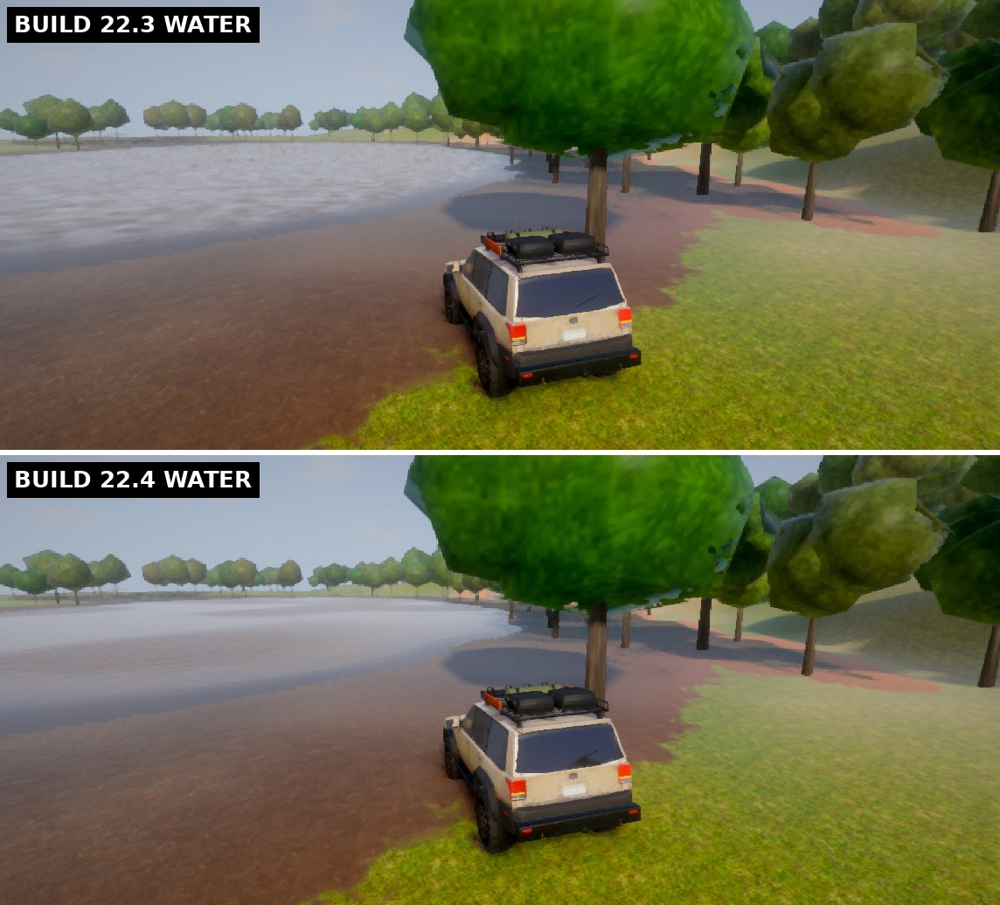
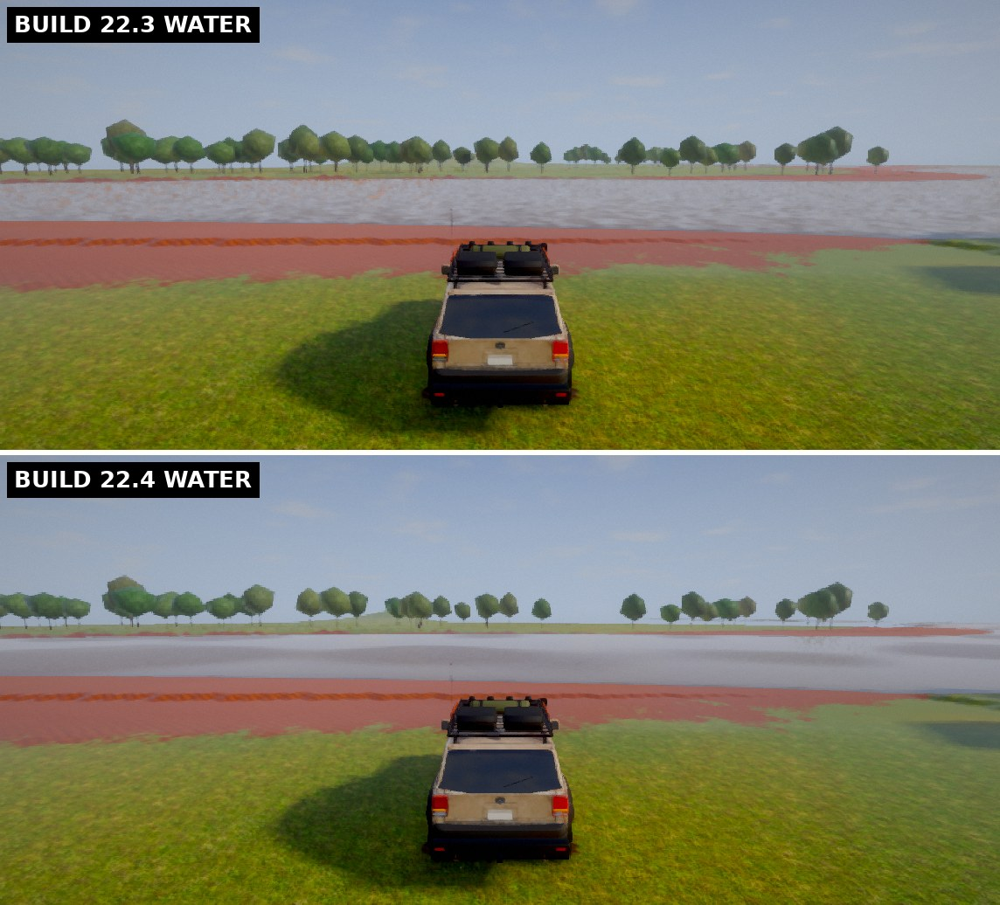
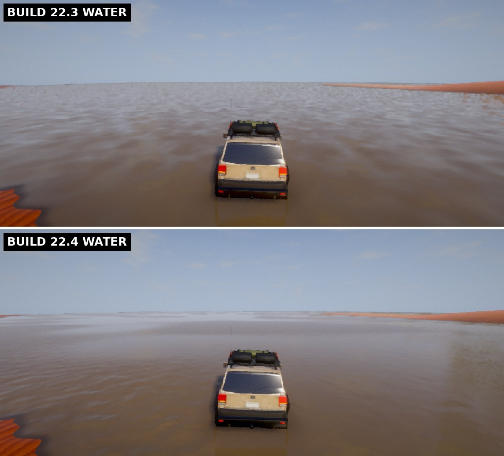
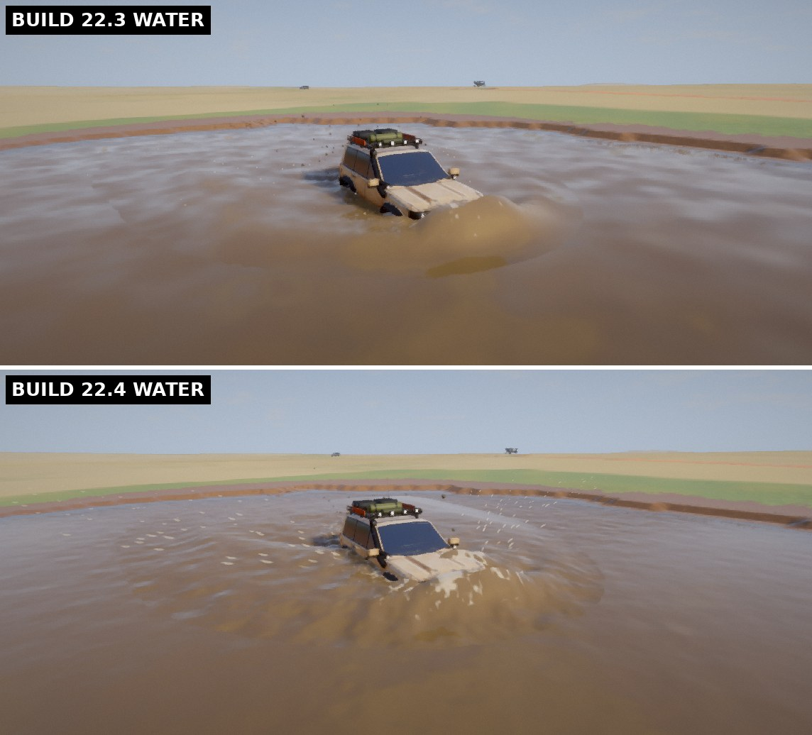
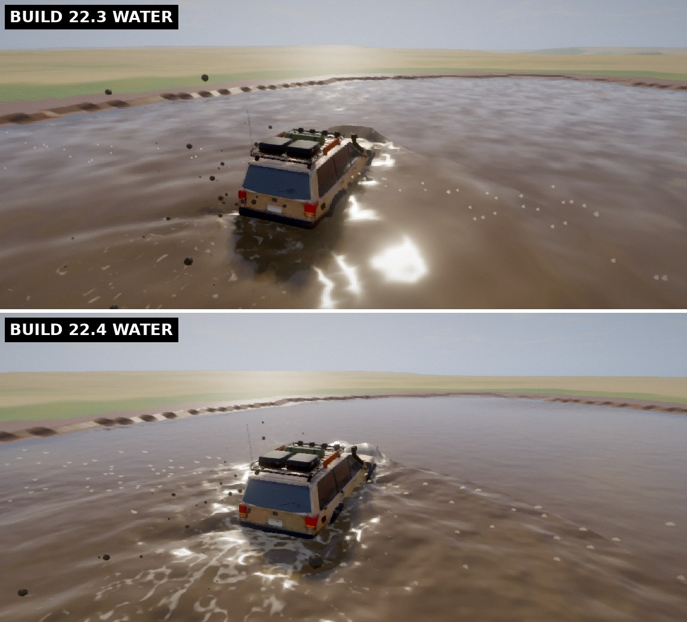
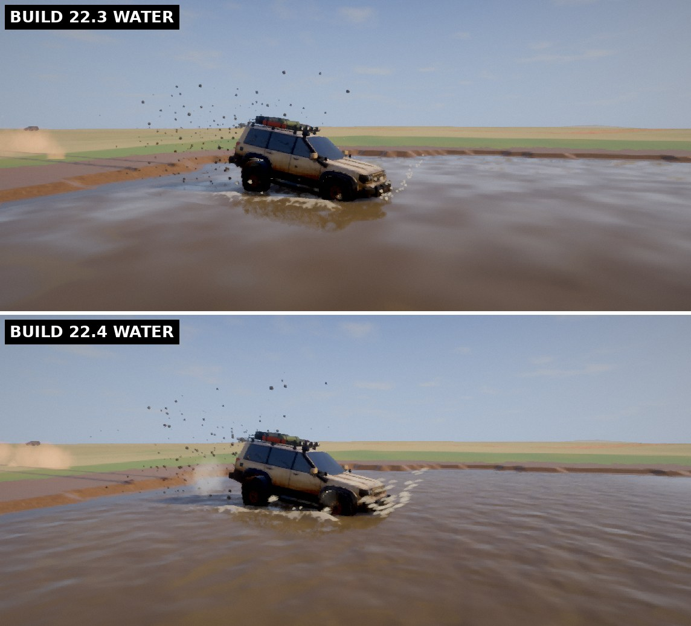
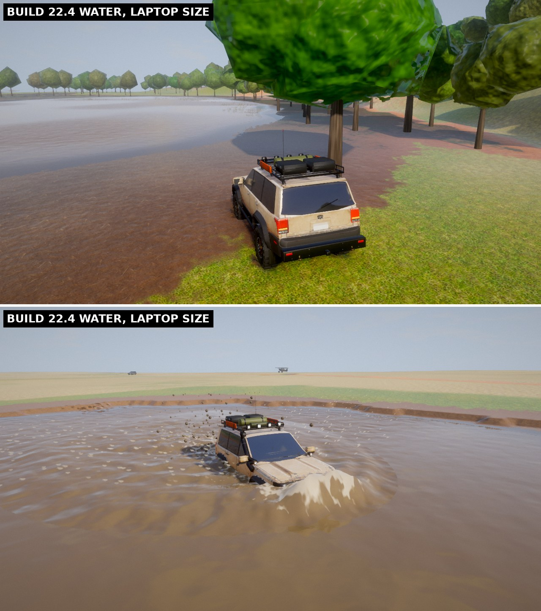

## Mud Lab 22.3 water (Nov 15 2026): ripples that are worked out, and a rut that fills

His words on Build 22.2: "There's a little bit too much splashing, or rather the splashing happens in a way that,
like, when you make a rut nearby a body of water, you're making a puddle full of water ... the splashing happens like
very suddenly, but the water would fill the rut after you made it. It wouldn't explode out of it unless you hit a rut
that was already there." And: "simulating the bow wake. If instead of doing these lines coming off of it, we tried to
simulate the water rippling effect slightly more realistically, or significantly more realistically if we can ...
if you're pushing through the water, you're making ripples, and you're pushing forward, the ripples are stacking up on
top of each other in front of the truck and getting stretched out behind the truck and propagating away from the side
of the truck ... It doesn't matter the orientation of the truck, it's the direction the truck is moving through the
water. So if we're just simulating the solid body of the truck, the solid body of the tires ... it's going to ripple
at the same speed no matter what speed you're going. The faster you're going means those ripples get taller and
tighter together because the ripples are still rippling."

Both are in this build. Only what is seen: nothing of the physics. Builds 22 to 22.2 are as they were.

### 1. The ripples are worked out (`src/ml-soil.js` mlRipple; `src/ml-look.glsl`; `src/build.py`)

Builds 22 to 22.2 **drew** a wake: a V of crests laid along the path each tyre and the body had taken, their shape
written down by hand. That is gone. Now the water's surface round the SUV is a sheet of points 28 m square, and each
point's height is **worked out** from its four neighbours', many times a second (the wave equation: a point higher
than its neighbours is pulled down, and overshoots). Nothing says where a crest should be.

- **What makes ripples is the solid shapes in the water**, by where they are now and where they were a moment ago:
  each tyre's foot (as long as its waterline, as wide as its tread) and the body below the waterline once the water
  is over the sills. Water a shape moves into is pushed up; water it has just left is drawn down. So a shape pushes a
  hump ahead of the way it **moves**, whichever way it points, and leaves a hollow behind; and a faster one moves more
  water each moment, so its ripples are taller.
- **How fast they travel is the water's own doing and nothing else's:** the speed of a wave in water that deep
  (1.7 m/s in a foot of water, 3.1 in 3 ft), worked out for each point from the depth of the water at it. The SUV's
  speed is no part of it. So ahead of a wading SUV the ripples it keeps making pile up close together, behind it
  they are drawn out, and off its sides they spread away. Faster than the ripples travel, they cannot get ahead at
  all and fold back into a V with a steep wave at the nose. None of that is written in: it is what the sums do.
- They slow and bunch up as the water shallows, and turn back from a bank.
- A spinning tyre works the water where it stands: rings.
- **At speed the water is thrown aside.** Worked out as above, a fast tyre's push and the hollow behind it all but
  cancel (it has left a point a thirtieth of a second after it came, before a ripple has gone anywhere). Water a fast
  tyre parts does not sit on its nose: it is flung out and lands beside it. So what a shape pushes up is put down to
  either side of the way the SUV is going, further out the faster (nothing at a wade, a metre at 37 mph), and the
  hollow stays in its track: a trough with a ridge and foam each side, which the water then makes a wake of. This is
  the one thing in the ripples that is a rule and not the sums.
- A wave too steep to stand breaks: it is eased down and leaves foam. Foam also comes where a shape parts the water
  fast. It stays where it is on the water and is gone in a second or two (the lace of 22.1).
- **What is drawn:** the sheet itself, lifted by each point's height, so crests and troughs are real shape; lit by
  each point's own slope; crests a little paler, troughs darker; choppier where it is worked up.
- The sheet goes with the SUV you are in (a little behind it at speed: a wake lies behind), in whole steps of its own
  grid, so the water never slides under the points. Its edge soaks ripples up.
- The spray of 22.1 and 22.2 (the fan, the mist, the splash on going in, the drips) is as it was.

### 2. A rut dug down to the water fills; it does not burst (`src/ml-soil.js` mlStand, mlStamp; `src/ml-look.glsl`)

Water stands wherever the ground is under a water's level, so the moment a tyre dug a rut below it, the rut was full:
the tyre was "in water" at once, and threw its spray, its splash and its waves. Now:

- Every spot of ground remembers when it was first dug below the water. For 0.3 s after there is no water in it at
  all; over the next 2.2 s the water comes up, the deepest of the rut first and out to its edges (in the picture too).
- What a tyre is taken to be in, for everything that is seen (spray, splash, mist, rings, ripples), is the water
  **standing half a metre ahead of it**, the way the SUV is going: the water that was there before it came, not the
  water in the rut it is making.
- A rut filled long ago is water like any other: hit it at speed and it splashes.
- The engine's own drops off a tyre in a rut that has not filled are still rolled for and counted (so the game's dice
  are what they were) and are of no size: not seen.
- The physics still goes by the ground and the water's level as it always did: the drag, the lift and the grip are
  untouched.

### The shader's size (his limit: landSoil no bigger)

| As the browser hands it to the graphics driver | Build 22 | Build 22.2 | Build 22.3 |
|---|---|---|---|
| landSoil, the phone's tier | 486,938 | 467,268 | 457,635 |
| landSoil, the laptop's tier (High) | 500,535 | 471,076 | 461,442 |
| landSoil's vertex shader | 37,779 | about 50,600 | 38,934 |
| Texture samplers | 16 | 16 | 16 |

The drawn wake was a loop of 52 sums for every pixel of water near the truck, and again for every point of the sheet.
Both loops are gone: the sums are done once, on the processor, for the sheet's points only.

### Checked

| | |
|---|---|
| The same seven drives, Build 22.2 and Build 22.3 (`tools/test/ml-same.py`) | 7 of 7 the same, to the last digit (speed, place, ruts, soil dug, clods). No page errors in either |
| A tyre digging down to the water beside the Mud Hole (a standing start flat out on the wet clay just short of it; each tyre's water by the old rule and by the new) | where a tyre had dug itself into 7 to 13 cm of water, the water standing ahead of it was 0 to 4 cm: no spray, no splash and no ripples from it; once in the Mud Hole's own water the two agree |
| Pictures, phone size (`tools/test/ml-views.py`, twelve views: ten of the water, two of the Bog) | all drawn with landSoil, no page errors |
| Pictures, laptop size (High, 1280 x 720) | the wade from behind and the hard turn: drawn with landSoil, no page errors |
| The processor's share (the test browser, the phone's tier, one step of the game in the Mud Hole) | 1.01 ms in Build 22.2, 1.39 ms in 22.3: the ripples cost about 0.4 ms a step here. A phone's processor is slower than this machine's |
| Triangles | the sheet is 24,642 on the phone's tier (22.2: 18,432), 32,258 on Low, 50,562 above, drawn only while there are ripples |
| Page errors | none |

### Not done, and limits

- **Not run on his phone or laptop.** This is the build that most needs it: ripples are movement, and the pictures
  can only show one moment of them. How big, how fast they die, how much foam: all set from still pictures.
- **The processor does this, every frame there are ripples:** the sums (12,544 points on the phone's tier, 25,600 on
  the laptop's), and sending the sheet to the graphics card (300 KB a frame on the phone's tier, 600 KB on the
  laptop's). If the phone is slower in water than it was, say so: the sheet can be made coarser in one line.
- The sheet's points are 25 cm apart on the phone (17.5 on the laptop): a ripple shorter than about a metre cannot be
  held, so these are broad ripples, not fine ones. The fine ripples on the water are still the engine's own.
- Ripples are worked out only on water at the level the SUV is standing in, over ground that was under water before
  any rut was dug, and within the 28 m square. A rut's own water, a puddle at another level and the far side of the
  Lake do not ripple.
- The other SUV's tyres make ripples; its body does not. The Heron makes none.
- How tall the hump at a wading SUV's nose stands, and how much foam, are set from the pictures. The hump is a
  smooth swell of water with little foam on it: calmer than 22.2's drawn roll. Say if it should be more, or less.
- Ripples push on nothing and wet nothing.
- A rut's water comes up by the clock (2.5 s), the same for a hand's depth as for a foot. It does not flow in from
  the pond: a rut dug far from open water fills the same way, from below.
- Driving back through a rut that has filled does not empty it.

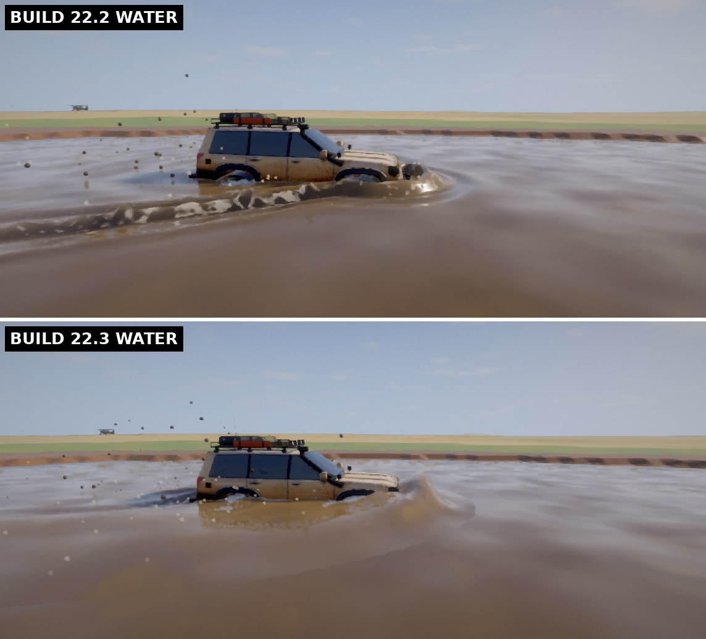
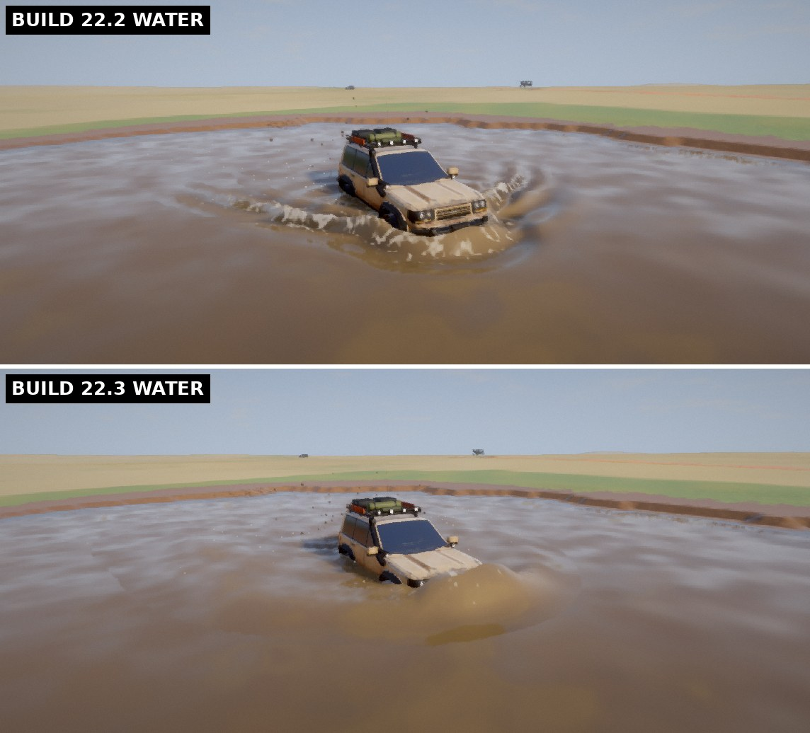
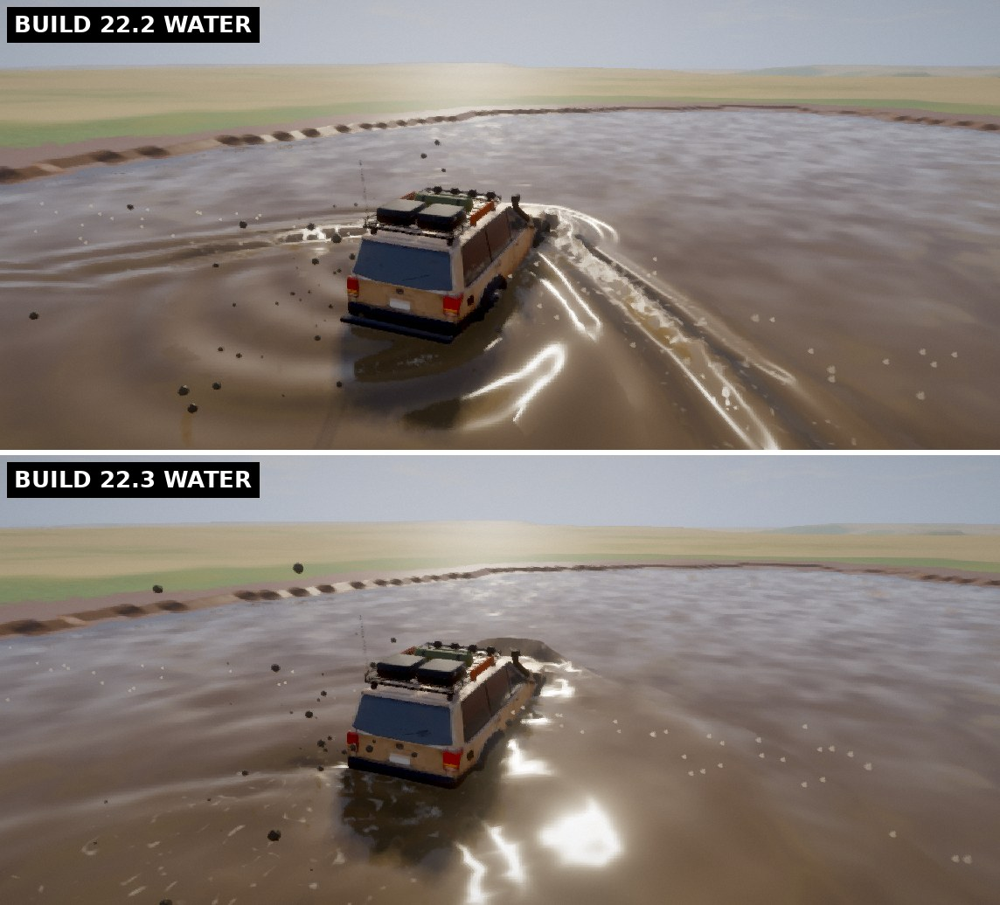
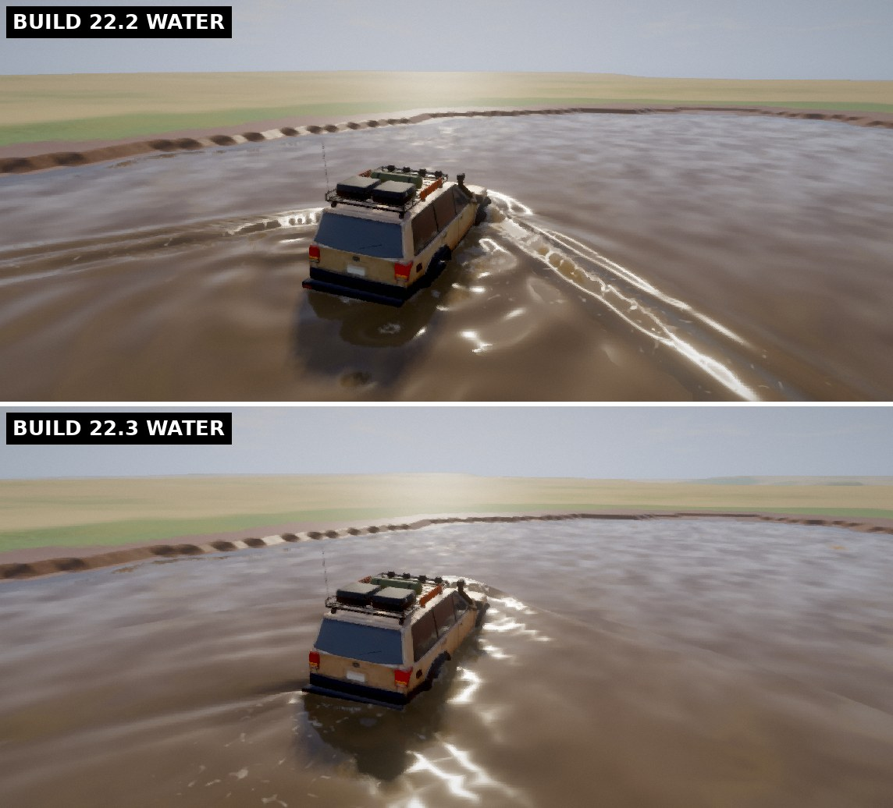
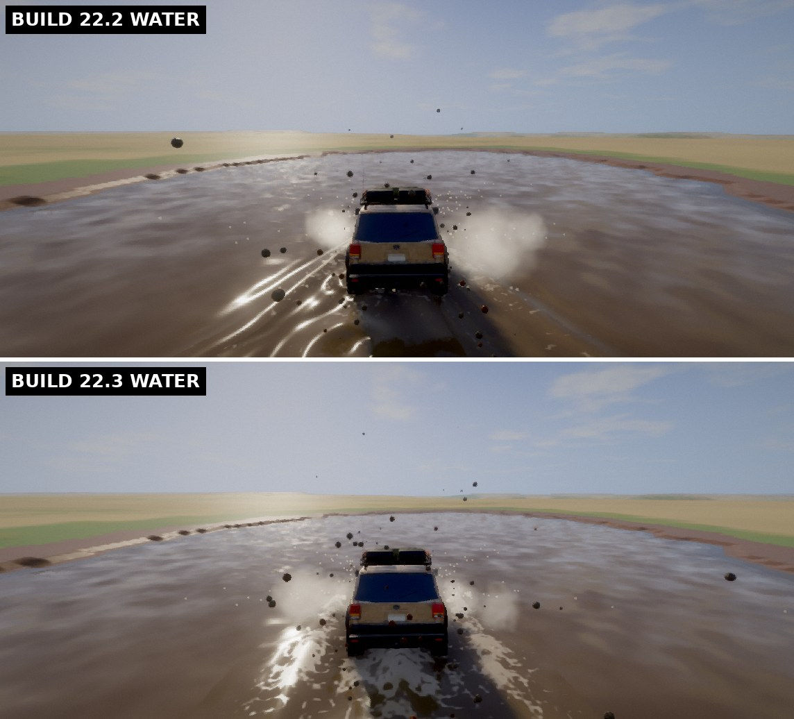
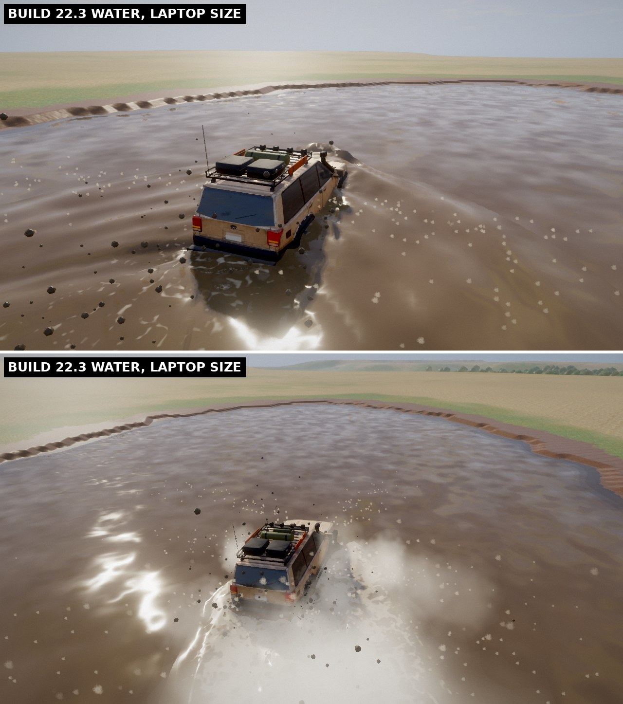

## Mud Lab 22.2 water (Nov 15 2026): the second pass at the water, and a look for what the page carries that it doesn't need

His words on Build 22.1: "Oh this is a really really good. Can we do another pass of the water improvement? And I also
asked to make sure there's not rendering things that are choking up the phone or the laptop that don't need to be in
here. Like there's not paved roads in this game or buildings. I don't know if the shaders are there for those but this
one built from a game that had all that stuff."

Only the water's look again, and one small piece taken out of the ground's shader. Nothing of the physics, the soil,
the map or the menus. Builds 22 and 22.1 are as they were.

### 1. What the page still carries from the game it was built from (the look he asked for)

Looked for three ways: every shader program the page builds and what each draws in a frame; the game's own code
sampled while driving (the field, the Mud Hole); every material a mesh is made with (Build 22.1's check).

| | |
|---|---|
| Shaders for roads, buildings, traffic | **none are built.** The engine's city program is never made. The ground's own shader had its branches for boulders, the drag strip, tracks, concrete, sheet metal, hay, painted lines, gravel, asphalt, lanes, the oval, the dry lake, the public roads, the town's walls and the traffic signals taken out in Mud Lab 8, eight unused car materials in Mud Lab 16, and the cars' liveries in 22.1 |
| The game's own code each frame | no traffic, police, town or career code runs: everything sampled was the soil's, the world's, the physics' and the drawing's. In the test browser the page's own code was about 3 % of the time (the rest is the test browser's software graphics) |
| What is built | 22 shader programs. The three for the ground are 72 % of all of it by size (in Build 22.1: landSoil 475,000, the reflections' ground 368,000, the plain ground shown while landSoil builds 359,000); the sky, fog, reflections, sharpening and the rest are 4,000 to 64,000 each |
| Built, and not drawn in any frame sampled | six small ones: motion blur, two for the engine's dot-matrix display style, a debug view, a copy, a depth pass (82,000 together, 5 % of the whole). **Left in:** they are made inside the engine's renderer, which expects them to exist, and 5 % is not worth breaking it for. Say if he wants them out anyway |
| Still in the ground's shader and dead | **rain.** It cannot rain in Mud Lab (the weather is the engine's Sim setting, and that part of the menu is hidden). Out now: the rain soaking the ground and putting a sheen on it, the puddles it fills, and the rain's rings on water and puddles |
| What a frame draws on the phone's tier | at the Trailhead: the picture 67 draws and 300,000 triangles, the shadows 39 draws and 189,000, the reflections' ground 3 draws and 14,000. In the Mud Hole: 51 and 257,000, 14 and 106,000, 3 and 15,000. All of it ground, trees and the SUVs: nothing of a town |

So there was little left to find: the big cuts were made in Builds 8 and 16. What is heavy is Mud Lab's own (the
ground's shader, and shadows that draw 40 to 60 % as many triangles again as the picture). Those are choices, not
left-overs; whether they need trimming can only be told on his phone and laptop.

### 2. The water (`src/ml-soil.js`, `src/ml-look.glsl`, `src/build.py`)

1. **The fan.** From 10 mph the water a tyre or the body parts is thrown out to both sides as a fan of drops: flung out
   and up at a share of its speed and carried along with it, the ones flung furthest the lowest, so they arc over
   and come down as a curtain beside the SUV. More and further with speed. Bigger and paler drops than 22.1's, so a
   phone shows them.
2. **The splash of going in.** A tyre, or the body, that meets the water at 9 mph or more throws up a burst the moment
   it does (up to 40 drops a tyre, twice that for the body): drops flung forward, out and up by how hard it hit, a few puffs of mist, a ring. Down counts as well as
   along, so a jump's landing in water splashes.
3. **Out of the water, it runs off.** A SUV that has been in over its axles drips for three seconds once it is out:
   drops from under the body all round, many at first and fewer as it drains, more the deeper it was.
4. **The bow's roll is alive.** It was one smooth roll. Now its leading face is the steeper one (it leans the way
   it is going), it swells and sinks in lumps a couple of metres long that move along it, with a quicker small chop
   on top, and the body's wave is lit as the steep wave it is (it was lit as flat as a tyre's).
5. **Mist that is a haze, not balls.** More puffs, thinner, swelling fast at first: 22.1's could be told apart as
   round puffs.

All of the spray is the wake's own (its own list and its own dice, as in 22 and 22.1): the game's dice and its count
of particles are untouched. At most 170 of them alive on the phone's tier, 340 above (22.1: 110 and 240); and of
those at most 56 puffs of mist (12 more for a splash), the same on every tier: a puff is big and soft, and at laptop
size a hundred of them in a hard turn were a white veil between the SUV and the chase camera (the first laptop
picture showed it).

### The shader's size (his limit: landSoil no bigger)

| As the browser hands it to the graphics driver | Build 22 | Build 22.1 | Build 22.2 |
|---|---|---|---|
| landSoil, the phone's tier | 486,938 | 475,249 | 467,268 |
| landSoil, the laptop's tier (High) | 500,535 | 488,847 | 471,076 |
| land (the plain ground while landSoil builds), the laptop's tier | 388,447 | 366,625 | 348,576 |
| Texture samplers | 16 | 16 | 16 |

Smaller again: the rain. It was worth 8,000 on the phone's tier and 17,800 on the laptop's (the rain's rings were only on the laptop's). The water's part of the shader grew by one sum (the body's wave lit steeper).

### Checked

| | |
|---|---|
| The same seven drives, Build 22.1 and Build 22.2 (`tools/test/ml-same.py`) | 7 of 7 the same, to the last digit (speed, place, ruts, soil dug, clods). No page errors in either |
| The spray, counted (the Rock & Mud into the Mud Hole flat out, then set down on the bank) | nothing in the air before the water; 81 drops and 18 puffs a tenth of a second after the front tyres met it at 47 mph (the splash); up to 136 drops and 38 puffs under way; out of 70 cm of water: 24 drops in the air after 0.4 s, 9 after 1.2 s, none after 2.4 s (the drips) |
| Pictures, phone size (`tools/test/ml-views.py`: ten views of the water; `water-entry` and `water-entryc` are new) | all drawn with landSoil, no page errors. (The ten were taken before the mist was thinned and given its own count; the pairs below, and the laptop's, are of the build as it is) |
| Pictures, laptop size (High, 1280 x 720) | the hard turn and the wade from the side: drawn with landSoil, no page errors |
| Triangles | nothing added: the sheet is as it was (18,432 on the phone's tier) |
| Page errors | none |

### Not done, and limits

- **Not run on his phone or laptop**, and this pass is nearly all movement: drops flying, a roll swelling, water
  running off. None of it has been seen moving by anyone. The pictures can only say it is there.
- A drop is still a round soft dot. A real sheet of thrown water is a sheet; this is many dots flying together.
- More drops in the air than 22.1 (the cap is up by half). If the phone slows in a fast splash, say so.
- How thick the mist should be is his eye's call: it was thinned twice on the pictures alone, so that it never hides
  the SUV from the chase camera. It may now be thinner than he would like.
- The splash is by speed alone: the same for a tyre dropping into a puddle as into the Lake.
- The drips fall straight and vanish at the ground: they wet nothing.
- Everything Build 22.1's limits said still stands (the sheet only lifts; it goes with the SUV you are in; a wave
  pushes on nothing).

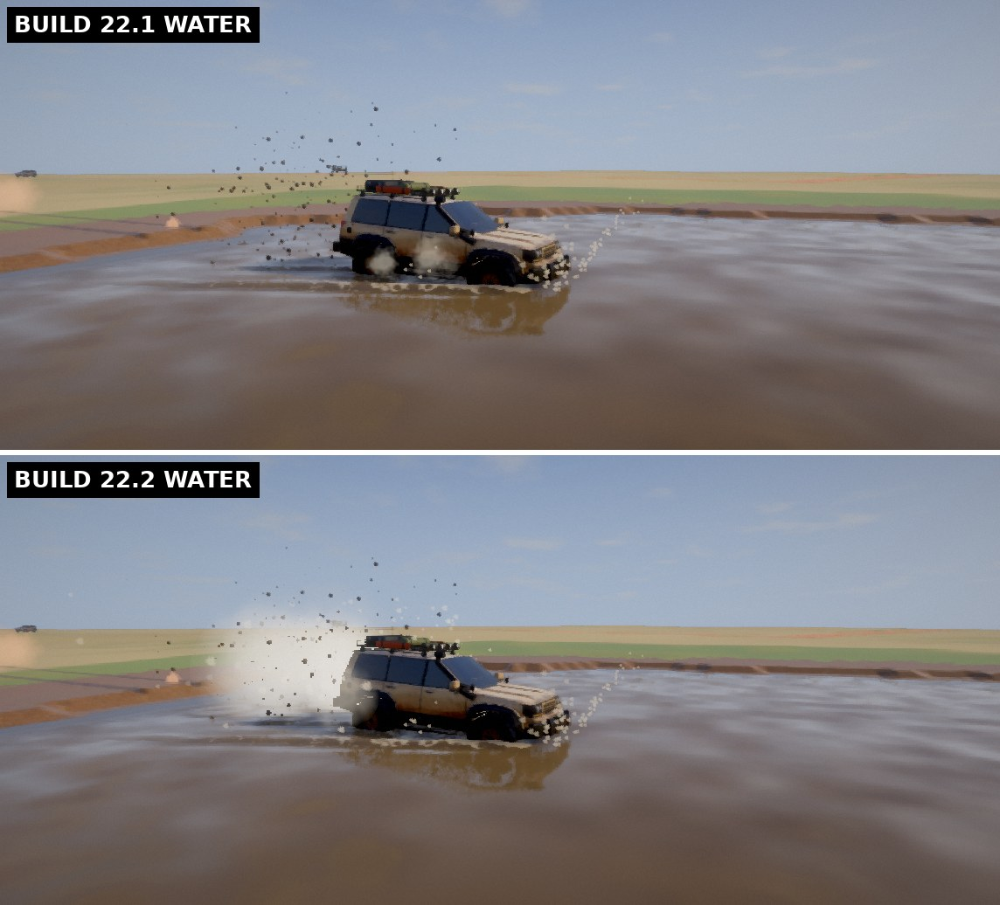
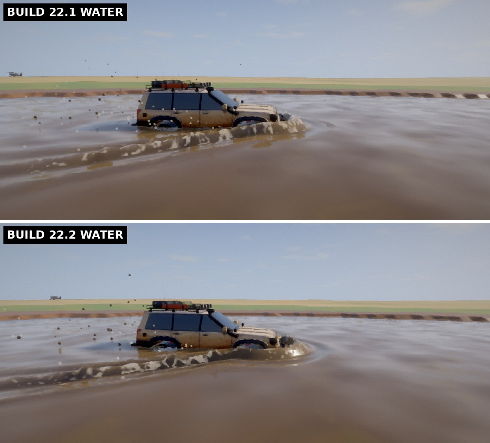
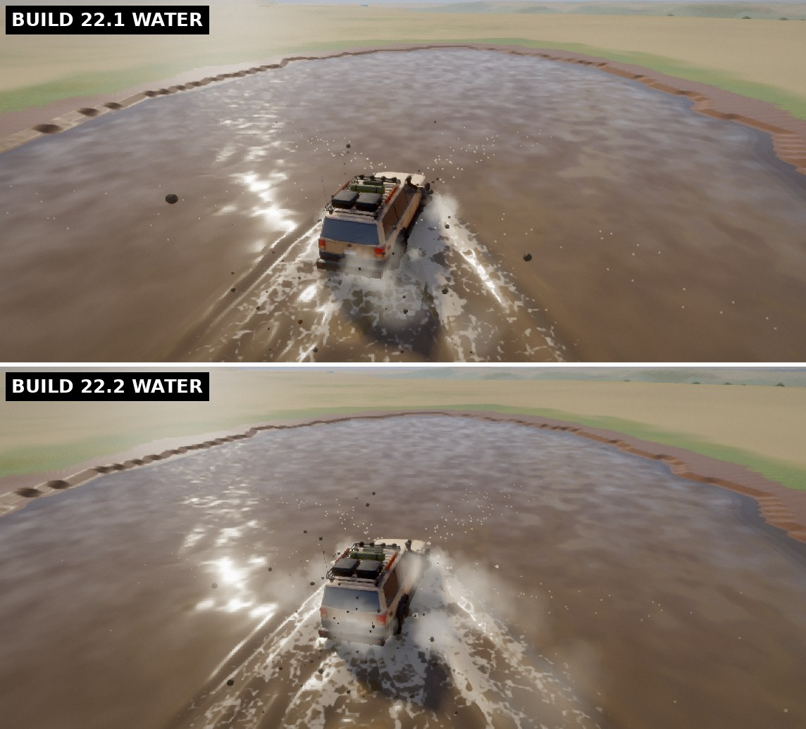
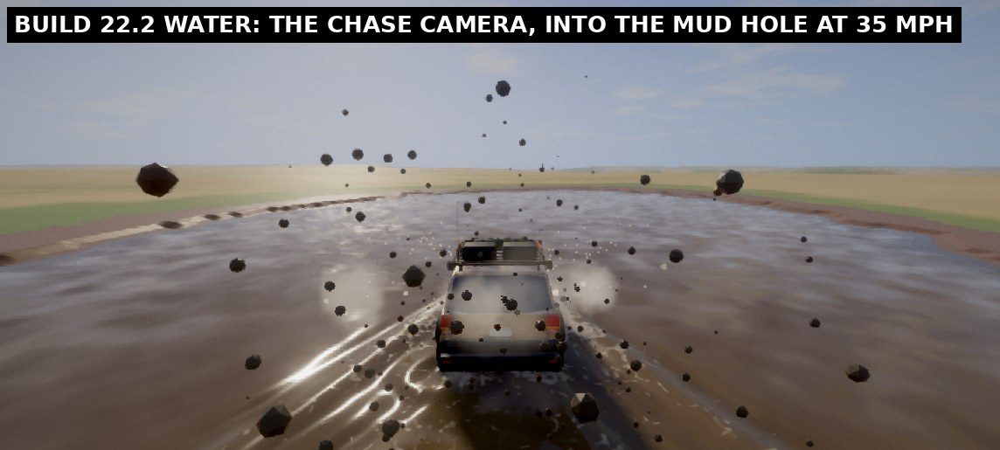
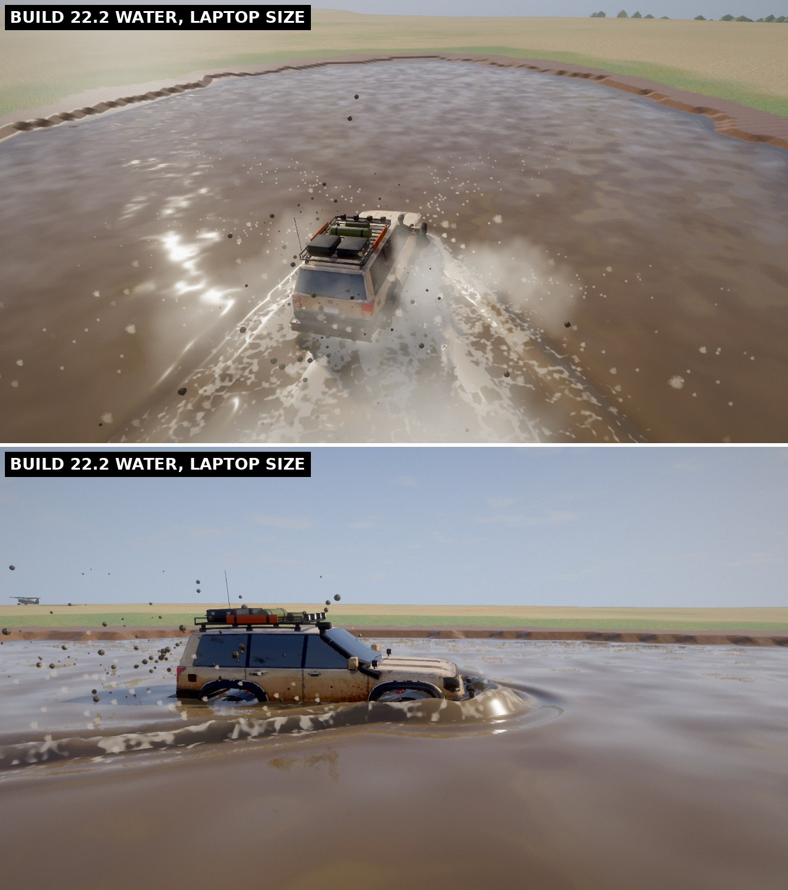

## Mud Lab 22.1 water (Nov 15 2026): waves that stand up, a bow wave round the nose, foam, mist

His words (Nov 15): "look at the way the bow wake and the tire wakes. And think about making that better and call your
version (mud lab 22.1 water) Because even if it takes multiple passes, we're going to get the water looking perfect.
Everything else in this game looks so good already".

This is the first pass. Only the water's look was touched: nothing of the physics, the soil, the map or the menus.
Build 22 is as it was (and is now in the repository: see Mud Lab 22, below).

### What was found (Build 22, the same drives photographed from the same places)

- **The waves were only slopes painted on level water.** A slope shows where it catches the sun and nowhere else: on
  the sun's side of the SUV the wake was thin bright scratches, on the other side there was nothing to see.
- **Wading, nothing stood at the nose.** From ahead and from the side the water met the bumper as flat as glass at any
  speed: a painted wave has no height, so it cannot rise against the SUV or hide anything behind it.
- **A wave's far side read as a sand bar.** Seen from low down, the side of a wave that leans away mirrored what is
  under the horizon (the land's colour): tan stripes across the water. In a broadside slide they lay in rows behind
  the SUV like corduroy (the picture below).
- **No foam and nothing thrown up fine.** Water at 35 mph was the same clear sheet as water at 5.

### What Build 22.1 does (`src/ml-look.glsl`, `src/ml-soil.js`, `src/build.py`)

1. **The crests stand up.** A fine sheet of water 28 m square goes with the SUV you are in (a point every 9 cm under
   it, 11 on the phone), lying 5 mm under the level of the water it is in. The same sums that paint the wake lift it:
   a tyre's wave up to 12 cm, the body's up to 30 cm, a spinning tyre's ring 3 cm. Where a crest lifts it clear it is
   seen: it stands against the bumper and the tyres, hides what is behind it, and shows from every side. The rest of
   the sheet stays under the level water and is not drawn.
2. **The bow wave runs round the nose.** The first stretch of every wave is now drawn round the front of whatever is
   cutting the water, not only out to its sides: the crest lies against the leading side, across the whole of it,
   and sweeps back round both corners into the arms. Nose first that is the bumper; reversing, the tail; in a
   broadside slide, the whole flank (Build 22 already knew which side leads).
3. **A bolder wave.** Crests 1.25 m apart (they were 80 cm): beside the SUV the wave is one roll of water with a dip
   either side, and it only spreads into a train as it travels. Crests are painted a little lighter and troughs
   darker, and worked-up water gives a broad soft glint in place of a needle.
4. **Foam.** Pale tan froth, matt: along a crest while it is fresh and strong, and in the strip the tyre or the body
   has just come through (the strip widens as it ages, so two tyres' strips run together behind the SUV). It is laid
   as a lace that stays where it is on the water, fills in where it is thick, thins back to flecks and is gone in
   about a second and a half. Speed makes it: none at a crawl, a little at 15 mph, a lot in a fast turn or a slide.
   Rings from a spinning tyre, and the bubbles over a drowned SUV, never have any.
5. **Mist.** From 8 mph a tyre or the body cutting the water throws up soft pale puffs either side of the wave's
   head (the engine's own spray, as off wet tarmac). They are the wake's own, like Build 22's side drops: the game's
   dice and its count of particles are untouched.
6. **How strong a wave is goes on with speed.** A tyre's wave was full strength from 7 mph. Now it is under half at
   7 mph and builds to full by about 27 mph. The body's own wave is full from 6 mph: water deep enough to reach the
   body holds the SUV to a wade, and a wade is when it pushes its biggest wave.
7. **A wave's far side mirrors sky.** Where a slope would mirror what is under the horizon it mirrors the sky just
   over it: no more tan stripes.

### The shader's size (his limit: landSoil no bigger)

| As the browser hands it to the graphics driver | Build 21 | Build 22 | Build 22.1 |
|---|---|---|---|
| landSoil, the phone's tier | 487,142 | 486,938 | 475,249 |
| landSoil, the laptop's tier (High) | 500,740 | 500,535 | 488,847 |
| land (the plain ground while landSoil builds), the laptop's tier | | 388,447 | 366,625 |
| Texture samplers | 16 | 16 | 16 |

The foam, the waves' height and the sky in a wave's far side came to about 10,000 more (landSoil was 496,994 on the
phone's tier with them in, before anything was taken out). Paid for by taking out the cars' liveries (race bands and stripes, the police's black and
white) from the engine's painted bodies: Mud Lab's two SUVs carry none and are drawn from their bakes, and there are
no police. That was worth about 21,800, in all three of the land's programs.

**What did grow:** landSoil's *vertex* shader, the small one that places points (37,779 to about 50,600 by the same
count): it now does the wakes' sums for the sheet's points. It is a tenth the size of the one the limit is about.

### Checked

| | |
|---|---|
| The same seven drives, Build 22 and Build 22.1 (`tools/test/ml-same.py`) | 7 of 7 the same, to the last digit (speed, place, ruts, soil dug, clods): the Rock & Mud across the dry field, through the Mud Hole, into the pond's bottoms and across the quarry's sand; the stock SUV into the Mud Hole and in 4 LO on the clay pan; the Heron's take-off run. No page errors in either |
| Triangles | the sheet is 18,432 on the phone's tier, 25,088 on Low, 41,472 above, drawn only while there is a wake (never on dry ground). Nothing else added |
| Pictures, phone size (`tools/test/ml-views.py`: thirteen views of the water, nine of them new: a hard turn, a broadside slide, a crawl, the wade from four sides, a shallower wade from three, the stock SUV wading) | all drawn with landSoil, no page errors; Build 22 photographed at the same eleven for the pairs below |
| Pictures, laptop size (High, 1280 x 720) | four of the views (`water-bowc`, `-wake`, `-slide`, `-deepf`): drawn with landSoil, no page errors |
| One frame in the test browser, the nine phone-size views first taken of both builds | 13 to 32 % longer in Build 22.1 (software graphics: it does the sheet's sums on the processor, which a graphics chip does not). With the painting changed and no sheet yet, the same views were 0 to 5 % longer |
| Materials (`tools/test/ml-mats.py`) | every material Mud Lab makes a mesh with still has its branch; none of the ones taken out is in use |
| Page errors | none |

### Not done, and limits

- **Not run on his phone or laptop.** Everything here is still pictures from the test browser. How it moves (the
  foam thinning, the mist drifting, the bow wave building as the SUV speeds up) has not been seen by anyone.
  Frame rates can only be judged on his devices: the sheet is one more thing to draw while in water (18,432
  triangles on the phone), and the mist is up to 110 soft puffs on the phone (240 above). **If the phone is slower in
  water than Build 22 was, say so:** the sheet can be made coarser, or left off the phone's tier, in one line.
- Edge's shader compiler was not timed. landSoil is smaller by the count above; its vertex shader is bigger.
- **The sheet only lifts.** A crest stands up; a trough does not dip below the level water (it is painted darker).
- The sheet lies at the level of the water the SUV you are in is standing in, and reaches 14 m from it. A wave
  further off than that, or the other SUV's wave in water at a different level, is painted but does not stand up.
- The roll at the nose is a plain smooth roll with foam on it: it does not curl over or break.
- The slide's foam is a lot of foam. Whether that is right or too much is his eye's call.
- A crest is lit by the painted slope, which is the same for every wave; its shape is the sheet's, which is taller
  for the body than for a tyre. From close by the two do not quite agree.
- Fast and straight through shallow water is the weakest case left: the two tyres' wakes run nearly parallel behind
  the SUV (that is what a fast wake does), with foam between them, and it is less of a show than a turn or a wade.
- The waves still push on nothing, wet nothing and do not bounce off the bank. The mist does not wet the SUV.
- Still to come if he wants it (the next passes): the water thrown by the tyres as sheets rather than beads; the
  splash of a landing or a clod; a hollow behind the SUV at speed; waves washing up the bank; the Heron's wake.

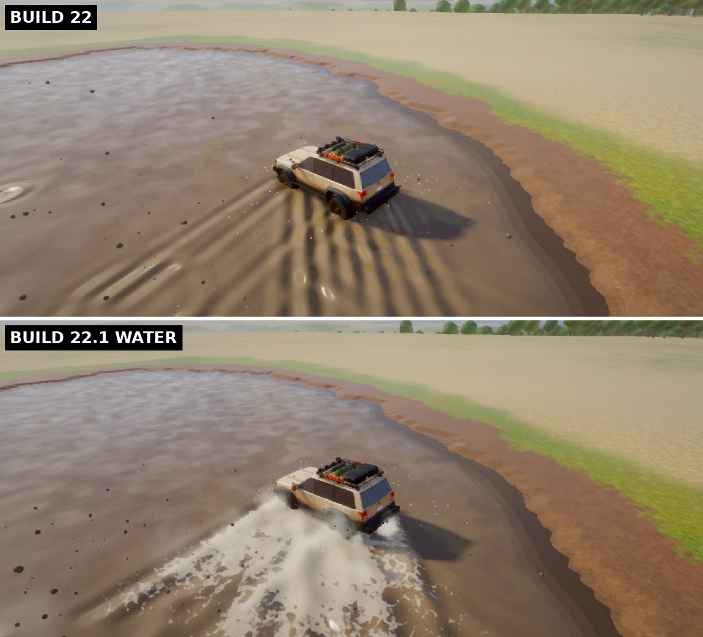
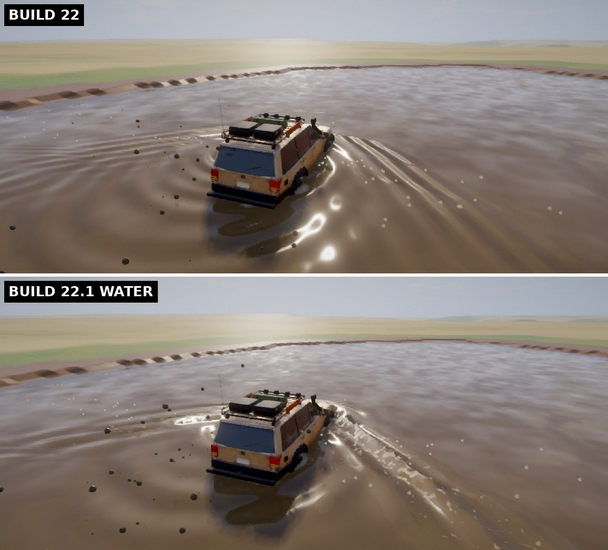
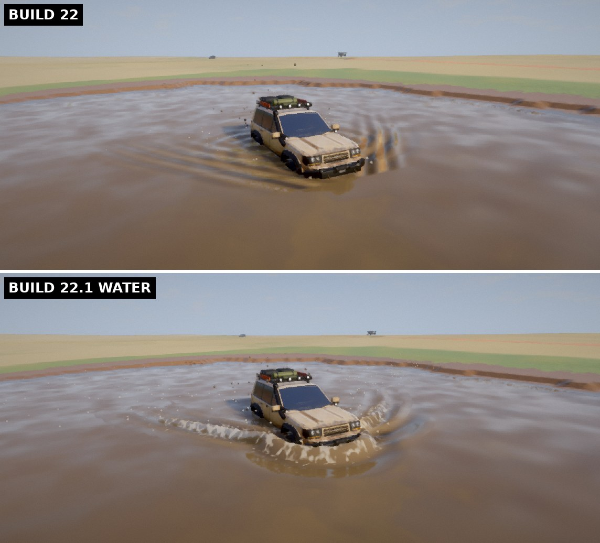
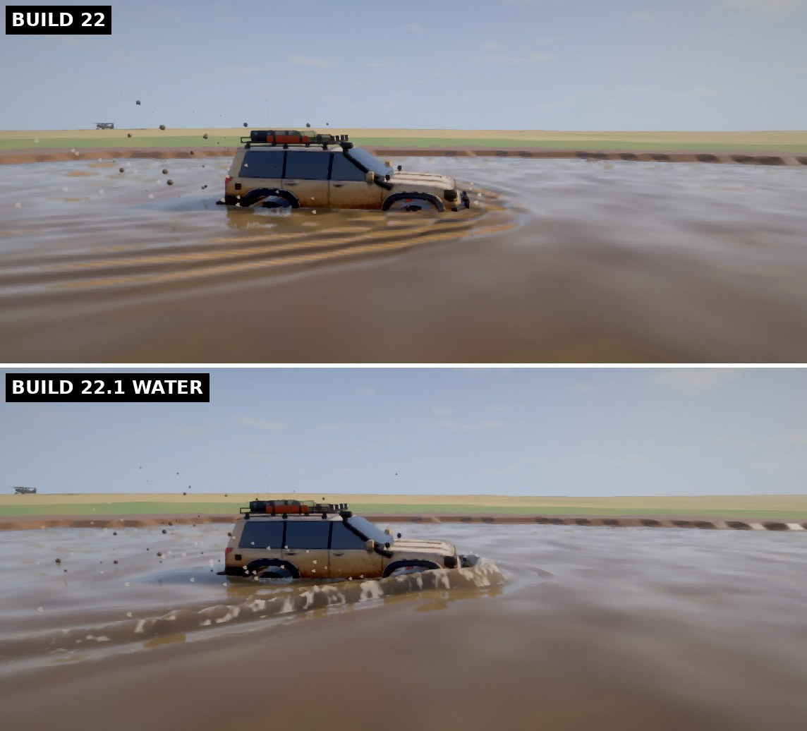
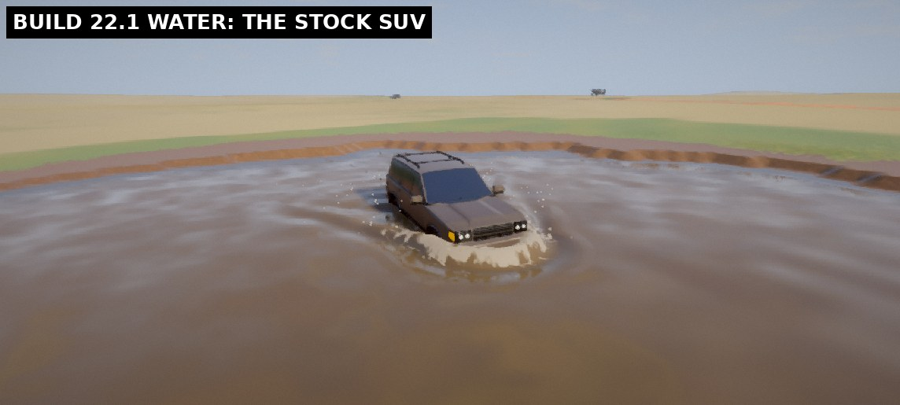
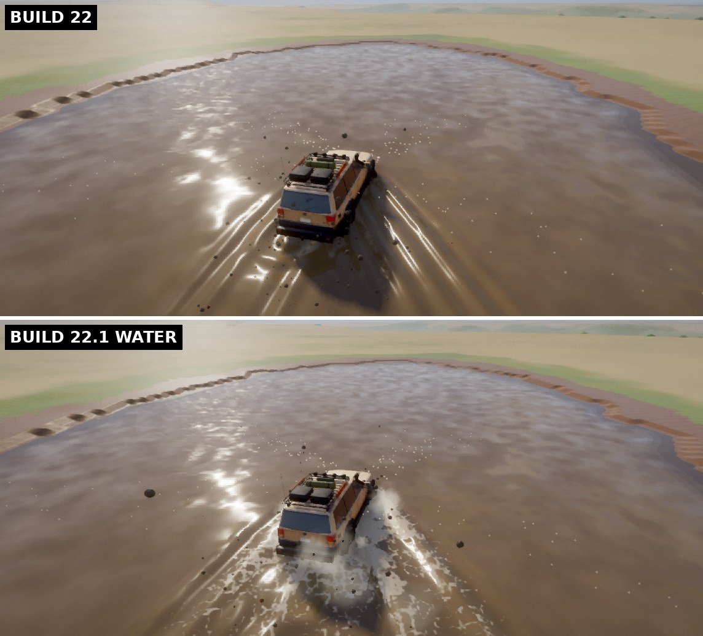
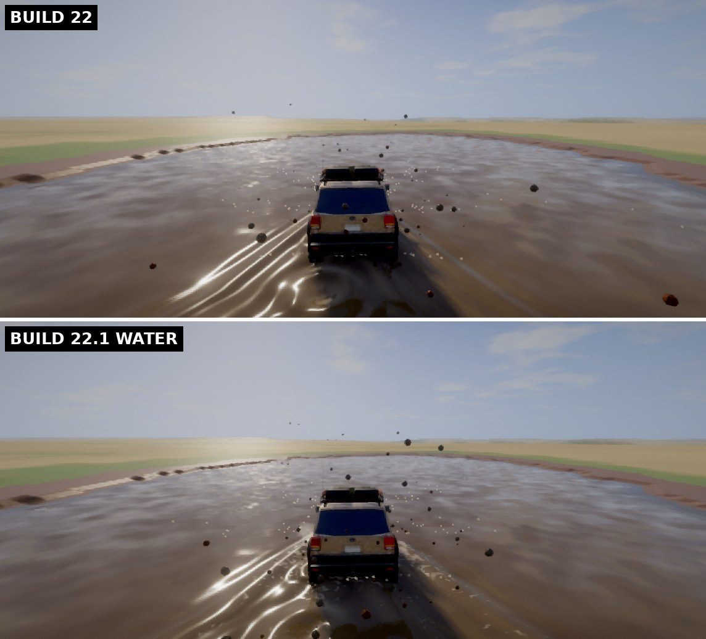
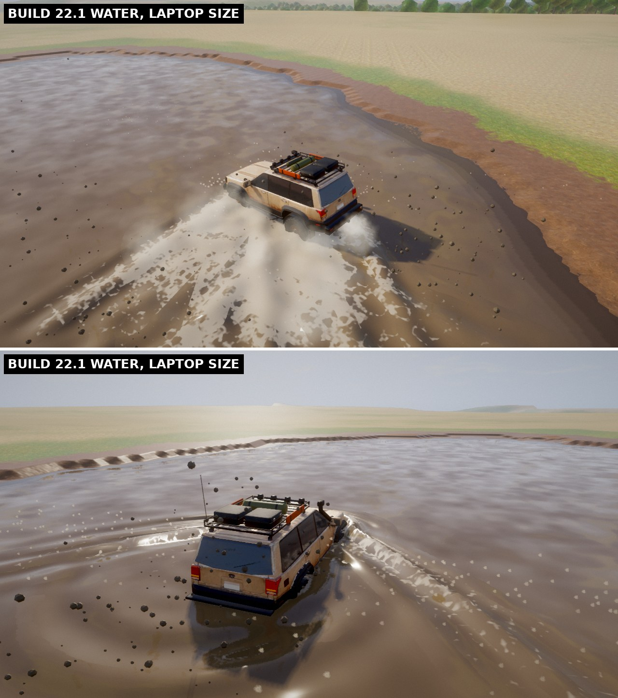

## Mud Lab 22 (Nov 14 2026): wet soil dark not shiny, the grain, a wake that follows the way the SUV moves

**This build's page came from him, not from the repository.** It was made in another session and its source was never
pushed; on Nov 15 he sent the page itself (`builds/mud-lab-22.html` is that file). `src/` was brought up to it from
the page: `python3 src/build.py mud-lab-22` at that commit writes the same file, byte for byte. That session's own
notes, checks and pictures are not here. What follows is only what the page's own comments say:

- **Wet soil is dark, not shiny** (`src/ml-look.glsl`). His words, Nov 14: "the ground's kind of shiny. I know that
  it's like wet and not wet but wet soil is dark not shiny." No soil is lit as a smooth wet sheet any more, wet or
  dry. Bare soil goes deeper and browner as it wets. The only shine left on soil is water standing in the deepest
  hollows of soaked ground, a faint smear where a tyre has pressed it, and a wet track while it dries.
- **The grain.** Bare soil is flecked with grains lighter and darker than their neighbours, at two sizes (about an
  inch and a half, and half an inch), and untouched bare ground has nearly three times the relief it had.
- **The wake follows the way the SUV moves** (`src/ml-soil.js`). His words, Nov 14, with a photo of the Rock & Mud
  sliding sideways with its V of waves still lying along its nose: "not just coming off of the front of the SUV at a
  specific angle but actually is related to the direction ... a bow wake off of each of the tires and then off of the
  front bumper or the side or the back, like whichever direction you're sliding." Each tyre in the water, and the
  body once the water is over its sills, lays a wave along the path it really took (the last 3.2 s of it); how wide
  the V opens is the water's own wave speed for its depth; the wave starts from whichever side of the body leads;
  a tyre running behind another makes none; drops off the flank in a slide. The other SUV gets one wave.

## Mud Lab 21 (Nov 14 2026): four jumps, the Lake's name back in the Lake, and a line that says how far you flew

His words after Build 20 (Nov 14, 08:24): "Okay, so jump to the lake should still jump to the middle of the lake as is
being requested by one of the play testers, my son. Also, I think that there should be interesting strategic literal
jumps placed in certain places that you can clearly drive super fast on to get the appropriate speed to like hit a ramp
and do something interesting. Because I think we're getting close to the point where I want to add the point system."

Builds 15 to 20 are as they were. The first map's ground is the same to the last digit (all 147,456 points of
`tools/world/dump.js`). Nothing in the ground's shader was touched. Nothing new is drawn: every jump is ground.

### 1. JUMP: THE LAKE is the Lake's middle again (`src/ml-heron.js` MLV_IN)

Build 20 moved it to the beach. Now the map's THE LAKE sets you down where the name stands, in 10 ft of water, as Build 19
did. LAKE BEACH (its own name on the map) is the dry landing; THINGS TO DO > THE LAKE is the beach, as before; in Real
the guide arrow for THE LAKE still leads to the beach (an arrow into the middle of a lake is no guide).

### 2. Four jumps (`src/ml-world.js` ML_JUMPS; `tools/world/jumps.js` sizes them; `tools/test/ml-drive.js` T9.jump drives them)

Each is a straight lane of bare packed dirt with its ramp at the end. All on the new ground. Each has its name on the map
(JUMP sets you at the start of its run-up, facing the ramp) and a line in THINGS TO DO with the speed to hit.

| | Where | What | The speed at the ramp |
|---|---|---|---|
| **CREEK GAP** | Big Creek's new reach, north-east of the first map | 59 ft lip to lip over 26 ft of creek. Two ramps 14 ft high, 300 ft of run-up each side: it goes both ways. The stock SUV's way over the creek | 55 mph |
| **RIVER JUMP** | The River where it is narrow, just above the Narrows | 190 ft lip to lip over 151 ft of water 6 ft deep. Two ramps 27 ft high. Both ways: 1,130 ft of run-up from the west, 1,390 ft from the east (down off a knoll) | 83 mph going east, 88 coming back |
| **LAKE JUMP** | The Lake's west shore, 280 ft south of the beach | Off a 17 ft ramp, over 138 ft of water, onto an island 680 ft long built for it. A sand bar 1 ft under the water leads from the island back to the shore | 70 mph |
| **BIG AIR** | The flat on the River's west bank, below the Shallows | No gap. 985 ft of run-up, one ramp 5.5 ft high, then 1,380 ft of level strip with a pale mark every 50 ft | as fast as you dare |

**How they were sized.** First the SUVs' real speeds, flat out from a stand on firm ground: the stock SUV 57 mph after
330 ft, 70 after 660, 81 after 1,000; the Rock & Mud 99 mph after 330 ft and 127 after 660. Then every jump was driven,
changed and driven again (eight trial builds). What that taught:

- A SUV comes down softly only on a slope about as steep as its own fall. On the flat past a ramp, falling at 25 mph or
  more, both SUVs roll. So each ramp has a long straight top to land on (the River's first ramps had 20 ft of it and
  no speed landed the stock SUV on its wheels; with 80 ft it lands, both ways).
- Even so the speeds that land well are few: on the River every 1 mph more carries a SUV about 25 ft further. **Each
  run-up is as long as brings the stock SUV, flat out from its start, to the right speed.** The Rock & Mud gets to
  99 mph in 330 ft: it has to hold the speed itself (the gas is a pedal, not a switch).
- The gap jumps run exactly east-west or north-south: the ground is drawn as 6.5 ft squares, and a lip lying at an angle
  across them was drawn as a row of saw teeth.

**The table** (Build 21, the test SUVs; "flat out" is from the start of the lane, where JUMP sets you):

| Jump | SUV | At the lip | In the air | Flew | Came down | On its wheels? |
|---|---|---|---|---|---|---|
| Creek Gap, north to south | stock, flat out | 56 mph | 1.4 s | 109 ft | 57 ft past the far lip | yes |
| Creek Gap, south to north | stock, flat out | 56 mph | 1.4 s | 109 ft | 60 ft past | yes |
| Creek Gap | stock, held to 46 | 44 mph | 0.8 s | 44 ft | 6 ft short: struck the far lip | yes, and stopped on the far ramp |
| Creek Gap | Rock & Mud, held to 56 | 55 mph | 1.3 s | 99 ft | 45 ft past | yes |
| Creek Gap | Rock & Mud, flat out | 97 mph | 2.2 s | 303 ft | 255 ft past, on the flat | yes (two bounces) |
| River Jump, going east | stock, flat out | 83 mph | 2.2 s | 256 ft | 73 ft past | yes |
| River Jump, coming back | stock, flat out | 89 mph | 2.3 s | 284 ft | 103 ft past | yes |
| River Jump | stock, from 820 ft back | 70 mph | | 156 ft | 20 ft short: into the far ramp's face | rolled over, on the far bank |
| River Jump | stock, from 660 ft back | 65 mph | | | in the River | no |
| River Jump, going east | Rock & Mud, held to 83 | 82 mph | 2.1 s | 238 ft | 58 ft past | yes |
| River Jump, going east | Rock & Mud, held to 86 | 85 mph | 2.3 s | 270 ft | 90 ft past | **no: it leaned 34 degrees in the air and rolled** |
| River Jump, coming back | Rock & Mud, held to 90 | 88 mph | 2.2 s | 275 ft | 93 ft past | yes |
| River Jump | Rock & Mud, flat out | 155 mph | 3.7 s | 771 ft, 36 ft up | 595 ft past | no |
| Lake Jump | stock, flat out | 72 mph | 1.7 s | 172 ft | 40 ft down the island's hill | yes; stopped 280 ft along the island |
| Lake Jump | stock, held to 55 | 50 mph | | 112 ft | 16 ft short | in the Lake, drowned |
| Lake Jump | Rock & Mud, held to 74 | 73 mph | 1.9 s | 190 ft | 60 ft down the hill | yes |
| Lake Jump | Rock & Mud, flat out | 127 mph | 3.1 s | 535 ft | 405 ft along the island, on the flat | no; rolled, and ended in the Lake, drowned |
| Big Air | stock, flat out | 80 mph | 1.2 s | 133 ft | | yes (it wobbles: two bounces) |
| Big Air | Rock & Mud, held to 100 | 99 mph | 1.3 s | 185 ft | | yes |
| Big Air | Rock & Mud, held to 125 | 123 mph | 1.6 s | 274 ft | | yes |
| Big Air | Rock & Mud, flat out | 147 mph | 1.9 s | 387 ft | | rolled over once and came back onto its wheels |

The sand bar, island to shore, stock SUV: across, the water 12 in at its deepest, never slower than 7 mph.

Where they are (the sketch sent before they were built; the River Jump and the Creek Gap were then turned square to the map):

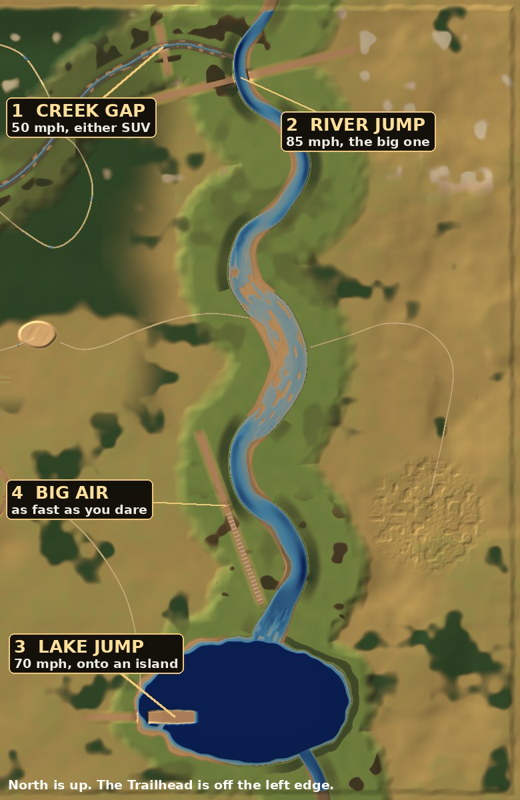

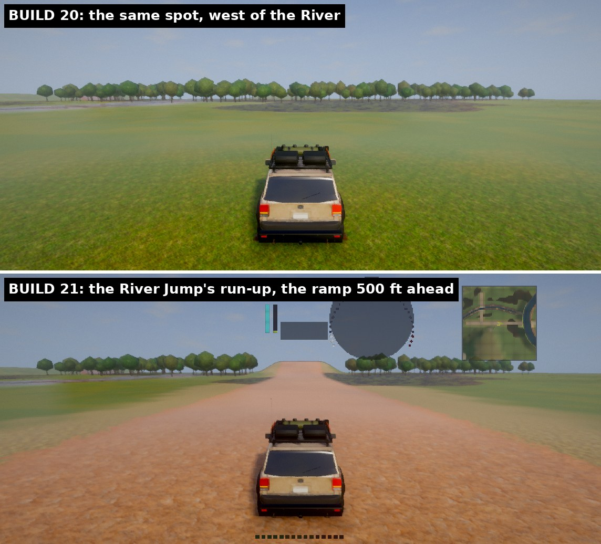

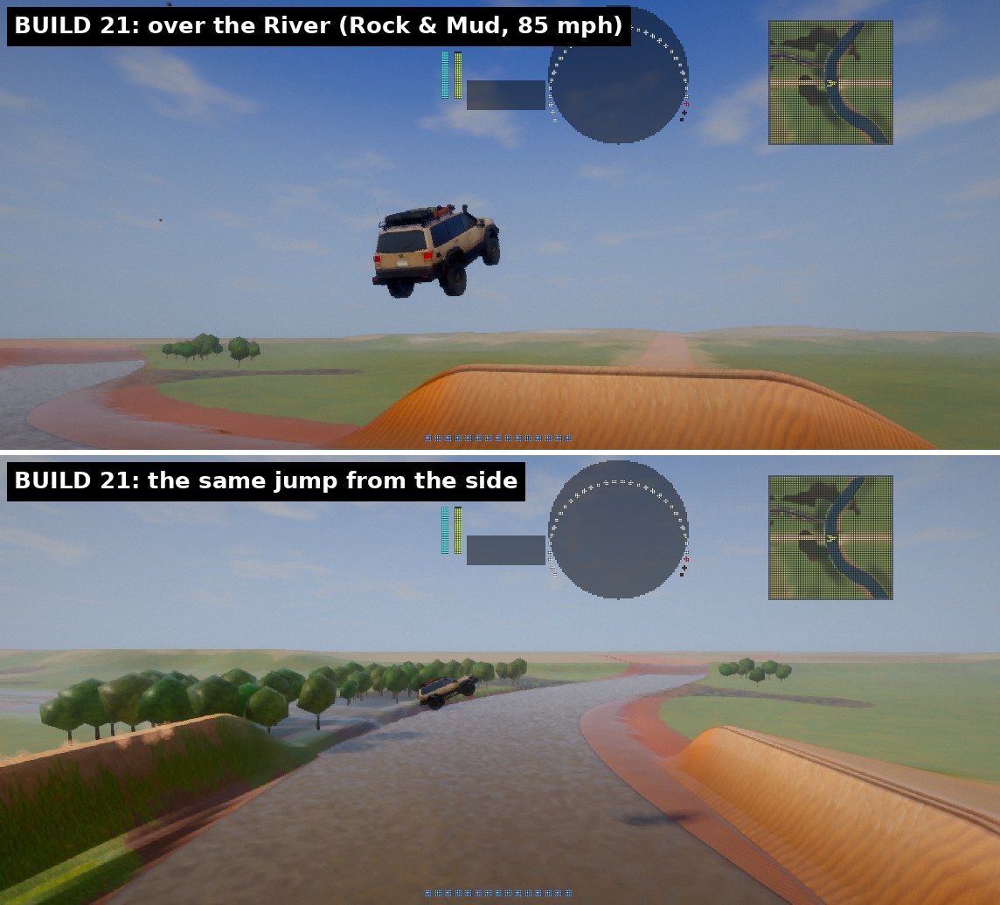

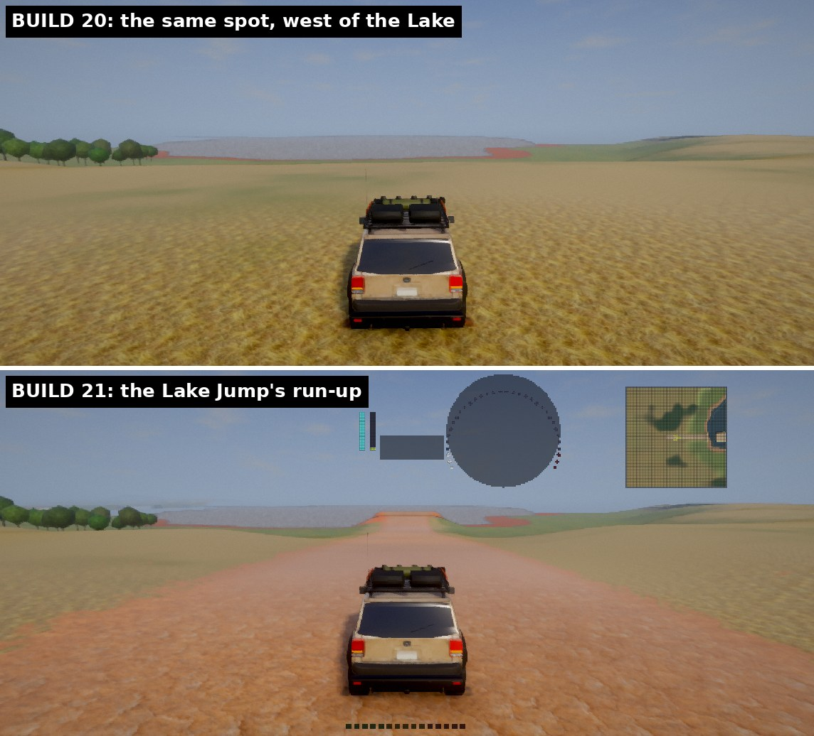

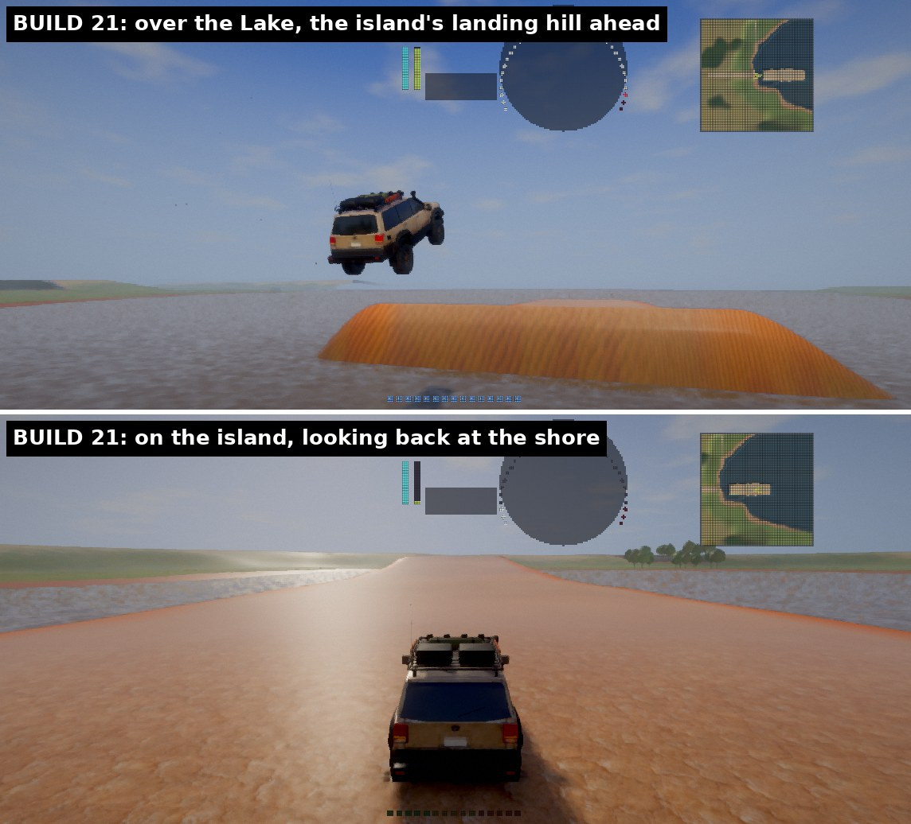

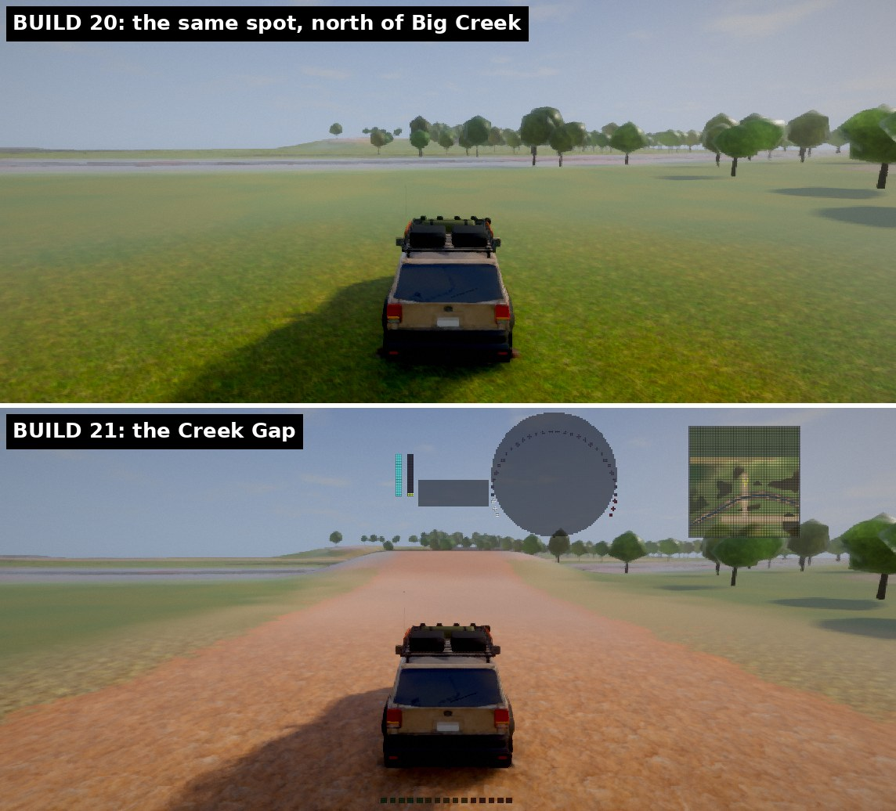

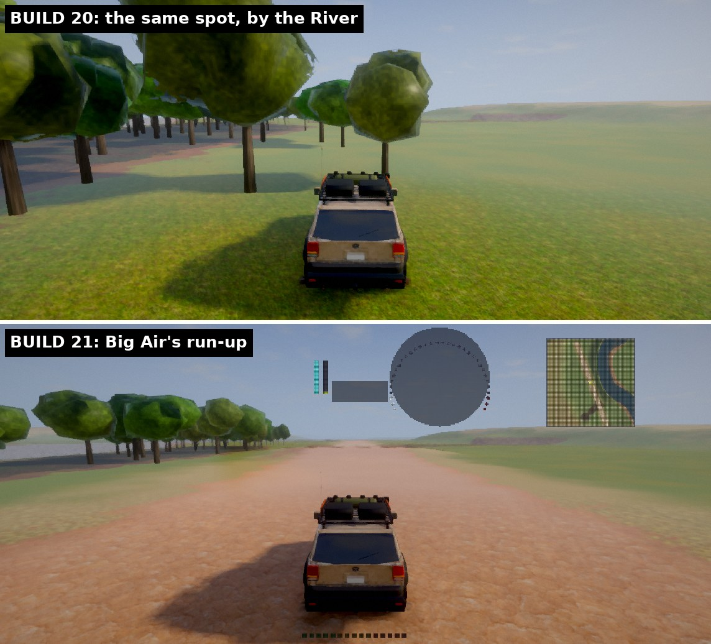

### 3. In the air over water is not in it (`src/ml-soil.js` mlWater)

The first jump over the River: the Rock & Mud left the lip at 152 mph, rose 60 ft as it should, and came down 26 ft
further on. The water's drag was worked out from how deep the water is over the ground under the SUV, whatever height
the SUV was at; over 6 ft of river that is a wall. Nothing had ever been over water without being in it. Now, with all
four tyres off the ground and the lowest of the SUV clear of the surface: no drag, no lift, no bow wave. Anything else
is exactly as it was (the rule did not fire once in a drowned SUV's winch-out of the Lake).

### 4. A line when you land (`src/ml-menu.js` mljTick)

Not points yet: the measure they would be made of. Any time all four tyres are off the ground for 0.7 s or more and the
SUV went 30 ft or more: one gold line as it touches down, "IN THE AIR 2.2 S: 256 FT". For a named jump, taken from its
own ramp, landed on its wheels on the far side: the longest so far for that SUV is kept ("RIVER JUMP: 256 FT. YOUR
FIRST" / "YOUR LONGEST") and shown beside the jump in THINGS TO DO. It also speaks on the Track's table-tops and after
the sky-yank. No new button. A reset, a tow or the map setting you down somewhere is not a flight (the first try credited
the Rock & Mud, reset off its roof to the far end of a lane, with a 1,252 ft jump).

### 5. Checks

| | |
|---|---|
| The first map's ground (`tools/world/dump.js`, every 13 ft) | identical: 147,456 of 147,456 points |
| The same seven drives, Build 20 and Build 21 (`tools/test/ml-same.py`) | 7 of 7 the same, to the last digit (speed, place, ruts, soil dug, clods) |
| The sky-yank (`tools/test/ml-yank.py`) | still there: 268 mph at its fastest, thrown 67 m, 5.2 s off the ground |
| The ground's shader (`tools/test/ml-shaders.py`) | not touched: landSoil 487,142 (phone) and 500,740 (laptop) as Build 20, 16 samplers, no errors |
| Triangles at the jumps, phone (`tools/test/ml-views.py`) | 163,500 to 183,200 at the nine views of the jumps (Build 20 at the same four run-ups: 168,000, 169,400, 178,300, 169,200; Build 21: 163,500, 168,200, 180,100, 176,000). The whole map open: 213,400. Laptop, over the River: 252,800 |
| Laying out the ground at the title (`tools/test/ml-prep.py`) | the same: the layer full 8.2 s after the page opens (Build 20: 8.3 s). Its fingerprint is new, as it must be (the new ground changed) |
| Every name on the map (T9.jumps) | all 34 land upright; THE LAKE in 10 ft 7 in of water at its name (as asked), every other name dry; each jump's name at the start of its run-up, facing its ramp; in Real THE LAKE's arrow leads to the beach |
| Build 20's 17 water and first-map tests, same list, same order, both builds | 14 of 17 identical. Two differ as they should: RESET from the middle of the Lake now finds the island, and the Track lap (the same 181.7 s) now has landing lines. One differs and is not explained (see the limits) |

### 6. Limits, and what is not known

- Nothing has run on his phone or laptop. The jumps have only been seen as still pictures; the landing line has only
  been read off the test's log.
- **The speeds that land are narrow, and the Rock & Mud is the touchier of the two.** On the River it landed at 82 and
  88 mph and rolled at 85 (it leaned in the air). The stock SUV, flat out from the start of a lane, landed every
  jump in every run.
- The stock SUV wobbles on Big Air's flat landing at 80 mph (it stayed on its wheels in both runs).
- The landing line also speaks for small hops (anything over 0.7 s and 30 ft). Whether that is fun or noise is his call.
- RESET for a SUV drowned in the middle of the Lake now sets it on the island (the nearest dry ground: 680 ft away,
  where the shore was 815 ft).
- One of the 17 water tests is not the same in both builds and I did not find out why: the Rock & Mud's winch-out of
  the Lake, run straight after the stock SUV's from the same spot, takes a slightly different path half way up the
  bank when the island exists (out of the water after 46 s either way). Run by itself it is identical. Traced step by
  step: the ground, the soil, the particles, the SUV and the winch are the same to the last digit until the step where
  they part, and none of this build's rule changes fire. (That test already gave a different trace by itself and after
  another test in Build 20: drives in one page are not fully independent.)

## Mud Lab 20 (Nov 13 2026): a polish pass: the Lake's edge, the winch under water, a choking engine, a camera that goes under, and a pop-up out of the water

His words after driving Build 19 (Nov 13, 20:39): "This is really good. My first edit though is if you use the map to
jump to the lake, you jump to the middle of the lake. So you should jump to the edge of the lake, not the middle of
the lake. Also, the ability to winch yourself out isn't popping up once you've disappeared under the lake. So I think
we need to do a polish pass, UI polish pass."

(20:41) "Can you also make it to where when you do fully submerge under the water you can switch wheel cam and
actually see the SUV underwater. And when it does submerge I think that it should like take a moment like vehicles do
in real life, and so the stock SUV's tailpipe can go below the water but it's the intake that can't go below the
water, and then the Rock and Mud SUV with its snorkel can go until the snorkel goes below water, and then once it does
go below water it like chokes the way an engine would, not just dying immediately."

(20:46) "Also, another thing to check. Similarly to when it used to roll over and like pop up and bounce erratically.
When you're in I think very mucky stuff and you're moving the soil around beneath the SUV, sometimes the SUV can like
pop up out of the water kind of intensely."

Builds 15 to 19 are as they were. Nothing in the ground's shader was touched; the world's ground is the same to the
last digit (the layer's fingerprint is Build 19's: `tools/test/ml-prep.py`).

### 1. The map sets you down at the edge (`src/ml-heron.js` mlvArrive)

The Lake's name stands in the Lake's middle, 235 m from the nearest shore. The search for a dry spot near a name gave up
200 m out and set the SUV down where the name was: in 3.2 m of water. In Real the guide arrow led to the same spot.

Now a name has a landing, and JUMP and the guide arrow both use it: the Lake's is the beach where the Lake Road comes
to it; for any other name on the new ground the search goes on to 640 m, takes the dry spot nearest the Trailhead of
those the same distance out (the bank you would drive to, not the far one) and stands 8 m back from the edge; a
water's or a ford's name that stands on dry ground itself faces you at the water. The first map's names are found
exactly as they always were.

All 30 names, jumped to one after another (`tools/test/ml-drive.js` T9.jumps): every one on dry ground, upright, and
its arrow leads to dry ground. THE LAKE: the beach, 413 m from its name.

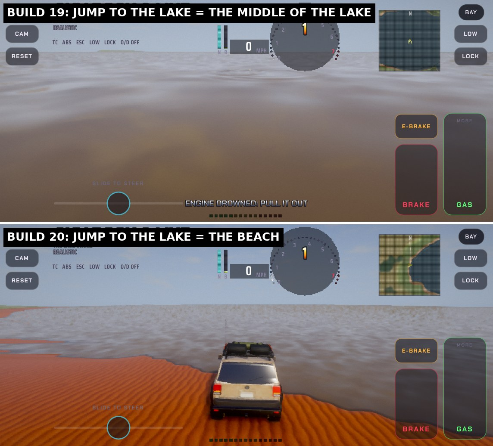

### 2. A drowned SUV can be got out (`src/ml-recover.js`)

Why no WINCH came up: the button waits for "bogged", and bogged was only ever "two seconds on the gas, going nowhere".
Nobody holds the gas on a dead engine. (Build 19's own test set "bogged" by hand before it looked for the button, so
it never saw this.) And RESET, which in Free play sets a bogged SUV on firm ground, looked for that ground 60 m round,
then 200 m, and then stood the SUV up where it lay: under the Lake.

- **A drowned SUV is bogged from the moment its engine dies.** The button, RESET and the map's tow home all follow.
- **Off the beach there is no tree. For a drowned SUV only, the winch also takes a ground anchor on the bank**
  (`mlrShore`): as far up the bank as the 30 m line reaches from a hook, as nearly in line with the SUV as there is.
  A tree in reach is still taken first. Nothing changes for a SUV that is merely bogged.
- **RESET** (Free play) for a drowned SUV: firm ground within 60 m as before; failing that, the nearest shore, however
  far.
- In Real, out past the line's reach, there is the strap and the tow home, as before. His question from Build 18
  (must a drowned truck in Real always be recoverable?) is still open.

`T9.drown`: into the water under its own power at about 8 mph, then what the game offers, read as it stands:

| Drowned where | Build 19 | Build 20 |
|---|---|---|
| Stock SUV, off the west beach (no trees) | drowned; not "bogged"; nothing offered | misses 2.4 s in (5 m out), dies at 5.4 s (10 m out, 2.7 m of water). WINCH: a ground anchor on the bank, 92 ft behind. Out of the water 40 s into the pull, the engine running again at 41 s, line off on dry sand at 56 s. Hardest pull 41 kN (the winch's most is 42) |
| Rock & Mud, off the west beach | the same: nothing offered | misses 3.2 s in (8.5 m out, 2.2 m of water), dies at 6.2 s (12 m out, 3.1 m). WINCH: an anchor 93 ft behind. Engine again at 22 s, out of the water at 46 s, line off at 56 s; 28 kN |
| Rock & Mud, off the wooded east shore | a tree in reach, and still nothing offered | WINCH: a tree 89 ft behind (a tree is taken first). Engine again at 19 s, out at 43 s, line off at 53 s; 32 kN |
| Stock SUV set down in the Lake's middle (where JUMP: THE LAKE put it) | under 3.2 m of water, drowned | nothing in reach, no button. RESET: on the shore 248 m away, upright, dry, engine running |
| Stock SUV through the Pond's middle (first map) | bogged, engine running | drowned 35 m in, in 1.1 m. WINCH: a tree 95 ft behind; engine again 33 s into the pull |

The map's own tap, as a finger does it (WHOLE MAP, THE LAKE, JUMP): on the beach at (838, 1900), dry, "The lake
shore". In Real the same tap sets the arrow to that spot, on dry ground.

### 3. The engine chokes before it drowns (`src/ml-soil.js` mlDeep, mlCough)

**Where the air goes in, measured on the two models** (their points, in Node): the stock SUV's hood is 1.07 to 1.17 m
off the ground, and it breathes from under the hood's front edge: 1.05 m (3 ft 5 in). The Rock & Mud's snorkel mouth is
on the windscreen pillar at 2.05 m (6 ft 9 in); its roof is 2.27 m. Where that point is against the water is worked
out from the body as it lies, so a SUV nosing down a bank puts a front intake under sooner. Build 19 had both over the
SUV's middle, the stock SUV's at 1.55 m (the top of its doors). A tailpipe under water is a running engine.

**Choking:** the intake under for a third of a second and the engine starts to miss: the engine's own fuel cut, a miss
at a time (so the sound is the engine's own misfire), longer and closer together as it swallows more, the revs
sagging with each one. A line says WATER IN THE INTAKE: THE ENGINE IS CHOKING (IN THE SNORKEL, on the Rock & Mud).
Three seconds of that and it dies. Get the intake clear first and it coughs for as long again and clears (IT COUGHED THE WATER OUT).
Dead, it stays dead until the intake has been 30 cm clear of the water for two and a half seconds; then it starts by
itself, and coughs once more.

**The cab** fills in six seconds once the engine has drowned and drains in eight once it runs again. (Build 19 gave all
the water's lift back at the instant the engine restarted: a jolt upward on the way out.)

The River's fords again (`T9.ford`, straight across at a steady 9 mph), with how near the water came to the intake:

| Ford (deepest water on the line) | Stock SUV, Build 19 | Stock SUV, Build 20 | Rock & Mud, both builds |
|---|---|---|---|
| the Shallows, three places (26 to 32 cm) | across | across; intake 61 to 67 cm clear | across |
| first ford north (56 cm) | across | across; 48 cm clear | across |
| second ford north (64 to 70 cm) | bogged 40 m out | bogged 40 m out; 7 cm clear, engine running | across |
| third ford north (81 to 113 cm) | bogged 29 m out | bogged 29 m out, **and drowned** (intake 18 cm under) | bogged 54 m out; snorkel 59 cm clear |
| first ford south (47 cm) | across | across; 54 cm clear | across |
| second ford south (85 cm) | bogged 29 m out | bogged 29 m out, **and drowned** (21 cm under) | across, down to 4 mph; snorkel 84 cm clear |
| third ford south (104 to 126 cm) | bogged 33 m out | bogged 32 m out, **and drowned** (43 cm under) | bogged 100 m out; snorkel 42 cm clear |

Every ford either SUV crossed, it still crosses. Where the stock SUV bogs in water over its hood, it now drowns too.

**What this changes on the first map.** The Rock & Mud: nothing (its snorkel is where Build 19 had it). The stock SUV's
intake is half a metre lower than Build 19 had it:

| On the first map, the stock SUV | Build 19 | Build 20 |
|---|---|---|
| The Bog at 0.6 throttle (`T9.bogRun`) | 105 ft in 18.2 s | 105 ft in 18.2 s; intake never nearer the water than 38 cm |
| The Bog flat out in 4 LO | 102 ft in 13.9 s | 102 ft in 13.9 s; 39 cm clear |
| The Mud Hole: stopped in its middle, then flat out | does not get through | does not get through; 21 cm clear at the nearest |
| Lower Ford on Big Creek | bogs | bogs 49 m in; 29 cm clear |
| **Straight through the Pond's middle (1.06 m)** | bogged 34 m in, engine running | **misses 32 m in, in 98 cm of water; drowned 3 s later.** A tree is in the winch's reach |

The Rock & Mud through the Pond: across, as before; its snorkel 50 cm clear.

### 4. Under the water with a camera that is on the SUV (`src/ml-soil.js` mlCamDry, mlUnderEnv)

Build 19 held every camera 70 cm over the water. The Wheel cam, the Hood and the Cockpit now go under with the SUV
once the water is deep over them: more than 55 cm over the camera's eye (and they stay under until it is less than
35 cm). The Film camera does the same while it is on one of them; every other camera stays above, as it was. An eye
under a water's surface looks through muddy water: the engine's own light-in-the-air pass with its haze made about a
hundred times thicker and brown, the sun's beam cut to a tenth, the sky's light to a half and browner the deeper the
eye is, the sky itself the same mud. The SUV 15 ft away is seen dimly; nothing is seen past about 30 ft. One swap in
`src/build.py` (the frame's environment handed to `mlUnderEnv` after the engine has worked it out); nothing added to
any shader.

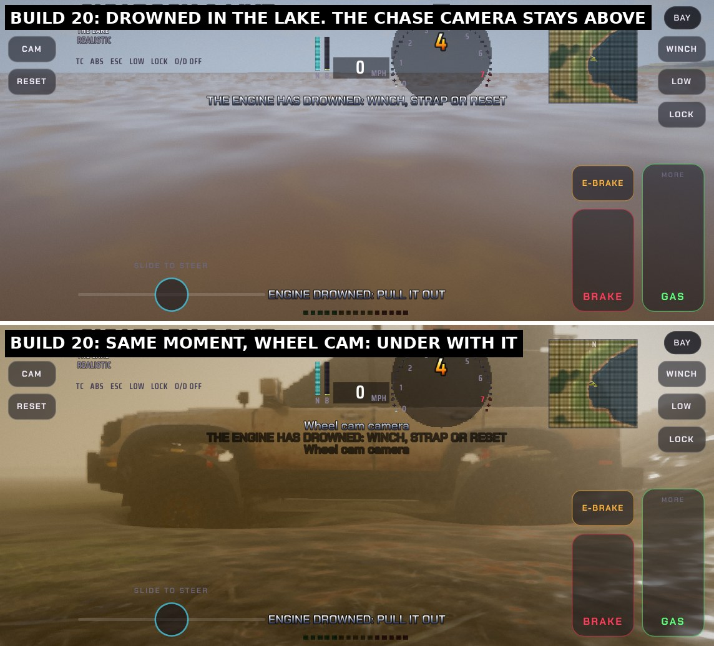

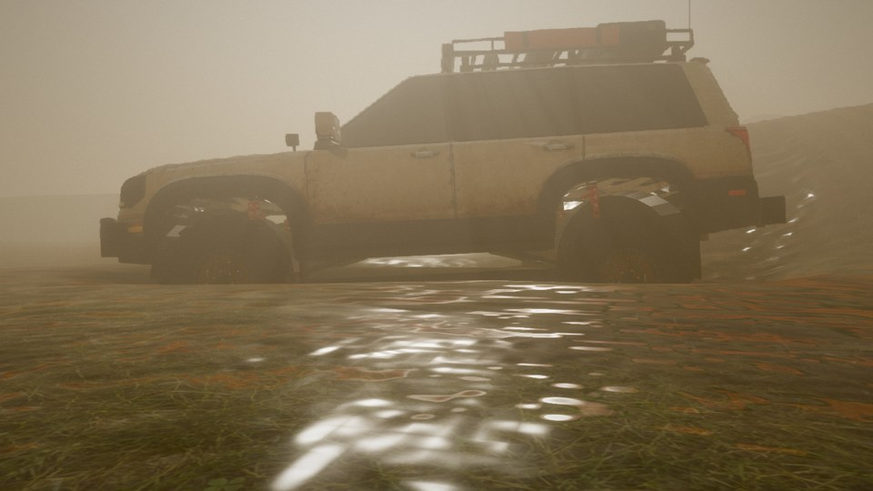

**In water shallower than that over the eye the camera is held over the surface, as Build 19 held it.** A first try
let the eye under as soon as it was under at all: in the Mud Hole (75 cm of water, the Wheel cam's eye 72 cm up) the
eye sat just under a surface that is not drawn from below, and the SUV stood in what looked like no water. The Wheel
cam's eye is 72 cm off the ground, so it goes under in water over about 1.3 m: nowhere on the first map (its deepest
is 1.15 m). On the first map every camera is where Build 19 had it.

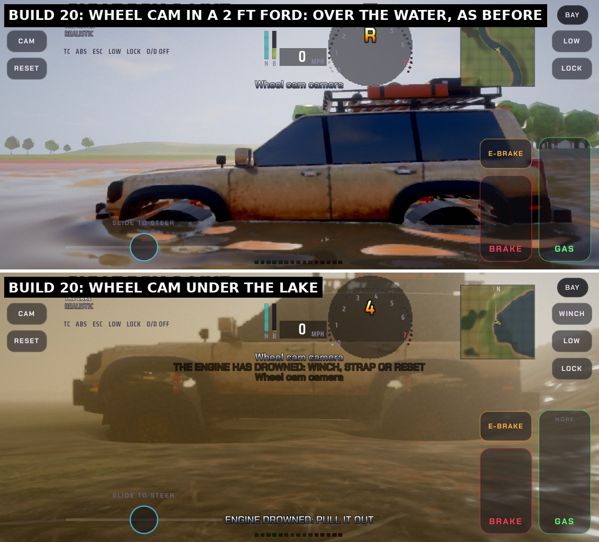

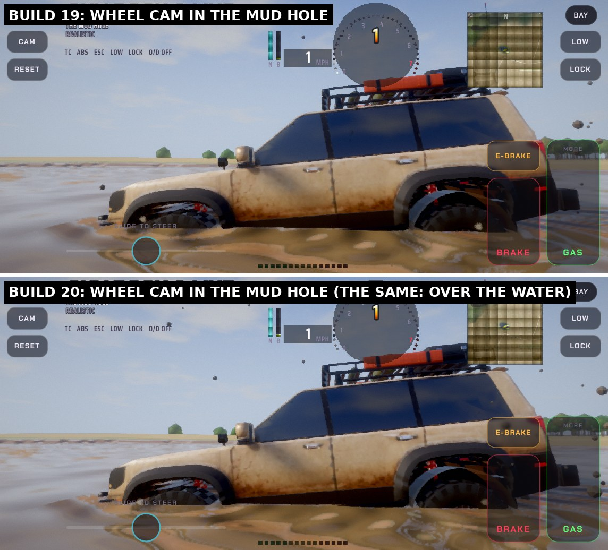

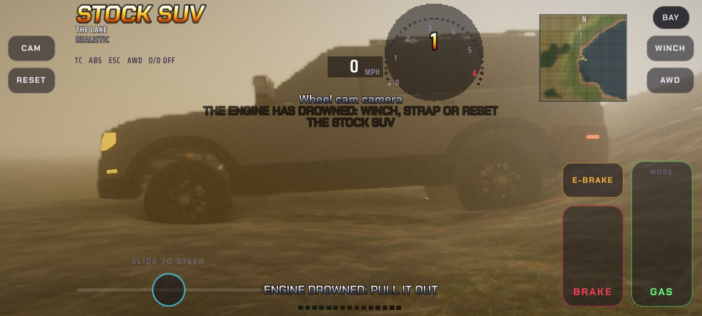

### 5. Popping up out of the water (`src/ml-soil.js` mlWater)

Caught in the Bog's last pit (`T9.churn`: in, stop, then rocking flat out with the wheel swung from side to side),
Build 19, the Rock & Mud in 1.2 m of water: the pit's wall kicked it up at 3.6 m/s, and it then hung in the air for
3.4 s with its sills 2.2 m over the water, and rolled over up there.

The water's lift on the body was worked out from how deep the water is over the ground under the SUV's middle,
whatever height the SUV itself was at. In that pit it is two thirds of the Rock & Mud's weight; and it went on being
two thirds of its weight all the way up and out of the water, so the SUV fell at a third of gravity. Deeper water is
worse (85% of its weight from about 1.1 m for the stock SUV, 1.5 m for the Rock & Mud), and Build 19 added a river
and a lake of it.

**With a tyre on the ground the lift is exactly as it was** (the Bog's marks and every crossing depend on it). **With
none on the ground it is for the water the body is really in.** A first try, the lift for the body's real depth at all
times, was right on paper and changed the Bog: his SUV stopped 8 m sooner in it. Taken out again.

| `T9.churn`, the same drive in both builds | Build 19 | Build 20 |
|---|---|---|
| **The Bog, Rock & Mud, 90 s of rocking flat out.** Highest its sills came over water 70 cm deep or deeper; longest with no tyre on the ground; most it leaned | 216 cm (over 1.2 m of water); 3.4 s; 124 degrees: over | 5 cm; 0.75 s; 37 degrees, on its wheels throughout |
| The Bog, stock SUV, the same | went in 38.82 m; kicked at most 2.9 g; leaned 20 degrees at most | the same three numbers to the digit (it never left the ground) |
| The muddy water above the Lake, Rock & Mud, 2 min | sills 20 cm over the water at most | the same numbers to the digit |

(The last two rows are from the same list of drives run on Build 19 and on this build's page before the changes to
the look and the anchor.)

### 6. The rest of the pass

- **Lines that pile up.** Going under, the screen showed BOGGED, WHEELSPIN DIGS YOU IN and UNDER WATER at once. Now
  the bogged lines are not said over a choking engine and are cleared when it drowns: one line, in gold.
- **A line too long for a phone.** The laptop's "the ground's detail is still being built by the graphics driver" line
  is 128 letters; a phone's screen holds about 105. A phone gets a shorter one. The three longest THINGS TO DO lines
  were shortened too.
- **The corner's place name on the River's banks.** The Shallows is 130 m wide, and its own bank read "Open country".
  The River's names now hold for 45 m back from the water's edge.
- **Checked and left alone:** the title at a phone's size (START all on the screen: `tools/test/ml-title.py`); the
  Track's lap clock (a lap at 36 mph ends with THE TRACK IN 3:01. YOUR FIRST TIME, and the time is kept); WHOLE MAP
  beside the map's MENU and JUMP.

### Checked

| | |
|---|---|
| Same seven drives, Build 19 against 20 | 7 of 7 the same, no page errors. That was run on the page before the last two changes (the camera's rule for shallow water, and one line's wording); that page against the one sent: 7 of 7 the same, no page errors |
| The world's ground (the layer's fingerprint, nine arrays) | Build 19's exactly |
| landSoil (not touched) | 487,142 characters on the phone's tier, 500,740 on High, 16 samplers: Build 19's. No errors or warnings |
| The sky-yank (`tools/test/ml-yank.py`) | still there: 268 mph, thrown 67 m, 5.2 s off the ground |
| The stock SUV on the first map, the same list of drives on both builds | the Bog at 0.6 throttle 105 ft in 18.2 s on both; the Mud Hole the same to the digit on both |
| The winch off the west beach, on the page as sent | the same numbers to the digit as on the tested page |
| All 30 names on the map (`T9.jumps`) | every landing dry and upright; every arrow to dry ground |
| Triangles at a phone's size, under the Lake | 147,000 to 181,000 (the cameras that go under draw nothing more) |
| Under the Lake on High (a laptop window) | the Wheel cam: `docs/shots/mud-lab-20-under-laptop.jpg`; 254,286 triangles |
| Page errors | none in any run |

### Not done, and limits

- **Nothing here has been run on his phone or laptop.** The under-water look most of all: it has only been seen in
  software graphics, as still pictures.
- The choke is heard through the engine's own misfire; I have not heard it, only watched the revs.
- Backing out when the engine first misses: on the Lake's drop-off and bogged in a deep ford it did not work in the
  tests (the SUV was already sliding in, or already stuck). Off the Lake's beach at a walking pace it did not work
  either. So the line does not say BACK OUT: it says THE ENGINE IS CHOKING.
- A drowned SUV out past the winch line's reach in Real has the strap and the tow home only.
- The bank anchor was tried at the Lake's west beach only (in the Pond a tree was in reach and was taken); not on
  steep banks.
- The pop-up: one case caught and fixed. The kick itself (a pit's wall at full throttle) is still there, as it always
  was; the SUV now comes straight back down from it. If it still pops, where and in which SUV would find the next one.
- The map's header still runs under the SUV's name on a phone (it has since Build 10), and the names round the
  Trailhead still overlap in a laptop window.
- Ragged rut edges and berms as real shape, and mud on the body and tyres: still parked.

## Mud Lab 19 (Nov 13 2026): four times the ground: a river to read, a lake to drown in, a track

His words (Nov 13, 14:52): "4 times the area, so you're only doubling length and width. So I want the areas to be like
interesting and new and unique. I know I want there to be like maybe a lake edge or just a deeper pond that you can
get bogged all the way down in, a wider river crossing that you have to cross strategically. Maybe there's like a big
chunk that is like clear you can cross just straight across like anywhere, and then like it gets harder and harder to
cross the further up or downstream you go. Less woods, more interesting ground bits, like maybe it looks like a dirt
bike or HEV trail. There's like hills and mounds. And like banked turns and stuff. Could we put that in an area?"

And: "just so it doesn't get removed, there's a feature that is not a bug. It is so fun. While you're attached to the
like pull strength post, if you don't detach and say get in the other vehicle, it yanks it across the sky super fast,
and it's outrageously fun, and I love it. It might technically be a bug, but it's a bug that's staying."

The thinking behind the river is the packet's map brief (`claude/mud-lab-map-brief.md` in the Project: how a river on
soft ground lays itself out, and what that means for where a truck can cross).

Builds 15 to 18 are as they were.

### The map: 3,072 m a side, the old map its north-west quarter

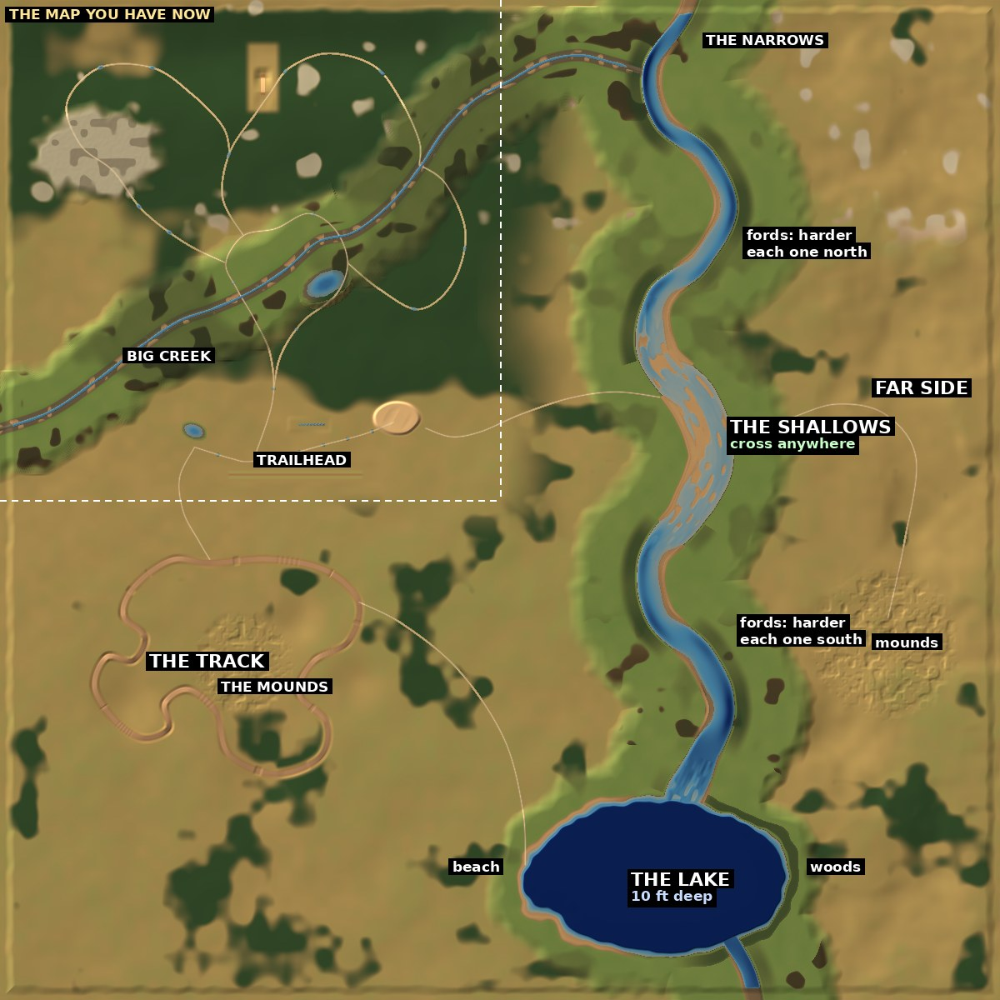

The square grew east and south from the same corner. So every place on the first map is where it was, with the
numbers it had: the ground's height, soil, moisture, water, sod, woods and trails are the same to the last digit at
138,386 of 147,456 points; the 9,070 that differ are all in the removed bank's zone or at the two road starts (120 of them inside the old map proper, the road starts) (`tools/world/dump.js`: every 4 m of the old square, Build 18's file against this one's). What changed there:

- **the bank along the old east and south edges is gone** (it would have stood between the old ground and the new), so
  the ground within about 50 m of those two edges is different;
- **two new two-tracks leave the old map:** the River Road from the Quarry's east rim, the Track Road from the Field
  Track's west end;
- the old map's woods run on east past the old edge and thin out unevenly, so they don't stop on a ruled line.

Nothing graded is near any of it: the same seven drives as ever, Build 18 against this one, come out **7 of 7 the same**.

**The new ground** (`src/ml-world.js`, MUD LAB 19; less wooded: a grove here and there in open rolling country):

| Place | What it is |
|---|---|
| **The River** | 3.1 km from the north edge down the east to the Lake; Big Creek runs on east into it. It swings from side to side. On the outside of each bend: a deep pool under a steep cut bank, trees along the bank's top. On the inside: a sand bar. Between two bends: a riffle, wide, shallow and firm: the ford |
| **The Shallows** | 600 m in its middle where it spreads to 120 to 140 m of shin-deep water over firm sand, with bars and islands: cross anywhere |
| **The fords** | every riffle up or down the river from the Shallows is deeper than the one before (and downstream the bed gets muddier), until it can't be crossed: the Narrows at the north, the muddy water above the Lake at the south. Table below |
| **The Lake** | 780 by 470 m. A firm sandy shelf round the edge, wading depth for 9 m (30 ft); then it drops away to 3 m (10 ft) of water over soft muck. A sand beach on its west shore; woods along its east shore, to winch out to |
| **The Track** | south of the Trailhead: a 2.9 km (1.8 mile) dirt loop, 10 m wide, over knolls (12 m of climb and fall). Every bend is banked, with a berm standing on its outside; four table-tops (1 to 1.8 m high), four rows of whoops, three kickers, a step-up. THINGS TO DO > THE TRACK times a lap and keeps each SUV's best |
| **The Mounds** | in the Track's middle, and a bigger field on the Far Side: lumps 2 to 3 m high, 25 m apart, smaller ones between |
| **The Far Side** | east of the River: open hills, reached by the Shallows |
| **Four two-tracks** | the River Road (Quarry to the Shallows), the Track Road, the Lake Road (Track to the beach), the Far Side Road |

### The fords, driven (`tools/test/ml-drive.js` T9.ford: straight across from the west bank at a steady 9 mph)

| Ford | Deepest water on the line | Stock SUV, 4 HI | Rock & Mud, locked |
|---|---|---|---|
| the Shallows, middle | 26 cm (10 in) | across; slowest 7 mph, tyres 22 cm down | across; slowest 8 mph, tyres 26 cm down |
| the Shallows, north end | 32 cm (13 in) | across; slowest 6 mph, tyres 28 cm down | across; slowest 8 mph, tyres 23 cm down |
| the Shallows, south end | 27 cm (11 in) | across; slowest 7 mph, tyres 28 cm down | across; slowest 8 mph, tyres 25 cm down |
| first ford north | 56 cm (22 in) | across; slowest 6 mph, tyres 45 cm down | across; slowest 8 mph, tyres 39 cm down |
| second ford north | 70 cm (28 in) | **bogged** 40 m out, tyres 44 cm down | across; slowest 7 mph, tyres 40 cm down |
| third ford north | 113 cm (44 in) | **bogged** 29 m out, tyres 46 cm down | **bogged** 54 m out, tyres 83 cm down |
| first ford south | 47 cm (19 in) | across; slowest 6 mph, tyres 18 cm down | across; slowest 8 mph, tyres 16 cm down |
| second ford south | 85 cm (33 in) | **bogged** 29 m out, tyres 48 cm down | across; slowest 4 mph, tyres 48 cm down |
| third ford south | 126 cm (50 in) | **bogged** 33 m out, tyres 51 cm down | **bogged** 100 m out, tyres 79 cm down |

His words were "a big chunk that is clear you can cross just straight across like anywhere, and then like it gets
harder and harder to cross the further up or downstream you go": the table is that, measured.

The first try had the Shallows up to 48 cm deep at its north end and the stock SUV bogged there (it sinks its tyres 25
to 45 cm into wet sand as soon as it slows and spins). The Shallows is now 23 to 33 cm at its deepest anywhere, and
the first ford each way about 45 to 55 cm.

### The Lake: deep water (`src/ml-soil.js` mlDeep)

**New rule: the engine drowns.** With the water over the engine's air intake for more than half a second the engine
stops, and it stays stopped until the SUV has been pulled to where the intake is 30 cm clear of the water for two and a
half seconds; then it starts again by itself. A drowned SUV's cab fills: over six seconds the water's lift on the body
falls to under a third, and it settles onto the bottom, into the muck.

**The intakes are put high on purpose:** at the top of the stock SUV's doors (1.55 m over the ground it stands on) and
at the Rock & Mud's roof (2.05 m). The deepest water on the first map is 1.15 m (the Bog's last pit). So nothing on the
first map can drown an engine and its balance is untouched: this is the Lake's rule, and the River's pools'.

| | Stock SUV | Rock & Mud |
|---|---|---|
| Driven in off the west beach at 9 mph | engine drowned 16 m out; at rest 18.6 m out in 2.84 m of water, upright, tyres 31 cm into the muck | drowned 17.5 m out; at rest 19.8 m out in 2.86 m (3.15 m at the deepest), upright, tyres 48 cm down |
| Stood in the deep off the wooded east shore | drowned in 4.4 s, 1.09 m of water over the roof. WINCH offered: 6 trees within 30 m, the nearest 25 m | drowned in 4.2 s, 72 cm over the roof, tyres 41 cm into the muck. WINCH offered: 5 trees, the nearest 26.4 m |
| Winched out (`T9.lakeOut`) | the engine runs again 16 s into the pull (intake clear); out of the water by 40 s; line off at 51 s; hardest pull 26 kN | the engine catches at 16 s; out of the water by 40 s; line off at 52 s; hardest pull 26 kN |

**No camera goes under the water** (`mlCamDry`): an eye that would be under a water's surface (the chase camera
following a SUV down) is held 70 cm over it, looking down at where the SUV is. Air comes up over a SUV that is all the
way under, so there is something to see.

The second of the packet's questions ("must a drowned truck always be recoverable?") he hasn't answered. As built: in
Free play RESET always works; in Real there is the winch (the east shore is wooded for it), the strap from the other
SUV, and the tow home.

### The Track, driven (T9.lap: its middle line followed at a steady speed, lifting for the bends)

| | Rock & Mud, locked, holding 36 mph | Stock SUV, 4 HI, holding 30 mph |
|---|---|---|
| One lap (2,880 m) | 181.7 s | 220.0 s |
| Most it leaned | 23 degrees | 22 degrees |
| In the air | 0.55 to 1.0 s off every table-top, kicker and the step; up to 0.85 s in a row of whoops | 0.2 to 0.5 s off the table-tops and kickers; up to 1.0 s in one row of whoops |
| Furthest off the middle at a feature | 1.1 m | 1.5 m |

Neither went over. (An earlier try at 49 mph in the Rock & Mud: over in a bend 1,546 m round. It is a track for 30 to 40 mph in these.)

The first try had the whoops a dirt bike's size (50 to 60 cm high, 6 to 8 m apart): at 36 mph the Rock & Mud went end
over end in the first row, and the stock SUV was thrown about at 25. They are now a SUV's: 30 to 42 cm high, 9 to
15 m apart.

### What had to grow with the map

- **The soil's store** (`src/ml-soil.js` MLS): 38,400 x 38,400 cells of 8 cm (it was 19,200 each way), still made only
  where a tyre touches. The whole-world layer every 2.56 m is 1,200 x 1,200 (it was 600 x 600): four times the cells.
- **Filling that layer** is still done while the title is up, and it is four times the work. It is now made in bands
  of 48 rows from both ends at once (`mlPrepStep`, `mlPrepWorkers`): up to three background workers (each with the
  world's generator, as the land's own worker has) take bands from the top; the page's own thread takes them from the
  bottom, a few rows at a time. If no worker can be made (or `#noworker` is on the page's address) the page does it
  all. `tools/test/ml-prep.py` times it and takes a fingerprint of every array in the layer:

  | In the test browser (2 cores, software graphics) | Layer full, from the page's start | |
  |---|---|---|
  | Build 18 (a quarter of the cells) | 5.5 s | |
  | Build 19, one worker (all this machine allows) and the page | 8.6 s (the page as sent: 7.9 s) | 14 bands by the worker, 11 by the page |
  | Build 19, the page alone (`#noworker`) | 9.1 s | |
  | Build 19, START pressed the moment the title is up (5 s) | 12.1 s | the first 7 s of the drive without soil |

  The fingerprints are the same all four ways, and the same as the first try's (workers only), so the ground does not
  depend on who made it. **START before the layer is full:** the SUV stands on the land's own ground (the same shape,
  no soil yet), a line says LAYING OUT THE GROUND: THE SOIL IS A MOMENT AWAY, and the soil comes in when it is done
  (the laptop's "still being built by the graphics driver" line waits for the layer, so the two are not said at once).
  On a phone with eight cores three workers should make short work of it; that is not measured.
- **The water** was a square for every 2.56 m cell with water in it, all drawn every frame. The River and the Lake
  would have been about 60,000 more triangles in every frame. It is now one strip for each run of cells along a row:
  3,654 triangles for all the water in the world (Build 18 drew 11,708 for a quarter of the ground).
- **The big map** has four times the ground, and all of it at once is too small for its names on a phone. It opens as
  it always did, a mile across with every name, on the ground round where you are; **WHOLE MAP**, one new button
  beside it, shows all two miles with the eleven main places' names; CLOSE UP goes back.

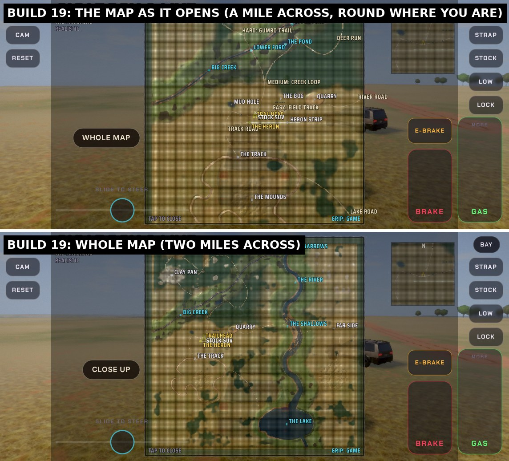

### Two things the Lake showed up

**Wide water mirrored itself.** The first pictures of the Lake had a dull sandy band with a line through it lying
across the water from about 20 to 140 m out. It read as a sandbar. It was the engine's screen reflections: looking low
across level water, a row of pixels spans metres of it, and the first steps of each reflection's ray "hit" the water
beside where they started, so the water there showed last frame's water in place of the sky. The Pond on the first map
has had the same band, smaller (Build 18 draws it so). One line in the reflections' shader (`src/build.py`, MUD LAB 19; not the
ground's shader): a hit on level ground or water at the mirror's own height is no hit, and the pixel takes the sky and
the far shore from the reflections' own picture, as water nearer the eye always did. **This changes how the first
map's waters look from a distance** (the Pond, Big Creek, the puddles: sky in them where the band was).

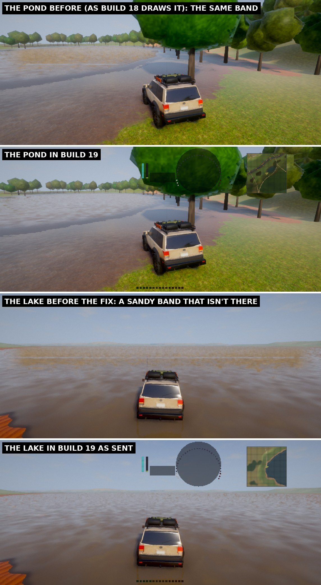

**"TAP GAS TO START" over a drowned engine.** The engine's own blinking line said so while `mlDeep` held the engine
off. It now reads ENGINE DROWNED: PULL IT OUT until the intake is clear.

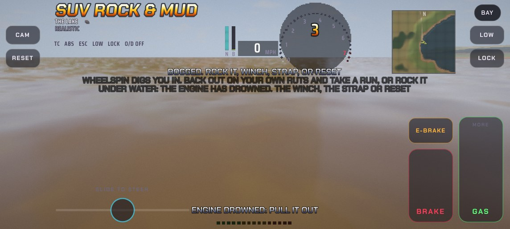

### The sky-yank, kept (`tools/test/ml-yank.py`)

It is this: `mlrSeat` (GET IN the other SUV) takes the winch's line off but not the pull test's. So with the line
still on the post, the line is on the SUV you get into, far too short, and it is thrown at the post. A note at that
line in `src/ml-recover.js` now says it is his and stays, with his words; and `tools/test/ml-yank.py BUILD` hooks the
Rock & Mud to the post, stands the stock SUV 60 m away, gets in it and fails if it doesn't fly. This build: the SUV you get into reaches 268 mph, is thrown 67 m and is off the ground for 5.2 s.

### Checked

| | |
|---|---|
| Same seven drives, Build 18 against 19 | 7 of 7 the same. That was run on an earlier page of this build (md5 6e9ec33a..., before the layer was filled from both ends and before the two things the Lake showed up); that page against the one sent: 7 of 7 the same, no page errors |
| The fords, the Lake and the laps | driven on that earlier page too. The ground's layer has the same fingerprint on both (`tools/test/ml-prep.py`), and the sky-yank was run on both: the same numbers |
| The old map's ground, every 4 m | the same at 138,386 of 147,456 points; the 9,070 that differ are all in the removed bank's zone or at the two road starts (120 of them inside the old map proper, the road starts) |
| landSoil (not touched) | 487,142 characters on the phone's tier, 500,740 on High, 16 samplers: Build 18's. No errors or warnings |
| Triangles at a phone's size | the start 212,468 (Build 18: 226,548); the new places 122,000 to 239,000; the Track's first table-top looking back at the Trailhead with the plane and the other SUV in view: 269,184, the top of what the start has always been with them near |
| Triangles on High (a laptop window) | the start 373,808 (Build 18: 381,862); the Lake 241,142 |
| THINGS TO DO: THE TRACK, THE RIVER, THE LAKE; the Track's name on the map | each sets the SUV down upright and dry at its place with its line of words; THE TRACK starts the clock (2,880 m) |
| The map's MENU (TUNE, CLEAR ALL RUTS, KEYS) with the map's new button beside it | MENU and its nine rows there with WHOLE MAP beside the map, the three tunes picked by real clicks and kept: as Build 18. The tool's CLEAR ALL RUTS and reload steps did not finish inside its 25 minutes in the test browser (they never have: the tool's fault, noted in Build 18's notes); the row is as it was in 17; the KEYS page was not re-run (nothing of it was touched) |
| The Film camera, the card's line, the fly-past (Build 18's check) | 16 cameras, Film the 16th, the card's line, the fly-past 1.018 / 0.983: as Build 18, no errors |
| Page errors | none in any run |

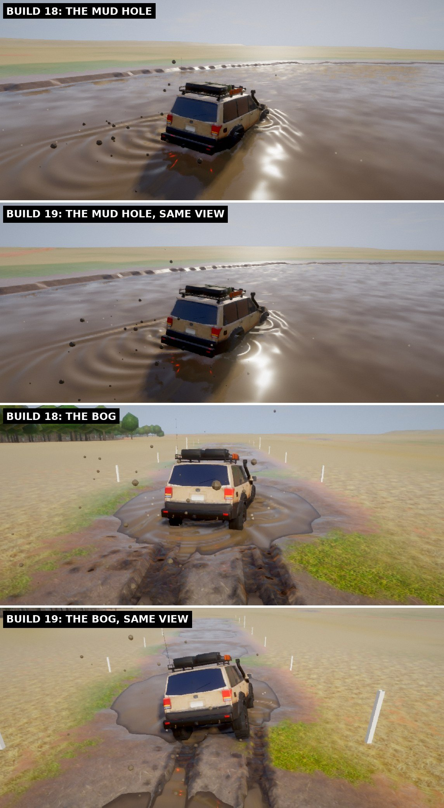

### Not done, and limits

- **Nothing here has been run on his phone or laptop.** How long the layer takes to fill on the phone, with three
  workers, is not known; nor whether the phone minds the bigger store (by my count about 35 MB more than Build 18's:
  the layer's arrays, its two pictures on the graphics card, and the list of soil squares).
- The River's water is flat and still: no current. The right place to cross is a matter of depth and bed only.
- The fords were driven straight across at a steady 9 mph only. A run at it, tyres aired down, a slanted line, the
  winch to the far bank's trees: not tried.
- The Lake's rule covers the engine and the cab filling. Nothing floats away.
- The Track has no start gate, no posts and no lap counter on the screen beyond the timed run's clock.
- A SUV all the way under the Lake can't be seen: the water is muddy from bank to bank. Air breaking the surface and
  the rings round it show where it lies; the small map shows it too.
- The reflections' change was looked at on the Lake, the Pond, the ford and the Mud Hole on the phone's tier, and on
  the Lake once on High (`docs/shots/mud-lab-19-lake-laptop.jpg`: no band), all in software graphics.
- Not re-run on this build: the Heron's HUD check, the hard-turn check and the graphics card's step-down check
  (`ml-hud.py`, `ml-turn.py`, `ml-gpu.py`): nothing they look at was touched.
- The helicopter camera knows ground, not water or trees.
- Ragged rut edges and berms as real shape, and mud on the body and tyres: still parked.

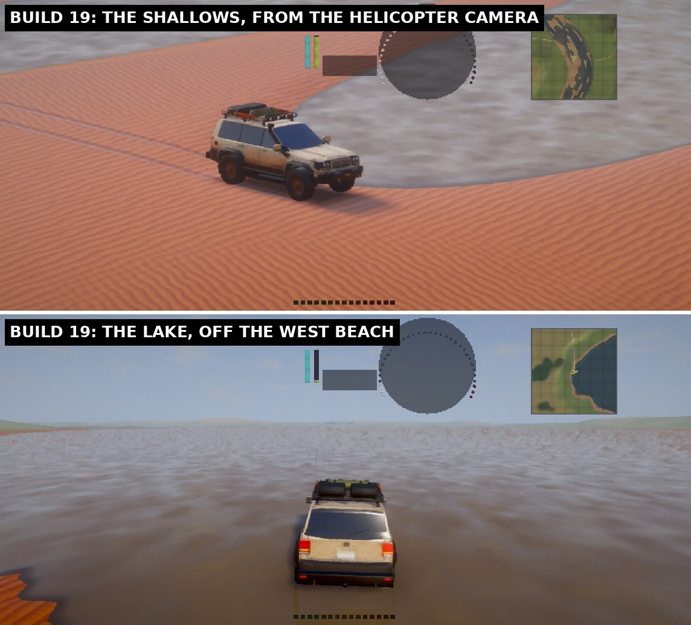

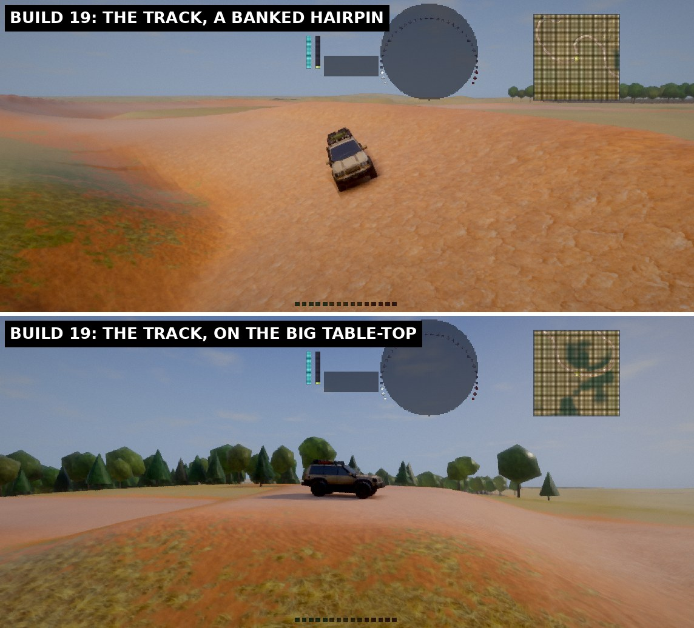

## Mud Lab 18 (Nov 13 2026): the packet: the Film camera, rollovers, the Heron's HUD, the graphics card

His words (Nov 13, 06:03): "there are camera angles in the most recent Salt and Sand that I want to use. And I'm
actually going to bring you a packet of those from that conversation." And with the packet (09:32): "this is next".

The packet (`mud-lab-packet-2026-11-13.zip`; on the branch `packet-2026-11-13-handoff` and in the Project as
`claude/mud-lab-packet-notes.md` and `claude/mud-lab-map-brief.md`) is from the session that was combining Ground
Truth, Mud Lab and Salt & Sand. Four pieces, each a patch of exact text swaps made against Mud Lab 15's page. All 23
swaps fit Build 17's page as they were written. They are now part of the build (`src/build.py`, its last section), not
patches run afterwards. A page made by running the packet's four patches on Build 17 and the page `src/build.py`
makes were held against each other line by line: they differ in the changes listed under each piece below, in a few
comments, in "the car" reading "the truck" in one line of the Settings text, and in a `typeof` test the build doesn't
need.

Builds 15, 16 and 17 are as they were.

### 1. The Film camera (`src/ml-film.js`, Salt & Sand's)

A 16th camera, second on the list after Chase (CAM on the phone, C on a keyboard). It watches what the SUV is doing
and cuts between the engine's cameras and two of its own, the way a car film would:

- **stopped** (a second and a half): a slow walk round the SUV at about waist height (PARK ORBIT, its own);
- **pulling away hard:** the wheel cam, a camera standing just ahead, the tracking car;
- **sliding:** shots that keep the whole SUV in the picture (the helicopter, the orbiting drone, the low drone);
- **under way:** the HELICOPTER (its own: a long lens 55 to 90 m off to one side and 9 to 25 m up, coming slowly round
  from the front quarter to the rear), the low drone, the following drone, the chase camera, the wheel cam, a long
  lens standing far ahead, the tracking car;
- **over 58 mph:** the same with fly-pasts and the drone looking back from in front;
- **in the air:** the jump cam, as on every camera.

Each shot has a shortest and a longest time; the same shot never comes twice running.

**Changed for Mud Lab** (each marked MUD LAB in the file):

- Salt & Sand told its dunes from its highway and flats by asking "north of the highway?". Mud Lab has neither, and
  that line would have split this map in two along an arbitrary line. Here all the ground is rough ground: the dunes'
  shots under 58 mph, the fast ones above.
- The wheel cam joins the rough ground's shots (it was only in "pulling away" and "fast"): the wheels in the mud are
  what this game is about. A pick of mine: say if it should go.
- **In the Heron the Film camera is the Heron's own chase camera.** A film crew's shots (the wheel cam, a camera
  standing by the road) are for a truck. Picture below: the same view from behind the plane on both.

The softer **fly-past sound** came with it (Settings, Dev: "Softer fly-past sound", on unless switched off). Read from
the page: passing a camera standing 20 m away at 67 mph, the engine's note rises 1.8% coming and drops 1.7% going; it
was 9.6% and 8.0%. The sound engine's own listener bends the pitch on top of that, as it always did.

### 2. Rollovers that roll like a truck (Ground Truth build 26's fix, re-pointed for the soil)

The fault he found in Ground Truth on 8 Nov ("flips really hard really fast") is in the engine's wheels, which Mud Lab
shares: a truck rolled onto its side still had its wheels "touching", and the springs and the tyres' side grip pushed
along the axles, which point straight up by then, and threw it back into the air spinning. Now a wheel lets go when
the truck's up and the land's are more than about 70 degrees apart, and carries less from about 52.

Ground Truth's fix as written read the soil's own 8 cm slope, so the wall of a rut counted as a truck on its side (the
packet's count: 215 wheels let go in 9,120 touches on an upright truck in the pond). The packet's Mud Lab version
reads the land under the ruts instead (`mlBroadUp` in `src/ml-soil.js`). That version is the one in this build.

A hard turn at 56 mph on the dry field (`tools/test/ml-turn.py`, from the packet; run here on Builds 17 and 18):

| Rock & Mud | Build 17 | Build 18 |
|---|---|---|
| Steering 0.3 | over at 4.58 s; **4.6 full turns**, fastest 849 degrees a second, 1.28 m into the air, ends on its roof | over at 4.58 s; 2.3 turns, 483 degrees a second, 0.71 m, ends on its side |
| Steering 0.6 | over at 4.65 s; **6.3 full turns**, 1,006 degrees a second, 1.54 m, not at rest 6 s later | over at 4.65 s; 2.3 turns, 461 degrees a second, 0.68 m, ends on its side |
| Full steering | stays on its wheels | the same, to the digit |
| Stock SUV, 0.3 and full steering (27 mph: all it reaches in the test's 3 s) | stays on its wheels | the same, to the digit |

These are the packet's own numbers for Mud Lab 15 and its patched page, to the digit.

Whether a Rock & Mud should go over at all from 0.3 of steering at 56 mph on dry loam is a question about the truck
and the soil, not about this fix: his call.

### 3. The Heron's HUD (Ground Truth's two swaps)

Flying, the HUD still showed the truck's TC / ABS / ESC lamps and a gear number in the rev dial. A plane has neither:
both are gone while you are in the Heron. Picture below (a phone's size; drawn at a laptop's size too, the same).

### 4. The graphics card (`src/ml-gpu.js`, from the combined trial)

- **On a laptop** the title's bottom left corner names the graphics card the page is running on; on a built-in Intel
  card it says how to give Edge the other one.
- **A level above Low that can't hold about three frames a second** for several seconds goes back to Low by itself
  and says why; the next title says what happened. Not on a phone.
- When Windows resets the card under the page, the line no longer says "the phone" on a laptop.
- **Changed for Mud Lab:** on a phone the title stays as it was (one chip, nothing to choose) unless the chip was
  reset last time. His rule: nothing new on the phone's screen unless it is needed.

- **Changed for Mud Lab:** the step down does not count while the soil's shader is still being built, nor for five
  seconds after it takes over. On Windows that build is the browser's slowest job, at the start of every new build,
  and a card busy with it is not a card that can't keep up. This guard was not seen at work: there is no slow Windows
  shader build in the test browser.

**The step down seen working, for the first time** (`tools/test/ml-gpu.py`: the page told it is not a test browser, on
High, where the test browser's software graphics draw a frame every several seconds): after 75 s of driving the page
said "This graphics card can't keep up on HIGH. Going back to the Low graphics level…", started again on Low, and the
title read "Last time this card couldn't keep up on HIGH, so the game went back to Low." That is software graphics,
not a real card that is struggling.

If his laptop ever goes back to Low by itself with that line when the game was running well, that is this piece
getting it wrong: say so and it comes out or gets a longer fuse.

### Checked

| | |
|---|---|
| Same seven drives, Build 17 against 18 | 6 of 7 the same to the last digit. The seventh is the dry field, the drive in which the Rock & Mud goes over (at 4.58 s of its 6.5 s): it ends at 34.37 mph, 21 cm from where Build 17's ended at 34.02 mph. That drive is meant to change: what a rolled truck does is what was fixed. The four soft-ground drives, the stock SUV's two and the Heron's take-off are the same. From here on two builds that both have the fix should show 7 of 7 again |
| The hard turn (above) | the packet's numbers, to the digit |
| landSoil (nothing in the shaders was touched) | 487,142 on the phone's tier, 500,740 on High: Build 17's to the character; 16 samplers |
| The Film camera's shots in the Bog, the Mud Hole and at the pond (`tools/test/ml-views.py`, views `film-*`) | each held and drawn: pictures below; 145,000 to 241,000 triangles (his range) |
| The packet's own check (`tools/test/ml-packet.py`) | 16 cameras, Film the 16th and second in the cycle; the card's line on a laptop-size title, none on a phone-size one; Film picked on a drive at 51 mph; no page errors or warnings |
| The page as sent against the page those runs were made on (one change between them: the step down's guard in `src/ml-gpu.js`) | 7 of 7 the same to the last digit (the dry field with its rollover too: two builds that both have the fix agree) |
| Rebuilt from source in a scratch copy | the same file (md5 d0063c43...) |
| Page errors | none in any run |

### Not done, and limits

- **Nothing here has been run on his phone or laptop.** Nobody has watched the Film camera's cuts while driving: the
  pictures are single shots held still. How the Helicopter does among the trees is for his eye (it climbs over ground
  that is in the way; it does not know about trees).
- The park orbit walks 35 cm over the ground at its lowest. At the pond's edge the picture below is over the water;
  in the deepest water it could be under it. Not tested.
- The fly-past sound was measured, never heard.
- The step down to Low was seen here only with software graphics (above). The card-reset line has only been read.
- Rollovers on side slopes (the Hill Climb) were not tested.
- The HUD's dials drawn only when their numbers change (the packet's one efficiency idea nobody has built): not done.

### The map brief (`MAP-BRIEF.md` in the packet): two questions for him before any of it

1. "Four times bigger": four times the area (3,072 m a side) or four times each way (6,144 m a side)? The second
   brings back the ground-detail seam Build 8 fixed and takes about 16 times as long to fill at the title.
2. The deep pond: must a drowned truck always be recoverable with the winch or the strap, or may it be a place nothing
   comes back from?

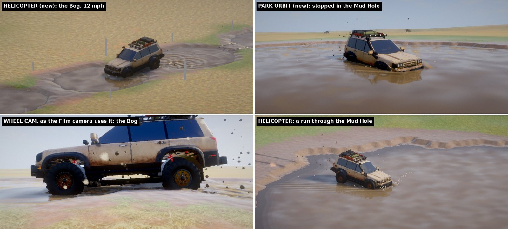
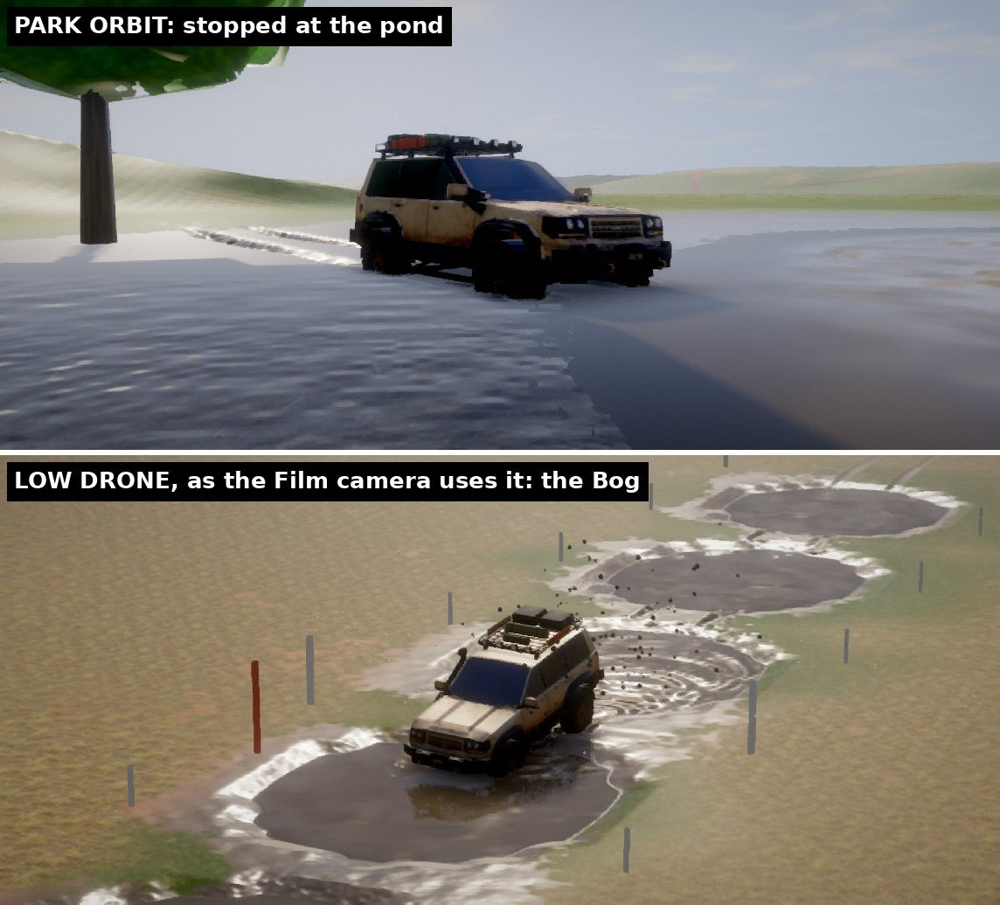
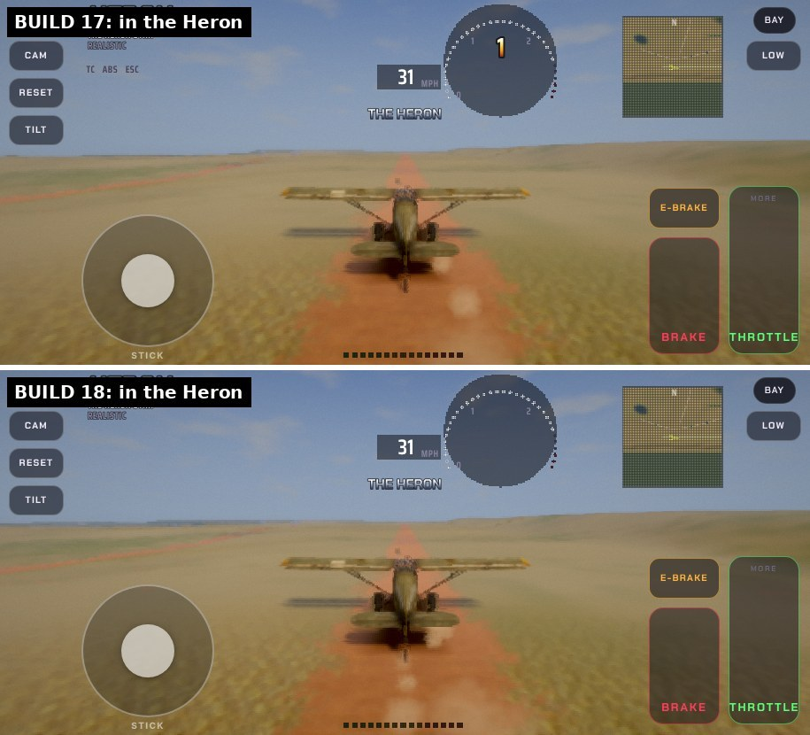

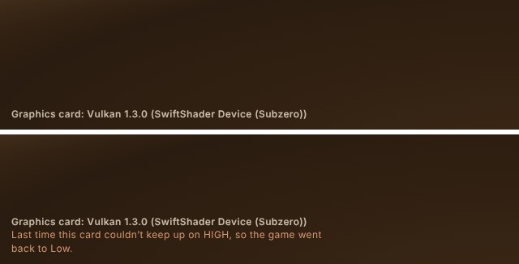

## Mud Lab 17 (Nov 13 2026): the water put right, tunes, CLEAR ALL RUTS

His words on Build 16: "the leaving churn water doesn't work because all the water is muddy anyways and what it looks
like is I'm leaving tire treads on the surface of the water more than churned ... there should be ripples coming off
the tires but also a bow wake. And I think leaving the muddy turned water effect is bad ... So let's remove that".
And for this round: "can we have like tuned presets for the performance part of the vehicle for both the stock and the
rock and mud SUV in the drop-down menu ... that's on the map and then also can we add a clear all ruts button so that
things like making new ruts can be done in free play and also ruts impede your ability to do consecutive hill climbs
and then bogs as well."

The packet from the session that was combining the games came while this build was being checked ("this is next").
**Nothing from it is in this build:** it is Mud Lab 18.

Builds 15 and 16 are as they were.

### The water (`src/ml-look.glsl`, `src/ml-soil.js`)

- **Out:** the darker, lumpy water over a bed the tyres had churned (Build 15) and its settling (Build 16). On water
  that is muddy from bank to bank it read as tyre treads lying on the surface. Water is one surface again.
- **Kept:** the rings off the tyres (Build 16).
- **New: a bow wave** for the SUV you are in. A band of waves trails back from each corner of its leading end (the
  tail's corners in reverse) at 23 degrees, its crests lying across the band, widening and fading along its length.
  It starts at about 1 mph through the water and is full by 8 mph and 20 cm of water; the bands are 3 m long at a
  crawl and up to 14 m at speed; it eases in and out over about a third of a second. Like the rings it is shading on
  the level water. A roll of water ahead of the bumper was tried, could not be seen in any picture, and was left out.

### Tunes: MENU > TUNE (`src/ml-suv.js`, `src/ml-menu.js`)

Each tune is a handful of the engine's own garage parts laid over the SUV as it came, built by the engine's garage
the way the bigger tyres are: the power, the weight, the gears and the sound are the engine's own. Tyres, suspension,
diffs and the body are not touched. The first of each list is the SUV as it has always been (the same build, to the
last digit). The list shows what each comes to; the one the SUV has is lit. Kept for each SUV over a reload. Pick one
stopped (rolling: "STOP FIRST"); in Real only on dry ground and not bogged, as the tyre size.

His SUV gets more power in three steps. The Rock & Mud comes with 2,175 hp, so its two tunes are for control: an
automatic, shorter gears and a crawl box (4 to 1 in low instead of 2.64).

| Stock SUV, 4 HI | Power | 0 to 30 mph | 0 to 60 mph | Speed after 8 s | Hill Climb, floored |
|---|---|---|---|---|---|
| FACTORY (as it came): 4.6 V8, 3.73 gears | 294 hp, 300 lb-ft | 2.5 s | 7.8 s | 61 mph | 49 ft |
| BOLT-ONS: cold air, cat-back exhaust, street tune | 335 hp, 334 lb-ft | 2.2 s | 6.45 s | 66 mph | 52 ft |
| SUPERCHARGED: a blower on the 4.6, 4.10 gears | 474 hp, 477 lb-ft | 1.8 s | 5.45 s | 79 mph | 52 ft |
| 6.2 V8 SWAP: headers, street cam, 4.10 gears | 565 hp, 547 lb-ft | 1.75 s | 4.4 s | 87 mph | 43 ft |

| Rock & Mud, locked | Power | 0 to 30 mph | 0 to 60 mph | Speed after 8 s | Hill Climb, floored |
|---|---|---|---|---|---|
| AS BUILT (as it came): blown 10.4 big-block, race four-speed, 4.10 gears, low 2.64 | 2,175 hp, 1,931 lb-ft | 1.6 s | 3.0 s | 143 mph | 74 ft |
| TRAIL V8: 6.2 V8, automatic, 4.88 gears, crawl box (low 4) | 554 hp, 536 lb-ft | 1.65 s | 4.65 s | 81 mph | 80 ft |
| FACTORY 4.6: the stock SUV's engine, automatic, 5.38 gears, crawl box | 294 hp, 300 lb-ft | 3.05 s | not in 8 s | 58 mph | 53 ft |

On the Heron's strip from a standstill, and the Hill Climb with the throttle floored from the bottom (`tools/test/ml-drive.js`
T9.accel, T9.tune; the test browser steps the physics, so these are the game's own numbers). Floored, more power is
not more hill: the 6.2 swap spins its tyres and stops lower than the factory engine.

Bests on the Hill Climb, the Bog and the trails are kept for each SUV, not for each tune.

### CLEAR ALL RUTS (`src/ml-menu.js`)

- A row on the MENU (phone and laptop), and the Backspace key: every rut, berm and track gone, the ground as it was
  made.
- **Found while testing it:** the Backspace key's raking, there since the first build, left a SUV that was sunk in
  a rut inside the new ground. Measured before the fix: the Rock & Mud with a tyre 61 cm down was thrown 173 cm up at 4.71 m/s, was in the air for 2.63 s and did not land upright; the stock SUV, 35 cm down, rose 35 cm at 2.19 m/s.
- **Now** a SUV whose tyres were more than 8 cm down is set on the new ground where it stands, as RESET does, and the
  other SUV is stood on it too. Measured after: the Rock & Mud (a tyre 61 cm down) comes up 28 cm at 0.02 m/s, never off its wheels, upright; the stock SUV (35 cm down) 31 cm at 0.00 m/s, upright. Standing in the Bog it then settles about 18 cm into the soft ground again, as it does anywhere there.
- In Real, not while you are bogged ("BOGGED: THE RUTS STAY. THE STRAP, THE WINCH OR A TOW HOME").

### The shader's size (his limit: landSoil no bigger)

| landSoil, as the browser hands it to the graphics driver | Build 14 | Build 15 | Build 16 | Build 17 |
|---|---|---|---|---|
| The phone's tier | 500,259 | 488,426 | 487,488 | 487,142 |
| The laptop's tier (High) | 516,565 | 502,024 | 501,085 | 500,740 |
| Texture samplers | 16 | 16 | 16 | 16 |

The bow wave costs about what the churned water did. The last few hundred characters came from the roll ahead of the
bumper (above) and from the soil's fine mottling, now one layer of noise instead of two.
The plain ground a laptop shows while landSoil builds (`land`) and the reflections' ground (`landProbe`) are 10
characters bigger each (the names of the bow wave's two numbers): phone 380,927 and 390,007.

**Checked:**

| | |
|---|---|
| Same seven drives, Build 16 against 17 (both SUVs as they came) | 7 of 7 the same to the last digit, no page errors |
| MENU > TUNE and CLEAR ALL RUTS, a laptop-size window, real clicks (`tools/test/ml-tune.py`) | The list opens from the MENU; each pick changed the power, the gears and the low range to the table's, left the SUV where it stood (within 10 cm), closed the map, said its line ("THE ROCK & MUD, TRAIL V8: 554 HP") and was written to the browser's storage; the MENU's row then read TUNE: TRAIL V8; a pick while rolling was refused ("STOP FIRST: YOU ARE STILL ROLLING") and changed nothing. CLEAR ALL RUTS through the list's own row handler (stepped physics, `mlmPick('rake')`): deepest rut 2.7 cm, 37.6 m2 churned, 28.2 m2 pressed before; 0, 0 and 0 after; the map closed; "ALL RUTS CLEARED: THE GROUND IS AS IT WAS MADE". The test's own real click on that row did not get through in the test browser (it draws a frame every ten seconds and the list is filled in from the frame; the tool now waits for it) |
| A tune over a reload | TRAIL V8 picked on the Rock & Mud, the page loaded again: TRAIL V8, 554 hp, 4.88 gears, six speeds, low 4; the stock SUV still FACTORY |
| Triangles | nothing added |
| Page errors | none |

**Not done, and limits:**

- Not run on his phone or laptop. Edge's shader compiler was not timed (landSoil is smaller by the count above).
- The bow wave is for the SUV you are in only (not the other SUV, not the Heron). Its bands are straight even while
  you turn. No white water.
- The tunes' names and what goes in each are a first pick: say which to change.
- Ragged rut edges and berms as real shape: not this round. The packet: Mud Lab 18.

## Mud Lab 16 (Nov 13 2026): the keys, and water that moves

His words, after playing Build 15 on the laptop: "The G key on the keyboard switches between the different grips of
the soil, and that's the rear view camera. So if adding a key mapping function and the menu was possible, we should
do that, as well as ... fixing the G key being two different functions that conflict." And of what could come next
for the soil's look: "Water that moves and ripples and wakes around the SUV and churn water clearing over a few
minutes would be amazing. Rugged rut edges and berms as real shapes. Both of those are good". Mud on the body and the
tyres: "much later". Camera angles from the newest Salt & Sand: he is bringing a packet of them.

This build is the keys and the water. Ragged rut edges as real shape are the next build; the cameras wait for his
packet. Build 15 is as it was.

### The keys (`src/ml-keys.js`, new)

**What was wrong.** G is the engine's look-behind (held), and Mud Lab had put its switch between game grip and soil
science on G too: looking behind changed the grip. Every letter on the keyboard was already taken by something.

**What Build 16 does.**

- The grip's switch is on **;** (beside J, K and L: lights, lockers, low range). G is look-behind only.
- **MENU > KEYS** on the open map (only where there is a keyboard: a phone's MENU has no such row) lists 25 things
  and the key each is on. Click a row, press the key you want. If that key was another row's, the other row gives it
  up and takes the key this one had, and the list says so. Esc leaves the row as it was. 1 to 9 stay part gas.
  RESET ALL KEYS puts everything back.
- The choice is kept in the browser (`mudlab:keys`) and is there after a reload.
- Text on the screen that names a key follows the table: the map's own "M TO CLOSE" and "GRIP: GAME (;)", "U: HOOK
  UP", "ENTER: INTO THE HERON", and the legend in the pause menu.
- Underneath: the engine keeps its keys in one table (`KEYS`); Mud Lab's four (grip, hook up, get in, rake) were
  written straight into its own listeners and are now in the same table.

**Checked** (`tools/test/ml-keys.py`: a laptop-size window, the game's own loop running, real key presses and mouse
clicks):

| What was done | What happened |
|---|---|
| G held, then let go | the camera looked behind and came back; the grip stayed on game grip |
| ; pressed twice | soil science, then game grip again |
| MENU > KEYS, GRIP's row clicked, G pressed | GRIP is G and LOOK BEHIND took ; (the list said so); the press itself did not switch the grip |
| HOOK UP's row clicked, M pressed (the map's own key) | HOOK UP is M, MAP is U; the map stayed open |
| HOOK UP's row clicked, Esc | left as it was; the game did not pause |
| HOOK UP's row clicked, 5 | refused: "1 TO 9 ARE PART GAS" |
| The page loaded again | the changed keys were still there; G switched the grip; the pause menu's legend listed the changed keys |
| The map opened with U, RESET ALL KEYS | every key as it came; nothing left in the browser's store |
| A phone-size touch screen, MENU | six rows, no KEYS |
| Page errors | none |

### The water (`src/ml-soil.js`, `src/ml-look.glsl`)

- **Rings.** A tyre in standing water sends out a ring for every 70 cm it moves (a tyre spinning on the spot
  counts), no more than nine a second between all the tyres; the last sixteen are drawn. Each widens at 1.1 m a
  second and fades in 2.6 s. Under way they trail off behind as a wake; stuck and spinning, they spread from the
  tyres. They are shading on the level water (the sky and the sun bend in them); the water's surface doesn't rise.
- **Settling.** The churned look Build 15 gave the water (dark, dull, lumpy over a bed the tyres have turned) now
  clears: whole for half a minute after the last tyre through it, gone in three minutes, by the same clock that
  dries a wet track. What stays is water a little darker over the churned bed, smooth, with the sky in it again.
- Nothing of the physics reads the rings and no dice are rolled for them.

### The shader's size (his limit: landSoil no bigger)

The rings are a sixteen-step loop in the water's part of the shader. Paid for by taking out eight of the cars' own
materials that no mesh in Mud Lab is made with, on either tier (`tools/test/ml-mats.py`: the LED bar, carbon,
louvres, halo lamps, City Limits' light strip and underglow, two of the Studio 2 car's surfaces), and by leaving
out a pale wash round the tyres that could not be seen in the pictures.

| As the browser hands it to the graphics driver | Build 14 | Build 15 | Build 16 |
|---|---|---|---|
| landSoil, the phone's tier | 500,259 | 488,426 | 487,488 |
| landSoil, the laptop's tier (High) | 516,565 | 502,024 | 501,085 |
| land (the plain ground while landSoil builds), the laptop's tier | 395,630 | 395,630 | 388,442 |
| Texture samplers | 16 | 16 | 16 |

**Checked:**

| | |
|---|---|
| Same seven drives, Build 15 against 16 | 7 of 7 the same, to the last digit (`tools/test/ml-same.py`) |
| Triangles | nothing added: the same count in four of the five views (174,322; 169,426; 175,772; 201,310) |
| One frame in the test browser, the same phone-size views in both builds | +2, +6, -2, +5, -2 % (Mud Hole chase, Mud Hole from above, Mud Hole stopped, the same 200 s on, the Bog): no more than the same view of one build differs from run to run |
| Page errors | none |

**Not done, and limits:**

- Not run on his phone or laptop. Edge's shader compiler was not timed (landSoil is smaller by the count above).
- The rings come from the tyres only: not from the body's bow, a thrown clod, or the Heron. They don't bounce off
  the bank.
- The settling is by the clock alone; nothing flows.
- The KEYS list is for the keyboard. A game controller's buttons are as the engine has them.
- Ragged rut edges and berms as real shape: next. His Salt & Sand camera angles: when the packet comes.

## Mud Lab 15 (Nov 11 2026): the soil's look

His words: he wants to keep working on Mud Lab, and "continue to upgrade the visuals of the soil cuz right now it's
just like smooth shiny surface that erodes and changes". Build 14 is as it was; nothing in how the soil behaves is
changed (the same seven drives end the same, below): this build is the picture.

### What was found (Build 14, from low behind the SUV along its own tracks, at the phone's and the laptop's size)

1. **Turned soil was lit as smooth mounds.** The only slopes the picture had were the soil's own heights every 8 cm;
   a churned rut, a berm and a rut's wall came out as rounded putty. Wet, the whole mound had one even sheen.
2. **Water lying in ruts and holes was one flat sheet** whatever had driven through it: a rut full of water was a
   smooth brown bar, the Mud Hole a mirror from bank to bank with no sign of where the SUV had been.
3. **Thrown clods were pale boulders**: the colour of dry clay whatever the ground, up to 20 cm across.
4. **Braking lit the mud red.** The engine's brake lamps light the ground behind at the same strength by day as
   after dark, and every wet edge caught a red glint: ruts that looked like cracks in lava.
5. Turned-up clay kept the crack pattern of its dry crust.

### What Build 15 does

- **Lumps.** Bare soil has relief of its own now, in three sizes (clods about 35 cm, 14 cm and 5 cm across), each
  shown only while a pixel is small enough to show it: slight on untouched ground, about ten times stronger where
  the soil has been turned or squeezed up into a berm. Hollows are darker; on dry soil the crests are paler crumbs.
  None in sand (its ripples are its picture's own). It is shading, worked out in the ground's shader on the phone and
  the laptop alike (`src/ml-look.glsl`, "the relief"); no triangles are added and the soil's shape is as it was.
- **Wet mud glints.** Wet, every lump shines and the lumps break the shine up into glints on the sides that face the
  light. Too far off to see the lumps, wet turned soil has a dull sheen (it was a glossy one).
- **Churned water is a slop.** Over a bed the tyres have churned, the water is darker, dull and lumpy, and the sky
  doesn't show in it: a rut full of water reads as a rut of mud, and the SUV leaves two muddy wakes across the Mud
  Hole that stay.
- **Clods** are as dark as the wet ground they came out of, and drawn at two thirds the size (what they carry and
  where they land is unchanged).
- **Brake lamps**: their light on the ground is a sixteenth of the engine's by day and a quarter after dark (one swap
  in `src/build.py`). The lamps themselves glow as before.
- Turned clay: dark and wet as before where it is wet; where it is dry, the pale powder of a broken crust, without
  the crust's cracks.

### The shader's size (his limit: landSoil no bigger)

The relief is three look-ups of the engine's noise and a dozen lines; the slop one more. Paid for twice over:

- the soil no longer calls the engine's own dirt detail (a laptop-only bump with a nine-step search for pebbles in
  it), which the relief replaces;
- landSoil no longer carries the engine's own sand and mud painting. In that program the engine paints only what
  lies outside the world (grass and bare dirt) and the moment before the soil is laid out; the plain ground a laptop
  shows while landSoil builds keeps both.

| landSoil, as the browser hands it to the graphics driver | Build 14 | Build 15 |
|---|---|---|
| The phone's tier | 500,259 | 488,426 |
| The laptop's tier (High) | 516,565 | 502,024 |
| Texture samplers | 16 | 16 |

The other two programs of the land (`land`, `landProbe`) are the size they were, on both tiers.

Tried and left out: grooves along a tyre's way (3.6 cm wide: on a phone they can't be seen past 3 m, and they cost
a tenth of the relief's size again).

**Checked:**

| | |
|---|---|
| Same seven drives, Build 14 against 15 | 7 of 7 the same, to the last digit: place, speed, each wheel's spin, rut depth, soil dug, clods (`tools/test/ml-same.py`) |
| Triangles | nothing added. The same count in five of the six phone views (222,104; 190,020; 213,430; 162,226; 193,456 in both builds); in the Bog's close view 180,856 against 183,160 (72 more clods still in the air when the frame was counted) |
| One frame in the test browser (software graphics: only good for before against after), the same six phone-size views and three laptop-size views in both builds | phone: +7, +5, +5, -5, -3, -7 % (Bog close, Bog chase, field, Clay Pan, Mud Hole, gentle tracks); laptop: -3, 0, -2 %. No change that this test can see: the same view of the same build differs by as much from one run to the next |
| Page errors, both tiers | none |

**Not done, and limits:**

- Not run on his phone or laptop: the pictures are from the test browser at the phone's and the laptop's picture
  size. Edge's shader compiler was not timed (landSoil is smaller, by the count above).
- The lumps are shading. A rut's outline against the sky and its edge at the water are as smooth as before.
- After dark, braking on wet mud still shows red glints on the lumps (dimmer; no longer by day).
- Still water that nothing has driven through is as it was. Churned water stays churned for good (the churn is the
  soil's own record; nothing settles it).
- A clod close to the camera is still a faceted lump (the engine's 32-triangle blob), only darker and smaller.
- The night pair of pictures was not the same scene in both builds, so night was judged by eye.

Each pair is the same drive in both builds (the views in `tools/test/ml-views.py` are repeatable now: a view's raking,
dice, setting down and drive are one step of the page's script, so the same list of views in the same order gives the
same pictures every run).

## Mud Lab 14 (Nov 11 2026): rocking out, Soil science regraded, the Hill Climb

His words: push 13, then "build 14 rocking out and soil science regrade together and the hill climb then I think
that's for mud lab as it is". All test numbers below are from the physics-only test drives, each started on the same
dice (`T9.seedN`: the clods a tyre throws are rolled for, and where they land changes the ground, so a drive used to
depend on the ones before it).

### Rocking out

Measured first, on game grip (which Build 14 doesn't change), with a test driver stopped in the middle of a hole:

| Stopped, then... | Stock SUV in an easy puddle | Rock & Mud in a hard pit |
|---|---|---|
| floored | stuck; tyres 36 to 40 cm down | stuck (in low range it claws through in 29 s) |
| straight back out on its own ruts | out in 5 to 7 s at 0.6 throttle or more (AWD, 4 HI); too gentle (0.3 to 0.45) stalls on the puddle's rim; in 4 LO the other way round: 0.3 is out, more spins and digs in within a metre | out in about 10 s |
| back out, then a run at it | - | back 13 m, then through in one go |

So the soil already paid for backing out on your own packed ruts and taking a run; two things were in the way:

- **Reverse was half a second away.** The engine goes into reverse when the brake has been held half a second at a
  standstill. Now, while the SUV is going nowhere in the soft (the throttle down, all but stopped, for 0.6 s, a
  tyre sunk 6 cm or in water) and for a second and a half after, it is a tenth of a second: gas until it stops
  gaining, brake (reverse) until it stops gaining, and again. Measured: 0.11 s straight off the gas, 0.51 s as before
  otherwise. Stopping at a line, parking, a dry slope and the Hill Climb are as they were. (One swap in
  `src/build.py`; `mlRock` in `src/ml-recover.js`.)
- **Nothing said so.** Once each time the wheels are spinning to no purpose (and the tread isn't packed with clay,
  when "SPIN IT CLEAN" is said as before): "WHEELSPIN DIGS YOU IN. BACK OUT ON YOUR OWN RUTS AND TAKE A RUN, OR ROCK IT".

The soil and the game grip are not changed: the same seven drives end the same in 13 and 14 (below). What it can't do:
once the ruts are deeper than the belly sits (floored for several seconds in low range), the SUV is on its belly and
it's the winch or the strap, as before.

### Soil science regraded

Under Soil science (G, or GRIP in the menu) nothing was graded: his SUV stopped in every easy puddle and the Rock & Mud
in every hard pit, moving or not. Three causes, found by tracing the same drives under both grips:

1. **Half the grip.** This game's ground gives every surface but sand double the tyre's own grip (the engine's
   `world.grip`: 2). Soil science worked its grip out from the soil and left that out.
2. **Its drag was on the body, and three times too much.** The work of pushing through soil the tyre has sunk into
   was 0.45 x sqrt(depth / radius) of the wheel's load, pulled straight off the SUV's speed. The wheels felt none of
   it, spun to 150 mph and dug themselves in. It is now 0.12 of that, given to the engine as rolling drag on each
   wheel (the way the game's own mud holds a spinning wheel back), with half as much again per m/s in wet soil.
3. **Afloat, it gripped more.** The soil's stickiness didn't care how hard the tyre was pressed in, so a SUV half
   carried by the water had more grip than on game grip. It now counts by the load on the tyre.

Also: a tyre that hasn't sunk yet has 24 cm on the ground (was 16), or his SUV couldn't climb a puddle's far side on
slick clay. (`ML_T` in `src/ml-soil.js`.)

| The same table under each grip | Game grip | Soil science before | Soil science now |
|---|---|---|---|
| Easy puddles, stock SUV kept moving (18 drives) | through 15 | 0 | 13 |
| Easy puddles, stock SUV stopped then floored (6) | bogged 6 | 6 | 6 |
| Medium puddles, stock SUV kept moving (12) | through 12 | 1 | 10 |
| Both fords, either SUV's test driver (4) | stopped 4 | 4 | 4 |
| Hard pits, Rock & Mud with a run at it (16) | through 12 (14 on other dice) | 0 | 10 (9) |
| Hard pits, Rock & Mud stopped then floored (4) | bogged 3 (4) | 4 | 3 (3) |
| Hard pits, stock SUV (2) | through 0 | 0 | 0 |
| The Bog, stock SUV | 75, 75, 100 ft | 40, 59, 40 | 101, 75, 103 |
| The Bog, Rock & Mud | 200, 154, 173 ft (205, 136, 239) | 93, 89, 95 | 161, 130, 137 (133, 139, 139) |
| Dry Clay Pan, stock SUV floored 3 s | 33.0 mph | 32.5 | 33.0 |
| Stock SUV stopped in an easy puddle, backing out | out at 0.6 throttle and up | never moves | out at 0.45 and 0.7 |

Still different on purpose: Soil science is slick on clay until the tyre bites in, so the Rock & Mud skimming the Bog
at half throttle stops about 40 ft sooner than on game grip.

### The Hill Climb

A lane bulldozed up the Ridge's south face beside the Ridge Trail (the map's HILL CLIMB is at its foot): 10 m wide,
142 ft of slope, 16 degrees at its foot to 28 at its top, 17 m of rise, a rounded crest and a level landing, the woods
cleared off it. **Loose dry sand**, because sand is the one ground here with a real tyre's grip on it: on the firm dirt
(double grip) a test SUV stood on 36 degrees and pulled away, and from a 14 m run-up was doing 26 mph at the foot and
went over the top whatever it was.

- **A standing start.** Stop with your front bumper at the line (the two tall posts): "AT THE LINE. THE HILL CLIMB:
  142 FT, STEEPER ALL THE WAY. GO WHEN YOU LIKE". How far up your bumper gets is your mark; the run ends when you've
  stood still two seconds, rolled back 8 ft, left the lane, or come over the top. Drive in without stopping: "STOP AT
  THE LINE FIRST, THEN GO" and no mark (his SUV from 30 m back crossed the line at speed and got 105 ft up, against 49
  from a stop).
- A post every 25 ft up both sides, a stake at each SUV's best (remembered). HILL CLIMB is in THINGS TO DO with your
  best beside it: Free play sets you down at the line, Real guides you there.
- **Tyres aired down now help on dry sand**, under both grips (on a trial shape they did nothing: 20 ft against
  21): the Rock & Mud 70 ft to 86 at 20 psi, his SUV on 33s 63 to 74 at 12 psi. On his SUV's standard tyres it makes
  little odds (49, 52, 47).
- The woods stand back from it: none within 35 m of the lane or for 110 m beyond its top (room to turn round, and
  fewer trees to draw). The ground comes up to the level place at its foot over 60 m from the south, 12 degrees at
  most (a first shape rose in 16 m: a 22 degree bank the Rock & Mud dug into from a standing start).

| From a stop at the line, floored unless said | Mark, of 142 ft |
|---|---|
| Stock SUV: AWD / 4 HI / 4 LO | 39 / 49 / 23 |
| Stock SUV, 4 HI: 20 psi / 12 psi | 52 / 47 |
| Stock SUV on 33s, 4 HI: 35 psi / 12 psi | 63 / 74 |
| Rock & Mud: open / locked / low | 72 / 70 / 73 (locked, nine more runs: 70 to 86) |
| Rock & Mud, locked: 0.7 throttle / 20 psi / 12 psi | 85 / 86 / 82 |
| Rock & Mud on 40s, locked: floored / 12 psi at 0.7 throttle | 75 / 101 |
| Soil science: stock 4 HI, then at 12 psi; Rock & Mud locked, then 12 psi at 0.7 | 41, 54; 69, 105 |

Nobody has topped it. After a run the e-brake holds either SUV where it stopped; in one test the Rock & Mud at 12 psi,
held on the e-brake alone at 105 ft, slid back and rolled over (RESET).

**Checked:**

| | |
|---|---|
| Same seven drives, Build 13 against 14 (game grip) | all seven end where they did, to the last digit: place, speed, each wheel's spin, rut depth, soil dug, clods (the Heron's take-off 94.1773 mph in both). The test prints 6 of them as DIFFERENT for one number only, `here.mu`: the Soil science grip figure, which is worked out under game grip too but not used there, and which this build changes on purpose |
| Triangles drawn at the Hill Climb's spot, phone size, the chase camera at its line / part way up / from the south | Build 13 (thick woods there): 264,994 / 281,470 / 267,056. Build 14, two passes: 238,558 to 262,542 / 255,330 / 245,472; at a mark with the run's dust and clods 253,464 (a count there moves about 15,000 with which trees are loaded) |
| The list on the phone | nine rows, all in view (HILL CLIMB 78 FT) |
| From the list twice running (Free play) | at the line both times; 80 ft, then "80 FT (BEST 80)" |
| The drive up to the line from 24 m south, stock SUV at 0.4 throttle | 7 s, 5 degrees at the steepest, stopped, "AT THE LINE" |
| Quick reverse | 0.11 s when going nowhere in the soft, 0.51 s otherwise |
| Page errors | none |

Not done: under game grip the soil is exactly as it was, so a SUV sunk to its belly still can't be rocked out.

 
 

## Mud Lab 13 (Nov 10 2026): the map's menu, a guide arrow, things to do, timed trails

His words: push 12, the SUVs look as good as they need to; go on with the play and feel and things to do. The Bog, the
pull test and the tyres weren't easy to find, and the open map's buttons (the other SUV, bring it, the tyres' pressure,
the grip) covered the map: one button with a drop-down instead. Places easy to get to; "navigate to a location and an
arrow directs you"; any experience that is easy to add here.

- **MENU** on the open map, beside it (over its corner on an upright phone; on a laptop under the game's own GFX,
  DOTS and BAY buttons); the four old buttons are gone and nothing lies over the map. It drops down: GET IN the other
  SUV; BRING IT HERE (Free play) or A TOW HOME (Real, bogged); TYRE SIZE; TYRE AIR (35, 20, 12 psi); GRIP (Game /
  Soil science); THINGS TO DO. A row that can't be done yet closes the map and says why ("STOP FIRST: YOU ARE STILL
  ROLLING"): the game's messages are drawn under the open map, so in build 12 a refused GET IN looked like nothing
  happening. If the other SUV were ever not the other kind, the first row reads SWITCH TO THE ... and swaps on the
  spot, so either SUV can always be had.
- **TYRE SIZE** in the menu: the size up or back down on the spot, stopped (29 or 33 in on the stock SUV, 37 or 40 on
  the Rock & Mud). Before it was only on the title (tap your SUV's name again; still there). In Real: on dry ground
  only, and not while bogged.
- **THINGS TO DO**: the Bog, the pull test, the easy, medium and hard trails, the pond's bank, a rescue; this SUV's
  best beside each that keeps one. In Free play picking one sets you down there facing the way it's done, with a
  line on what to do; in Real it guides you.
- **The guide arrow** (by the HUD, under the SUV's name): a pointer that turns to the place, its name, and the feet
  to go; at 50 ft it says what to do there and goes. In Real a tap on any place's name on the map starts it; in
  Free play the tap offers JUMP as before and OR GUIDE ME THERE over it. STOP GUIDING is in the menu.
- **Timed trails**: a trail picked from the list is a run. The arrow leads down it bend by bend (it points at the
  trail 130 ft ahead) with the feet left and the clock; the clock starts as you pull away and stops at the trail's
  end: "EASY TRAIL IN 0:48. YOUR FIRST TIME", then against your best, each SUV's own on each trail, remembered. Getting
  out of a bog with the winch, the strap or the other SUV is part of the run; a jump ahead doesn't count (the run
  only moves on along the next 200 ft of trail), and a JUMP somewhere else or a tow home ends it. Easy is the Field Track east to the Quarry (1,475 ft, five
  puddles); medium the whole Creek Loop (5,379 ft, four puddles and both fords); hard the Gumbo Trail (4,589 ft,
  four pits).
- **A rescue**: the other SUV is stood in one of the Field Track's puddles; the arrow takes you to it; strap it, pull
  it clear (20 ft past the puddle's end), unhook: "RESCUED IN 2:41".
- **The pond's bank** from the list sets you down at its top (32 ft over the water) in a lane between the trees.

**Checked** (the phone's picture size; the physics-only test drives):

| | |
|---|---|
| The menu's rows | GET IN THE STOCK, BRING THE STOCK HERE, TYRE SIZE: 37 IN, TYRE AIR: 35 PSI ROAD, GRIP: GAME, THINGS TO DO |
| Tyre size from the menu (stock SUV) | wheel radius 0.378 m to 0.42 and back; engine running, drives off; the other SUV stays |
| The same in Real | bogged: "ON DRY GROUND ONLY", nothing changes; on dry ground it changes |
| Set down from the list (Free play) | all six within 0.8 m of the spot, facing it dead on (0 to 1 degree), upright |
| The Bog from the list | drive straight on and the run starts ("THE BOG: 262 FT. HOW FAR?") |
| The pull test from the list | PULL TEST is offered where you're set down |
| The pond's bank from the list | lane 3.2 m from the nearest tree; down it in 26 s, 32 degrees at the steepest, 6.8 mph at most, upright, into 31 cm of water |
| Easy trail, Rock & Mud, at about 20 mph | "EASY TRAIL IN 0:48. YOUR FIRST TIME"; again slower: "IN 1:13 (BEST 0:48)"; the list then reads EASY TRAIL 0:48 |
| A trail in Real | the arrow guides to the start; the run begins there; END THE RUN stops it |
| A jump to near the trail's end | doesn't count: the run stays where it was |
| A JUMP from the map during a run | the run is over, the arrow gone |
| Medium and hard trails, Rock & Mud | the run follows along (60 trail points in 34 s on the medium; bogged in the hard trail's first pit at a steady 16 mph, as that pit should) |
| A rescue, start to end | the stock SUV stood in a Field Track puddle; arrow to it; STRAP offered beside it; pulled 18 m clear; unhooked: "RESCUED IN 0:07" (the test starts beside it) |
| A place tapped on the map, Free play | MENU, OR GUIDE ME THERE, JUMP: THE RIDGE; GUIDE closes the map: "THE RIDGE 4,148 FT" |
| A laptop window (1280 x 720, no touch, Gfx High), real mouse clicks | MENU, GET IN: stock to Rock & Mud and back, four times running, each time in the SUV named (in Real with the bigger tyres saved, and in Free play) |
| GET IN while rolling at 18 mph | "STOP FIRST: YOU ARE STILL ROLLING", the map closed so it can be read; still in the same SUV |
| Same seven drives, build 12 against 13 | 7 of 7 the same to four decimals (speed, place, ruts, soil dug, clods); no page errors in either |
| Page errors | none |

No driving, soil or sound code changed; no shader changed; nothing new is drawn in the world (the arrow and the menu
are page elements over the picture), so the triangle counts are build 12's.

**His report on build 12 (laptop, Gfx High): "you can't switch back to the stock SUV once you switch to the rock and
mud SUV."** Not reproduced: in the same laptop-size window build 12's own GET IN button went stock, Rock & Mud, stock,
Rock & Mud, stock (four clicks, each right, no page errors), and the title's two SUV buttons switch both ways. Two
things that could look like it are dealt with above (a refusal hidden under the map; the fallback SWITCH row). Asked
him which button he used and what it did.

Not done: sky and shine painted into the stock SUV's bake (he said it was welcome, not needed). The game still runs
while the map is open, as before. Ideas offered for after this (not built): a hill climb mark on the Ridge like the
Bog's; a delivery (a load across the creek); a night run; spotting the bogged SUV from the Heron.

 
 
 

## Mud Lab 12 (Nov 10 2026): the stock SUV baked, a look back while towing, a title that fits a phone

His words after playing build 11: "extremely fun"; pulling one truck out with the other needs a rear view or a drone
view that looks back; the opening screen doesn't show all its options on his phone; and the stock SUV baked like the
Rock & Mud, with the bake tools from salt-mini-plus, where he made the Studio models.

**The stock SUV, baked.** The bake tools are in salt-mini-plus (branch `beyond-the-last-road`, `models/tools/`:
`bake.py` runs in Blender, casting a ray from every pixel of the game's own car into the detailed Studio car and
writing what it finds as pictures), and so is their result for the stock SUV, `models/suv/suv_baked_data.js` and
`suv_baked.glb`. `tools/suv_pack.py` repacks those into `base/suv-stock-baked.js`, and `src/ml-truck.js` draws it exactly as it draws the
Rock & Mud's play model (the same three picture slots, whichever SUV is being drawn: no new sampler, no shader change).
Triangles: 51,044 for the game's built model's 51,586 (the frame in the same view: 234,256 for 235,980). The page
is 19.5 MB (15.8): the three pictures, 2048 x 3072 each, halved on the phone. Two things had to be put right to draw
it: the data file's normals are in the car's own axes, and Mud Lab's baked material reads them in the surface's own
frame, so the bake's other set (in the `.glb`: `skin_tnrm`, `wheel_tnrm`) is laid into the atlas instead; and the
bake's lamps go back to the game's own lamp materials, so they light.
How it looks (side by side at the phone's size, `docs/shots/mud-lab-12-stock.jpg`, left build 11): the same shape,
the wheels and arches better drawn, the paint a flatter, darker taupe, and the chrome grille and bumper dark. The
bake carries a clear coat and chrome that Mud Lab's baked material doesn't shine (the Rock & Mud has little of
either), and that material is in the land's shader, which may not grow. So at this size it is not clearly better
than the plain model yet: his call, on his screens.
What this is and isn't: it is the bake his pipeline already made, from the first Studio SUV (484,359 triangles). It
is not a new bake of the Studio 2 SUV: that means running Blender's bake again from the Studio 2 model (about ten
minutes of baking, plus exporting the Studio 2 SUV's parts), which was not done here. On the 33s the wheel is drawn
a size up; the body is the standard one, 5 cm higher.

**REAR.** The engine's own look-back button, which Mud Lab had taken off the screen, is back only while a strap, the
pull test's line, or a winch line to a tree behind is on (tap for the view behind, tap again to return); it goes
when the line does.

**The title on a phone.** Start and Bay side by side; on a short screen the description gives way and the title
shrinks; on a narrow one the picks wrap; the page scrolls if it must. All six buttons in view at 915 x 412, 740 x 330,
640 x 300 and 412 x 780.

**Checked:** `tools/test/ml-same.py builds/mud-lab-11.html builds/mud-lab-12.html`: 7 of 7 drives the same to four
decimals, no page errors. No shader changed; no physics code changed (drawing, the title and one button).

## Mud Lab 11 (Nov 10 2026): the pond's bank, a tyre size up, and the Heron from far off

His asks: the cliff at the pond made a steep slope you can drive down ("unstably of course"), splash into the pond and
winch back out of; then tyres (his idea: the stock SUV on bigger tyres, the Rock & Mud on bigger ones still) and the
vehicle models.

**The pond's bank.** Where the pond was cut into the hills its rim ended in a sheer 10.5 m (34 ft) step. It is now a
slope, 27 to 35 degrees, its foot curving up over the first 6 m, the woods on it thinned to a third (room to drive,
trees to hook). Tested from the top with the brakes dragging: both SUVs get down upright (the Rock & Mud in 32 s,
nose down 27 degrees and leaning as much, never over 7 mph; it does not stop on the brakes alone before the water).
Winched from the water's edge back up: 23 m of line, 4.5 m of height, 52 s, "AT THE TREE"; further up is the next tree.
Neither SUV drives back up it.
The winch's trough (build 10) no longer cuts where the land itself slopes more than about 11 degrees: at this bank's
foot it had dug a 1.25 m pit instead of climbing. (Letting a pulled hull pass through the soil instead was tried and
is worse: the SUV sinks a metre and the tyres cut their own tunnel.)

**A tyre size up** (the title: tap your SUV again; each SUV's own, remembered). Built by the engine's own garage, so
the radius, width, weight, tread and the taller gearing are the engine's, and the soil reads them as any tyre.

| | Stock SUV | Stock SUV, 33s | Rock & Mud | Rock & Mud, 40s |
| --- | --- | --- | --- | --- |
| Tyre | 245/65R17 all-season | 33x12.5R17 all-terrain, 2 in leveling kit | 37x12.5R17 mud-terrain | 40x13.5R17 mud-terrain (new to the garage) |
| Radius, width | 37.8 cm, 24.5 cm | 42.0 cm, 31.8 cm | 47.0 cm, 31.8 cm | 50.8 cm, 34.3 cm |
| Sills above the ground | 31.5 cm | 40.7 cm | 55.7 cm | 59.5 cm |
| Weight | 2,180 kg | 2,223 kg | 2,530 kg | 2,548 kg |
| The Bog, steady throttle | 75 ft AWD, 104 ft 4 HI | 168-170 ft | 175-205 ft | 205 ft (258 at 12 psi) |
| The Bog, floored | 76-103 ft | - | 158 ft | 137 ft |
| Stopped in an easy puddle | bogged | bogged still; cruising through, 10.5 mph at its slowest (7) | - | - |
| Stopped in a hard pit | - | - | bogged (11 of 13) | drove out (the one try) |
| Big Creek's ford | bogged | bogged still | - | - |

So the 33s more than double the stock SUV's mark on the Bog (its sills clear the fourth and fifth pits' water) without
letting it restart in a puddle or cross the creek; the 40s give the Rock & Mud 4 cm and little else. The Rock & Mud's
baked wheels are drawn 8% larger on 40s; its body is the same model, riding 4 cm higher.

**The vehicle models: what was done, and what wasn't.**
- Done, the cost: the Heron had no simpler copy, so all 60,481 of its triangles were drawn out to 450 m. It now has
  one, made as the page loads by merging its corners on a grid (10 cm; 4 cm for the pieces with thin parts, the
  struts and gear legs, which a 10 cm grid erased): 26,636 triangles, used (and for its shadow) from more than 70 m
  away on the phone, 130 m on a laptop. The Heron on its strip seen from 85 m: 217,331 triangles in the frame in
  build 10, 183,486 in build 11; side by side in `docs/shots/mud-lab-11-heron.jpg` (left the full model).
- Where the triangles are: the Rock & Mud is 24,978 for the body and 6,169 a wheel (half of it is wheels); the stock
  SUV is the game's own built model, about 51,000; the Heron 60,481.
- Not done, the finer look. The Rock & Mud looks finer than its triangle count because the 800,000-triangle Studio 2
  model was baked onto it as pictures (colour, normals, roughness). The stock SUV is still the game's plain built
  model; giving it the same treatment (and both SUVs sharper pictures) is the real step, and it needs the bake tools
  that made `base/truck-rock-mud-50k.js`, which are in his other repo, not this one.

**Checked:** `tools/test/ml-same.py builds/mud-lab-10.html builds/mud-lab-11.html`: every drive ends in the same place
at the same speed with the same ruts (7 of 7, to four decimals). In one, the pond's bottoms, the count of clods and
splashes thrown differs (3,721 / 3,740 and 4,033 / 4,092): they fly to the bank, whose shape changed. (Run on the
build before two last changes that touch no physics: the title row's spacing and the far copy's grid.) No shader
changed. The title's row of four picks is at its width on the phone.

 

## Mud Lab 10 (Nov 10 2026): the Bog, the pull test, tyre pressure; and the winch at a bank

His asks: on to the measured bog and pull test, tyre pressure, clay in the tread, then the vehicle models; and a fault
from playing build 9: winched out near the pond, the line (on a tree above a sudden 30 ft drop) went on pulling him at
the drop, "which made the cliff erode away", and the SUV ended up stuck in a valley of its own making.

**The winch at a bank (the fault).** Build 9 let a pulled body cut the soil it was into, with no limit, so the winch
dragged the SUV straight into the bank. Now only the belly ploughs (not the bumpers), only soil standing less than 40 cm
over it (mud it has sunk into, never a bank's face), and never deeper than a metre; and a winch that has stopped
taking in line while it climbs more than about 14 degrees to its tree lets go ("TOO STEEP FOR THE WINCH"). The same
test in both builds (the Rock & Mud at the foot of the pond's steepest bank, winch on a tree above): build 9, 17 m into
the bank and a cut 12.3 m deep; build 10, 4.2 m to the foot of the bank, 40 cm of churn, line off after 17 s. Winching
out of the hard pits is as it was (23 m of line in 48 s). The drop itself is the pond's rim: the pond was cut into the
hillside and its rim ends in a 10.5 m (34 ft) step. It is as it was; it could be eased into a slope if he wants.

**The Bog** (on the map; north-east of the Trailhead): 262 ft of eight clay pits end to end, each deeper than the last
(30 cm of water in the first, 115 in the last), a post every 25 ft, a taller one every 100. Drive in from the west;
where you stand still for two seconds is your mark; a stake stays at each SUV's best (remembered).

| SUV | Road pressure (35 psi) | Aired down (12 psi) |
| --- | --- | --- |
| Stock, AWD | 75 ft | 104 ft |
| Stock, 4 HI | 103-105 ft | 104-105 ft |
| Rock & Mud, lockers, steady throttle | 175-205 ft | 233-262 ft (all of it on one run) |
| Rock & Mud, lockers, floored | 158 ft | 172 ft |
| Rock & Mud, low range | 174-223 ft | 207-248 ft |

(A first try, one long pit of water deepening to a metre, stopped nobody: kept moving, both SUVs half float across.
In this soil what stops a SUV is climbing out of a pit.)

**The pull test** (drawbar pull: what a vehicle can pull, as a share of its own weight; the number traction is
measured by). A post by the Bog's start: stopped with your tail to it, PULL TEST puts a line on; drive off, hold it,
lift off, and it reads the pull held and the peak in pounds. For the soils elsewhere `tools/test/ml-pits.py` ties the
same line anywhere (`T9.pull`). This is the card to check the soil against after it moves into another game
(0.7 throttle, 6 s, the pull held over the last 3 s; road pressure -> 12 psi):

| Soil (where) | Stock SUV | Rock & Mud |
| --- | --- | --- |
| Dry loam (the Trailhead's field) | 0.80 -> 0.83 | 1.28 -> 1.29 |
| Damp clay (the Clay Pan) | 0.69 -> 0.71 | 0.99 -> 0.99 |
| Dry sand (the Quarry) | 0.60 -> 0.66 | 0.66 -> 0.73 |
| Wet clay under water (the Mud Hole) | 0.37 -> 0.42 | 0.45 -> 0.54 |
| Wet silt (the pond's bottoms) | 0.12 -> none (it couldn't take up the line's slack) | 0.73 -> 0.86 |

**Tyre pressure** (the map: TYRES: ROAD 35 PSI -> TRAIL 20 -> SOFT 12, stopped; each SUV keeps its own, remembered).
Aired down, the footprint is longer (x1.25, x1.5) and a little wider: the same weight presses less, so the tyre sinks
less; soft or slick ground grips up to 10% / 18% better (both grip physics; in Soil science the longer footprint also
counts in its own sum); firm ground drags a little. At road pressure nothing is changed: the SUVs are exactly as they
drove. What it does: the stock SUV crosses an easy puddle no slower than 10 mph at 12 psi (7 at road), but stopped in
one it is still bogged at any pressure; the Rock & Mud, stopped in a hard pit and floored, is bogged at road pressure and
drives out in 6 s at 12 psi.

**Clay in the tread** was already the soil's (it packs in wet clay, costs up to half the grip, and spins out; a mud
tyre's lugs clear sooner): it now says so, once each time: "TREAD PACKED WITH CLAY: SPIN IT CLEAN". Nothing of it is
changed, so the two SUVs stay balanced as they are.

**Checked:** `tools/test/ml-same.py builds/mud-lab-9.html builds/mud-lab-10.html`: 7 of 7 drives the same to four
decimals (road pressure, no line on: the SUVs drive exactly as in builds 8 and 9). No shader changed; the
Bog's posts are about 370 triangles. **Not done:** bigger tyres for each SUV (his idea), the three vehicles' models.
The Bog was measured on Game grip.

 

## Mud Lab 9 (Nov 10 2026): getting stuck is the game

His ask: two ways to play (free play, and a realistic one where bogged means recovered, not reset); a winch to the
trees and a tow strap from the other SUV; three trails, easy, medium and hard, tuned to the two SUVs; leaning into how
mud is really driven (keep moving, don't gun it, rock it out). Still to come, in his order: a measured mud bog and pull
test, tyre pressure, clay packing the tread as a bigger part of the driving (only if the two SUVs stay balanced as they
are), and last the three vehicles' models reworked to look finer and cost less.

**Two ways to play** (the title; remembered):
- *Free play*: as before. JUMP anywhere from the map. Bogged and upright, RESET sets you on the nearest firm ground.
- *Real*: no jumps (you drive there, or fly). RESET only rights a rolled truck. Bogged, you rock it out, winch to a
  tree, get the other SUV and strap out, or take A TOW HOME from the map (both SUVs back to the Trailhead).

**Both SUVs are in the world at once.** The one you didn't pick stands by the Trailhead. On the map GET IN: puts you in
it, where it stands (the one you leave stays where it is, engine off); in Free play BRING THE ... HERE sets it on firm
ground within the strap's reach, facing away, ready to pull; its name is on the map too.

**The winch** (both SUVs; 9,500 lb, 100 ft of line, 1 mph). Bogged with a tree within reach and within 60 degrees of
straight ahead (or, failing that, behind), WINCH appears; it takes the tree that gives the longest straight pull. The
line reels in by itself, pulls up to its rating and stalls there (a message says to help with the wheels), and lets go
3 m from the tree. UNHOOK any time.

**The strap** (46 ft, a stretchy kinetic rope). With the other SUV in reach of a bogged one, STRAP appears: hooked
between the two nearer ends. During a rescue the other SUV's name is a button too: get in it, drive off, and the strap
comes tight. The towed SUV rolls free, out of gear, engine off.

**What had to give:** the engine holds a body out of the ground as if the ground were rock, so a truck sunk to its floor
stood fast against the winch's whole 42 kN. Now, only while a line is pulling, the soil the hull is into gives way and
is left churned (a trough). Driving without a line on is untouched.

**The three trails** (each hole's recipe found on a row of trial pits in the open field, then checked where it lies):

| Trail | Holes | What the tests show |
| --- | --- | --- |
| EASY: the Field Track (Mud Hole to Trailhead to Quarry) | six puddles, 8 m long, 30 cm deep, mostly clay | Stock SUV at a steady 10-20 mph: through in 16 of 18 drives (it slows to about 7 mph in each). Stopped in one: bogged, 6 of 6, 4 LO included. The whole trail: through in AWD at 11 mph (94 s) and in 4 HI at 20 mph (58 s); bogged in the first puddle in AWD at 16 mph (it was changing gear as it went in). Rock & Mud: 49 s, never under 15 mph. |
| MEDIUM: the Creek Loop | four of the same puddles, and Big Creek's two fords (as they were) | Stock SUV: through all four puddles (12 of 12 drives), bogged in a ford every time (3 of 3). The Rock & Mud's test driver, which only holds a speed, bogged in the fords too (6 of 6); he crosses them by hand. |
| HARD: the Gumbo Trail | four pits, 20 m long, 72 cm deep, all clay, on level stretches in the woods | Rock & Mud kept moving: through in 12 of 16 drives, down to 0-5 mph in the middle. Stopped in one, then floored: bogged in 11 of 13 tries. Winched out of three of them in 37-56 s (24-28 m of line, 4-26 kN), and drove away each time. |

The Ridge Trail's and Deer Run's holes, the Mud Hole, the creek, the pond, the Clay Pan and the Quarry are as they were.
Trees for the winch: plenty at the hard pits (28-58 within 30 m); none along the Field Track or at the fords (open
ground: there it's the strap, or rocking it out).

What the trial pits showed (Game grip): the stock SUV's limit is water over its sills (32 cm): at 40 cm a cruising stock
SUV bogged in 10 of 12 trail drives, at 30 cm it gets through and still can't restart from a stop. The Rock & Mud's
limit is about 80 cm: at 72 it crawls through, at 80 it's a coin toss, at 90 it never gets through. Flooring it in a
deep pit digs it in where half throttle carries it through (his "gunning it makes you more stuck"). Near the limit the
same drive can go either way from one try to the next: judge on several.

**Numbers.** At the start the phone draws 221,738 triangles (build 8: 230,723) with the other SUV in the picture: a
parked vehicle outside the picture isn't drawn any more (the Heron on its strip behind you was 60,000 triangles a
frame), and the other SUV is its coarse copy past 30 m. With both SUVs and the Heron all in the picture near the
Trailhead it would be about 280,000. The other SUV is on the physics only when strapped, within 8 m, or moving. No
shader changed (the lines are drawn as plain bars with the trucks). Strap test: the Rock & Mud at light throttle pulled
the bogged stock SUV 26 m clear in 6 s, 4-18 kN on the strap, 71 kN at the snatch. Driving physics, soil and sound:
`tools/test/ml-same.py builds/mud-lab-8.html builds/mud-lab-9.html`: 7 of 7 drives the same to four decimals (the
dry field, the Mud Hole, the pond, the quarry, the clay pan, the Heron's take-off).

**Not done or not measurable here:** the trails were graded on Game grip; Soil science grip is harder everywhere and
wasn't re-graded. Rocking a bogged SUV out by hand couldn't be scripted (a crude forward-reverse robot didn't free the
stock SUV from an easy puddle). The phone's real frame time, as always. Ruts are still forgotten when the page closes.

 

## Mud Lab 8 (Nov 9 2026): the look

His ask: make the game look better without slowing it down (the Pixel 7a first, the laptop too), inside the limits that
had already bitten: 16 texture samplers in the phone's fragment shader and no more, the laptop's slow shader compiler
(landSoil no bigger), about 175,000 triangles at the start (230-270,000 with the Heron or the stock SUV near), nothing
of the physics, the soil's behaviour or the sound touched, no new buttons.

**What was wrong with the picture** (looked at at the phone's real picture size, which the old test shots weren't):
the day was still Salt & Sand's (High noon in the desert's air: thin haze, a blank pale sky, the exposure aimed 1.8
times as bright); the fields were one orange carpet (a tint over his dry-grass picture, 40% red dirt blended evenly
through it, and the picture's tiling as a grid from 30 m out); the woods' floor was hard-edged blotches that read as
camouflage; water was a grey sheet; the trunks were his wood-planks picture wrapped round a post; the crowns glowed.

**What changed, biggest first** (`src/ml-look.js`, `src/ml-look.glsl`; shots in `docs/shots/mud-lab-8-*.jpg`):
1. *Its own daylight.* The sun lower and warmer from the west-south-west (32 degrees up, so ruts and the lie of the
   land show), a deeper blue sky with fair-weather clouds, three times the haze (distance reads as distance), all of
   the sky's light in the shade, the exposure down to 1.3 (from 1.8). Free: the same passes, other numbers. Golden hour and the
   full moon are as they were.
2. *The ground.* Sod lies in patches with bare soil between (not blended through); straw where it's dry and his green
   bog-grass picture where it's damp, in big soft patches; the woods' floor is leaf litter and moss; big light and dark
   patches so a field isn't flat from far off; his pictures fade to their own colour where a whole tile is only a few
   dots across (the grid over the fields was that tiling); dry grass, litter and dry soil no longer glint white toward
   the sun.
3. *Water.* Muddy brown, cloudy where it's deeper, the wet bed showing at its edge, the sky in it by how low you
   look. A water's far shore follows the ground's own heights, not the triangles of the land's coarse mesh.
4. *Trees.* Bark on the trunks. Crowns with clumps of leaves and gaps in their colour, deeper shade under them, and
   some sun through to the side away from it. No triangles added. Past where trees are drawn (340 m on the phone) the
   woods' floor is painted as canopy, so from the Heron the woods are woods, not brown ground.
5. *A sharper picture.* The phone draws at 75% and rebuilds; four looks round each pixel in the last pass put the edges
   back (never brighter or darker than the pixels round it). In place of the lens's colour fringe.

And one old fault found on the way: the engine's ground detail starts afresh every 4,096 m, and one of those lines
(x = 0) runs north to south through the middle of Mud Lab's world: every pattern on the ground broke along it. The
soil's detail is now laid out from the world's own corner.

**What pays for it: the land's shader cleaned out** (`src/build.py`, "MUD LAB 8").
- It was the engine's whole county. Out: the drag strip, the park's tracks, the dry lake, gravel and public roads, the
  town's walls and traffic signals, concrete, sheet metal, hay, boulders, the salt flats and their course line, rock
  in the ground: 19,065 characters that Mud Lab never reaches (`tools/test/ml-mats.py` lists every material a mesh is
  made with: 0-27, 40, 46, 48, 50, 70-108, 120).
- Inside the world the engine painted its own ground and the soil then painted over it. Now it's one or the other.
- The soil worked out all five soils, the sod and the woods' floor for every pixel. Now each only where there's some
  of it and it shows. His pictures were looked at 11 to 17 times a pixel of ground; now 2 to 5 near, none far off.
- His pictures are looked up two ways (`MLPHONE`, set on the Mobile tier): the phone's own cheapest way; everywhere
  else with gradients worked out once (textureGrad), so Windows' compiler isn't asked for gradients inside a branch
  anywhere in the ground (Mud Lab 6's "left for later").
- The rock's, salt's, gravel's and planks' pictures aren't carried: the page is 1.5 MB smaller, four fewer pictures
  to decode at the start, 5.6 MB less on the phone's graphics card.

**Numbers** (`tools/test/ml-views.py` on both builds; phone size is 858 x 386 rebuilt to 1144 x 515, the Mobile tier
at its best). The test browser has no graphics card: its times are only good for before against after, and they
drift from one sitting to the next (Mud Lab 8 was timed twice, straight after Mud Lab 7's run and an hour later), so
read them as "a third to a half less", not to the decimal. And it probably overstates what a phone will gain: the gain
is about the same in every view, mud, woods or open field, which suggests the software renderer was paying for much
of the shader on every pixel whichever branch it took (the county's roads on every pixel of mud); a phone's chip pays
only for the branch it takes. What the phone gets for certain is fewer looks at the pictures, the ground painted
once, and a smaller shader to hold.

| View (phone size) | Triangles, 7 | Triangles, 8 | Test browser, one frame, 7 | 8 (two sittings) |
| --- | --- | --- | --- | --- |
| The Trailhead at Start (the Heron parked 70 m off) | 230,723 | 230,723 | 4.5 s | 2.1 s, 2.8 s |
| Tracks across the dry field | 251,171 | 250,595 | 8.3 s | 4.0 s, 5.2 s |
| A trail through the woods | 304,757 | 304,341 | 10.9 s | 5.4 s, 6.8 s |
| The Mud Hole | 229,157 | 227,909 | 10.8 s | 5.0 s, 6.3 s |
| The Lower Ford | 197,304 | 194,064 | 7.5 s | 3.6 s, 4.5 s |
| The Pond | 252,688 | 252,688 | 12.4 s | 5.8 s, 7.5 s |
| The Clay Pan | 218,782 | 218,814 | 9.4 s | 4.6 s, 6.3 s |
| The woods by the Quarry | 217,442 | 217,442 | 10.7 s | 5.2 s, 6.8 s |
| The Bottoms | 217,566 | 229,174 | 9.1 s | 4.4 s, 5.6 s |
| Pines on the Ridge | 316,884 | 316,884 | 13.7 s | 7.6 s, 9.0 s |
| Beside the Heron | 232,933 | 232,933 | 5.3 s | 3.0 s, 3.2 s |
| The stock SUV | 223,217 | 223,217 | 6.0 s | 3.1 s, 3.7 s |
| From the Heron, 170 m up | 185,379 | 185,379 | 2.4 s | 1.5 s, 1.6 s |
| All thirteen | | | 111 s | 55 s, 69 s (50%, 62%) |

| | Mud Lab 7 | Mud Lab 8 |
| --- | --- | --- |
| landSoil, the full ground shader, as the browser hands it to the graphics driver (phone tier / laptop tier) | 683,160 / 700,653 | 500,259 / 516,565 |
| land, the plain one the title waits for | 598,866 / 616,360 | 388,104 / 395,630 |
| texture samplers in landSoil (the phone's limit is 16) | 16 | 16 |
| the page | 17.3 MB | 15.8 MB |

Triangles are the same view for view: nothing was added. (Where they differ it is clods in the air, 32 triangles
each, and in the Bottoms a stand of trees that had arrived for one picture and not the other.) At the laptop's size (1280 x 720, the High tier) the Trailhead's frame went from
19 s to 12 s in the test browser. From opening the page to the full ground being drawn took the test browser 58 s
with Mud Lab 7 and 33 to 40 s with Mud Lab 8 at the phone's tier, 146 s and 88 s at the laptop's (its own shader
compiler, not Edge's). **Checked:** `tools/test/ml-same.py builds/mud-lab-7.html builds/mud-lab-8.html`: seven drives (the Rock & Mud
over the dry field, through the Mud Hole, into the pond's bottoms and over the quarry's sand; the stock SUV into the
Mud Hole and in 4 LO on the clay pan; the Heron's take-off run), every number the same in both builds to the fourth
decimal: where it ends up, its speed, each wheel's spin, the ruts' depth, the soil dug, the clods thrown. The physics,
the soil and the sound are untouched. Both tiers' shaders build with no errors; golden hour and the full moon keep
their own light; the bay, the map and the driving screen's buttons are as they were.

**Not measured here, and how to see it:** the phone's own frame time, and how long Edge on Windows takes to build
landSoil (it should be shorter: the shader is a quarter smaller and the ground no longer needs gradients in
branches; the test machine has no Direct3D to prove it). On the phone: tap the build's name in the corner of the
title (it says "numbers on"), start, and the engine's readout shows frames a second, the frame's and the graphics
chip's time, the picture's size and the triangles; tap it again to switch it off. It's saved, so Mud Lab 7 opened
from the same place shows it too. On a keyboard it's F.

**The limits as they stand, for the next change:** the phone's fragment shader still uses all 16 samplers; landSoil is
about a quarter under Mud Lab 7's size (keep it under 683,000 on the phone tier's count: `tools/test/ml-shaders.py` prints it);
four picture slots are free in the ground's texture array (a forest floor, bark, green grass of his own would go
straight in). Not done, because they cost triangles or want his say: grass blades standing up out of the sod near
the truck (about 15,000 triangles), rounder tree crowns, his own pictures for the woods' floor and the bark.

## Mud Lab 7 (Nov 9 2026): the sound after another app

His report: the Digital Engine's sound (in all his games that use it) turns to garble after switching to another app
on the phone and back, or leaving the laptop's window and coming back; everything else in Mud Lab "amazing". The engine
had no handling for the page going out of sight: the synth ran on by itself (the phone hands the sound back on a
reopened output stream; the synth's state had run on with nothing from the engine), and nothing reset it. Now
(`src/ml-audio.js`): out of sight, the sound fades out and the browser's sound is suspended; back, it resumes, the
engine's synth is made fresh and fades in; if the phone takes the sound away while the page is in front, the next
touch or key gets it back. The test browser can't reproduce the phone's garble (no real sound device); there the sound
comes back clean after a simulated app switch (no broken samples, engine at idle 950 rpm). The same fix can go into his
other games that use the Digital Engine.

## Mud Lab 6 (Nov 8 2026): his stock SUV, and a page that opens on his laptop

**The stock SUV.** His own SUV as the engine has it (the game's Stock build, made to drive like his real one: the 4.6 V8,
six-speed automatic, 3.73 gears, 2,180 kg, 245/65R17 all-season tyres, all-wheel drive through a slipping centre
coupling with brake traction control, open diffs, no lockers, factory height, a two-speed transfer case), beside the
Rock & Mud. Pick it on the title (remembered) or swap in place on the map. Its button goes AWD -> 4 HI (centre locked) ->
4 LO (low range). Drawn with the game's own model (Studio 2's is about 800,000 triangles: never while driving now).

What makes it bog where the Rock & Mud doesn't (the soil reads each vehicle; nothing about the Rock & Mud changed):
- the tread: in soft soil an all-season's small voids bite less than mud-terrain lugs (from the engine's own grip in
  mud, .47 against .68), and pack with sticky clay sooner and throw it out later;
- its body: sills 32 cm up against the Rock & Mud's 56; water over the sills pushes on the body, and lifts it (a quarter
  of the water it pushes aside: a cab isn't sealed), so the tyres press down and grip less;
- its belly: sunk deeper than the underside sits, the axles and floor plough the mud between the ruts.

Tested (straight in from 12 m back, full and half throttle, Rock & Mud with its lockers on): a shallow trail hole, both
through (the stock 9-13 mph, the Rock & Mud 21-23); a deeper trail hole, both through (the stock crawling 3-7 mph, the
Rock & Mud 10-12); the Mud Hole, the Rock & Mud through at 3.5-4.5 mph, the stock to the far side and stuck; the pond's
soft bottoms, the Rock & Mud through at about 3 mph, the stock stopped.

**The laptop hang** (two reviews, Opus 5.5 and Fable 5.1, both found it): the page stuck on "Warming up the shaders
20 / 21" on his Windows laptop in Edge. The 21st is the land's shader; Mud Lab's ground photos and soil painting made it
the largest the engine has, and Windows' shader compiler (Direct3D's, through ANGLE) takes minutes over it. The engine
waited 60 s, then sat in a blocking wait. Mud Lab 4 had the same shader. Now:
- the land program the title waits for leaves out the photos and the soil painting (about the size of the reflections'
  program his laptop already builds); the full one, landSoil, builds in the background and takes over when it's ready
  (the plain ground until then, and a line saying so). Windows keeps a built shader, so later opens are quick;
- the soil's 19 texture reads ask for their one level outright (textureLod), and the truck's and plane's pictures use
  gradients worked out once (textureGrad): nothing in Mud Lab's code needs the compiler to work out gradients in a branch;
- the warm-up waits as long as the shaders take and the loading line names what is still building.

**And from the reviews:** nothing drawn behind the title, and no traffic cars built for a game without traffic (the
soil's preparation finishes under the title); the big map's picture made once (it was redrawn dot by dot, 25 ms a frame
on a laptop); the ground's own heights per square kept for the next time it comes into view; after a jump the ground round
the truck is ready before it's drawn; the Heron's paint is its model's picture (one 2048 picture and 0.75 MB less); the
parked Heron drawn out to 450 m and its shadow within 150 m; the town, park and Outer Loop's buildings, posts and chevrons
the engine was putting round and inside the world are gone; map names under the steering strip can be tapped; the swap
key is Enter (E is the gear-up key) and the rake Backspace (K is the lockers').

## Mud Lab 5 (Nov 8 2026): the Heron, and jumps on the map

His ask: a quick way round the map for testing, and the Heron from Ground Truth to get about and sightsee, flown for
real: take off and land yourself (or crash, reset, and switch to the truck).

- **The Heron Strip**: 400 m (1,300 ft) of mown grass in the south fields, laid level, a worn track down its middle, no
  trees near it. The Heron waits at its west end, facing east.
- **Getting in and out**: drive up to the Heron, stop, and HERON (E on a keyboard) puts you in it; the truck waits where
  you left it. Stopped on the ground anywhere, TRUCK (E) puts you in the truck beside the Heron's left wing (the nearest
  dry spot out of the trees), the Heron left standing there. Crash, RESET puts it back on its wheels where it came down,
  then TRUCK.
- **Flying**: the Heron as it is in Ground Truth (260 hp, 750 kg, the same stick, throttle lever, flaps and tilt); only the
  chase camera is Ground Truth's too. Up in it, the haze thins to half (from 20 m up to 250 m up), so the whole map shows.
- **Jumps**: on the map, tap a place's name (or THE HERON, where it waits): JUMP puts the truck at the nearest dry, open spot
  to it, facing it. From the air the Heron goes back to its strip; landed, it stays where it is.

Tested (test pilot in the headless browser): the take-off run on the strip, 10 degrees of flap, full power: tail up at
36 mph after 27 m, off the ground at 56 mph after 67 m, over 50 ft after 182 m. Level at full power: 140 mph; at about
half power, 106 mph (the map is crossed in about 30 seconds). A straight-in landing on the strip with full flap: down at
52 mph, 216 ft/min, stopped 159 m later, TRUCK put the truck 14 m off the left wing. A reset from 870 ft put the Heron on
its wheels and TRUCK worked. About 210-230K triangles on screen while flying over the woods.

## Mud Lab 4 (Nov 8 2026): five thousand feet built on moisture

His ask: a 5,000 ft map built on moisture (dry hard ground too, every spot a soil and how wet it is); a world map with
everything on it from the start, not a reveal; mud trails through the woods; and the soil science off-road engineers
use for grip as a switch beside the current grip. Getting stuck as it was (bogged to about 1 mph at full power in the
pond mud) and mud on the truck stay as they were.

**The world** (1,536 m square; u east, v south of its middle). Every spot has a soil mix (loam, clay, silt, peat, sand),
a moisture from bone dry to soaked, sod or woods' floor, and a water table. The soil's strength, grip, how it digs and
throws all slide between each soil's dry and wet numbers by the moisture.

| Place | Where (u, v) | What it is |
| --- | --- | --- |
| The Trailhead | 0, 650 | The start: dry, hard loam. |
| The Mud Hole | -172, 556 | 30 x 19 m, wet clay under up to 75 cm of water. |
| Big Creek | runs (-800, 560) to (800, -520) | Wet silt bottoms, sand bars, two fords (Upper and Lower). |
| The Pond | 232, 104 | Soft silt under deep water. |
| The Bottoms | along the creek | Wet silt and peat, moss. |
| The Clay Pan | -470, -300 | Dry, cracked clay: hard and fast when dry. |
| The Quarry | 450, 516 | A sand pit 6 m deep, dry sand. |
| The Ridge | v = -600 | High ground, pines. |
| Mud trails | Creek Loop, Ridge Trail, Gumbo Trail, Deer Run, Field Track | Two-track trails through the woods with 14 mud holes along them. |

**The map** shows the whole world from the start: soil colours, woods, water, trails, every place named, the truck's arrow,
and which grip is on.

**The grip switch** (G, or the Grip button on the phone's map; it's remembered):
- *Game* grip: the grip it always had (the engine's grip times the soil's).
- *Soil science* grip (terramechanics): grip = how sticky the soil is (cohesion) over the tyre's footprint, plus how it
  holds by friction (its friction angle); pushing through soft ground costs more the deeper the tyre sinks; sticky wet
  clay clogs the tread.

Tested (full power from a standstill, 6 s): pond mud, Game 4-5 mph, Soil science 0.4-0.7 mph (much harder: carry speed in);
the Mud Hole, Game 5.5-6 mph, Soil science 0.3-0.5 mph; dry clay pan after 3 s, Game 51 mph, Soil science 35 mph (closer to
a real SUV's pull); dry quarry sand after 6 s, Game 13 mph, Soil science 5 mph. Woods: about 253K triangles on screen
(open ground about 175K).

## Mud Lab 3 (Nov 7 2026): the whole world is soil

His ask: the modified ground the entire space, a small world (about 1,000 ft square), going hard on soil: different
muds, different depths of water on the mud.

**The world** (327.68 m square; u east, v south of its middle):

| Place | Where | What it is |
| --- | --- | --- |
| The field | the middle | red loam, gently rolling; a patch of sod to the south; you start at the south edge |
| The clay flats | north-west | flat grey clay, cracked; puddles 1-4 cm deep in its hollows |
| The peat bog | north-east | dark and mossy, the water 3 cm under the moss (ruts fill); three bog holes of open water 20-30 cm deep |
| The ditch | bog to pond | 4 m wide, about 30 cm of water over soft silt |
| The pond | east | silt bottom, water up to 65 cm deep; a ford across its west end, 15-17 cm |
| The beach | pond's south shore | sand, wet near the water |
| The sand | south-west | dry dunes 1-2 m high |
| The hills | west | a mound (1.8 m) and a steeper hill (3.6 m) |
| The bank | all round | grass rising 3 m; trees beyond |

**The soils**, each with its own behaviour (mixed where they meet; `ML_SOIL` in `src/ml-soil.js`):

| Soil | How it behaves | Test numbers (headless, phone size) |
| --- | --- | --- |
| Loam | firm: shallow ruts, berms, dust when dry | ruts stay where they are (7.2 cm, still 7.2 cm 8 s later) |
| Clay | slick (grip x 0.62); packs into the tread so grip falls further until you spin it out; sharp ruts; big clods; mud builds up on the truck | after 3.5 s at half throttle the front treads were half clogged, grip 0.47 (loam 1.0) |
| Silt | soupy: sinks deep, ruts slump back and fill in, splashes | a 19 cm rut: 15 cm after 1 s, 11 cm after 3 s, 7.6 cm after 8 s |
| Peat | spongy: 60% of what sinks springs back behind the tyre; spin it and the mat breaks through to soup | springs back 12.5 to 7.7 cm; spun through: 49 cm deep, 6.5 m2 broken |
| Sand | loose: sprays and dusts; wet sand by the pond is firm until churned, then goes soft (quicksand) | berms up to 31 cm when spinning |
| Sod | grass on loam, tears up when spun | |

**Water**: flat levels (the clay's puddles, the bog's water table and holes, the ditch, the pond, the ford), drawn as a
surface wherever the ground (ruts too) is below them, so ruts fill. Muddy, the bottom showing through where it's
shallow. The tyres throw spray, the truck pushes a bow wave, the water drags on the tyres and the body (harder the
deeper and faster: about 16 kN at 5 m/s in 60 cm), and the tyres come out wet and leave wet tracks that dry over
90 s. The ground's grip is the engine's own for the surface, times the soil's.

**How it's kept:** the soil every 8 cm (4096 x 4096 cells) in 5.12 m squares made only when touched (a test tour of
every place made 78 squares, 4.3 MB); the world's own ground every 64 cm. On the graphics card: the soil in a 122 m
window that moves with the truck, the world's ground for all of it, a fine mesh under the truck (8 cm apart under it,
out to 30 m), the water (about 9,000 triangles). Frame: about 170,000-200,000 triangles on the phone level. No stunt
scores or money in this game.

**Known:** at full throttle in sand or peat the tyres spin very fast and dig straight down (the engine's big-block
has a lot of torque); ruts are forgotten when the page closes; the land's shader now uses all 16 of a phone's
picture slots.

## How to work with Christopher

- He can't code; explain in plain words and **prove every step with screenshots and simple numbers**.
- **Uncluttered phone screens**: every button has to earn its place.
- His devices: a Pixel 7a phone and an MSI Cyborg 15 laptop (Edge). Frame rates can only be judged there.
- **Never overwrite a build**: each step gets a new file name in `builds/`.
- Change the engine with exact text swaps (`src/build.py`), so a changed engine fails loudly.
