# Mud Lab

Christopher's soil game: the Rock & Mud — the exact truck, physics and engine sound from his racing game and Ground
Truth — on ground that tears up for real. Its own game, not connected to Ground Truth's code: if the soil proves
itself, it gets copied back into Ground Truth.

**Open `builds/mud-lab-13.html`** (one self-contained page, 20 MB). On the title pick ROCK & MUD or STOCK SUV (tap
your pick again for a tyre size up: 33s on the stock SUV, 40s on the Rock & Mud), and FREE PLAY or REAL; START drives out from the Trailhead with the other SUV parked beside you. The map shows the whole world
with every place named (Free play: tap a name, then JUMP and you're there, or GUIDE ME THERE and an arrow leads you;
Real: tap a name and the arrow guides you), the
three graded trails (EASY: Field Track, MEDIUM: Creek Loop, HARD: Gumbo Trail), and MENU beside it: the other SUV, the
tyres, the grip, and THINGS TO DO; the Heron waits on its strip (drive up, stop,
HERON); G (or GRIP in the map's MENU) switches the grip physics; in the MENU, TYRE AIR airs the tyres down (35, 20,
12 psi), TYRE SIZE changes their size, and THINGS TO DO sets you down at (Free play) or guides you to (Real) the Bog,
the pull test, the three trails (each a timed run), the pond's bank and a rescue. THE BOG, north-east of the
Trailhead, measures how far you get; the post by its start is the PULL TEST. Bogged, a button appears: WINCH (a tree in reach)
or STRAP (the other SUV in reach); U on a keyboard. Other keys: Enter is HERON/TRUCK (and, in a rescue, the other SUV),
L the low range (his SUV: AWD, 4 HI, 4 LO), Backspace rakes the ground smooth; a tap on the build's name in the corner of
the title switches the numbers on (frames a second, triangles: F on a keyboard). Earlier builds stay as they were
(`mud-lab-12.html`: four buttons over the open map, no guide arrow, no list of things to do;
`mud-lab-11.html`: the stock SUV as the game's plain built model, no look-back button, a title that didn't fit a phone;
`mud-lab-10.html`: one tyre size each, a sheer 34 ft step at the pond's rim, the Heron always drawn in full;
`mud-lab-9.html`: no Bog, pull test or tyre pressure, and a winch could drag the SUV into a bank and carve it away;
`mud-lab-8.html`: one SUV at a time, no winch or strap, the trails' holes ungraded; `mud-lab-7.html`: the look before
Mud Lab 8, lit as Salt & Sand's desert; `mud-lab-6.html`: the sound garbles after switching apps; `mud-lab-5.html`: no
stock SUV, hangs on Windows laptops; `mud-lab-4.html`: no plane; `mud-lab-3.html`: the 1,075 ft world;
`mud-lab-2.html`: the 96 m field).

## What it's made of

| What | Where | Notes |
| --- | --- | --- |
| The engine | `base/engine-salt-and-sand.html` | A frozen copy of Redline County's Salt & Sand page (the Road Not Found engine: renderer, physics, Digital Engine sound), from `chriskizer91-ops/salt-mini-plus` branch `beyond-the-last-road`, Nov 7 2026. Never updated from there: this copy is Mud Lab's own. |
| The stock SUV's play model | `base/suv-stock-baked.js`, `tools/suv_pack.py`, `src/ml-truck.js` | Mud Lab 12: his own bake of the stock SUV (salt-mini-plus, branch `beyond-the-last-road`, `models/suv/suv_baked_data.js`: the Studio SUV baked onto the game's own stock SUV by that repo's `models/tools/bake.py`), repacked the way the Rock & Mud's is: 51,044 triangles and one 2048 x 3072 atlas (colour, normals, occlusion + roughness + metal). |
| The truck | `base/truck-rock-mud-50k.js`, `src/ml-truck.js` | Ground Truth's Rock & Mud play model: 49,654 triangles, the Studio 2 baked onto it, Station Sand paint. Its numbers are the engine's own Rock & Mud (`crawler`): checked identical to Ground Truth's (mass 2,530 kg, tyre 0.47 m radius, 0.318 m wide, the same chassis and engine numbers). |
| His ground pictures | `base/texpack.js` | The textures Ground Truth paints its ground with (red dirt, wet mud, sand, grass...). |
| The world | `src/ml-world.js` | Mud Lab 4: 1,536 m (5,040 ft) square, every spot a soil and a moisture (below). |
| The soil | `src/ml-soil.js` | The ground every 8 cm, dug, packed, thrown, slumping and springing (below). |
| The sound coming back | `src/ml-audio.js` | Out of sight, the sound stops; back, the engine's synth is made fresh and fades in (Mud Lab 7). |
| The stock SUV | `src/ml-suv.js` | His own SUV as the engine has it (the Stock build's garage preset), the pick on the title and the map, its AWD / 4 HI / 4 LO. |
| The Heron | `base/heron/`, `src/ml-heron.js` | Ground Truth's bush plane: the Redtail's flying code (frozen copies of salt-mini-plus `redtail/game/rt-game.js` and `rt-fly.js`, Nov 7 2026), the redtail-2 model (`heron-data.js`, made by that repo's `glb2js.py`, 60,481 triangles) in his Heron paint. |
| The look | `src/ml-look.glsl`, `src/ml-look.js` | Mud Lab 8: how the ground, the water and the trees are painted (pieces of the land's shader), the picture's sharpening, and Mud Lab's own daylight. |
| Getting stuck | `src/ml-recover.js` | Mud Lab 9: Free play and Real, both SUVs in the world at once, the winch, the strap, what RESET does when you're bogged. |
| The Bog and the pull test | `src/ml-bog.js` | Mud Lab 10: the measured lane's marks, stakes and bests; the pull post and its reading. |
| The map's menu | `src/ml-menu.js` | Mud Lab 13: MENU on the open map (the other SUV, bring it, tyre size and air, grip, things to do), the guide arrow, timed trail runs, the rescue. |
| The front door | `src/ml-ui.js` | Its own title; the phone's driving screen without N2O, O/D OFF, REAR and HORN. |
| The build | `src/build.py` | `python3 src/build.py mud-lab-9` writes `builds/mud-lab-9.html` (each build its own name, never overwrite) with exact text swaps on the engine. |
| Tests | `tools/test/` | Headless Chrome (software graphics: slow, so compare two builds, don't trust its speeds). `ml-run.py file://$PWD/builds/mud-lab-8.html TAG m "start;place:9_20_0;drive:1_0_0_1.2;shot:roost;stats"` (m phone size, l laptop): one-off steps. `ml-views.py builds/mud-lab-8.html OUTDIR m`: the thirteen fixed views at the phone's real picture size, each with its triangles and frame time: run it on two builds for before/after. `ml-same.py builds/A.html builds/B.html`: seven drives, every number has to match (a build that only changes the picture). `ml-mats.py builds/mud-lab-8.html`: every material Mud Lab makes a mesh with. `ml-shaders.py builds/mud-lab-8.html m`: the land's shaders' sizes and sampler counts (the two limits). `ml-pits.py builds/mud-lab-9.html tools/test/ml-drive.js runs.txt`: physics-only drives through a hole, along a trail, on a strap or a winch (how the trails were graded; its header lists the drives). `ml-rescue.py builds/mud-lab-9.html OUTDIR`: the title, the start, a strap rescue, a winch pull and the map, as pictures with their numbers. |

## Mud Lab 13 (Nov 10 2026): the map's menu, a guide arrow, things to do, timed trails

His words: push 12, the SUVs look as good as they need to; go on with the play and feel and things to do. The Bog, the
pull test and the tyres weren't easy to find, and the open map's buttons (the other SUV, bring it, the tyres' pressure,
the grip) covered the map: one button with a drop-down instead. Places easy to get to; "navigate to a location and an
arrow directs you"; any experience that is easy to add here.

- **MENU** on the open map, beside it (over its corner on an upright phone; on a laptop under the game's own GFX,
  DOTS and BAY buttons); the four old buttons are gone and nothing lies over the map. It drops down: GET IN the other
  SUV; BRING IT HERE (Free play) or A TOW HOME (Real, bogged); TYRE SIZE; TYRE AIR (35, 20, 12 psi); GRIP (Game /
  Soil science); THINGS TO DO. A row that can't be done yet closes the map and says why ("STOP FIRST: YOU ARE STILL
  ROLLING"): the game's messages are drawn under the open map, so in build 12 a refused GET IN looked like nothing
  happening. If the other SUV were ever not the other kind, the first row reads SWITCH TO THE ... and swaps on the
  spot, so either SUV can always be had.
- **TYRE SIZE** in the menu: the size up or back down on the spot, stopped (29 or 33 in on the stock SUV, 37 or 40 on
  the Rock & Mud). Before it was only on the title (tap your SUV's name again; still there). In Real: on dry ground
  only, and not while bogged.
- **THINGS TO DO**: the Bog, the pull test, the easy, medium and hard trails, the pond's bank, a rescue; this SUV's
  best beside each that keeps one. In Free play picking one sets you down there facing the way it's done, with a
  line on what to do; in Real it guides you.
- **The guide arrow** (by the HUD, under the SUV's name): a pointer that turns to the place, its name, and the feet
  to go; at 50 ft it says what to do there and goes. In Real a tap on any place's name on the map starts it; in
  Free play the tap offers JUMP as before and OR GUIDE ME THERE over it. STOP GUIDING is in the menu.
- **Timed trails**: a trail picked from the list is a run. The arrow leads down it bend by bend (it points at the
  trail 130 ft ahead) with the feet left and the clock; the clock starts as you pull away and stops at the trail's
  end: "EASY TRAIL IN 0:48. YOUR FIRST TIME", then against your best, each SUV's own on each trail, remembered. Getting
  out of a bog with the winch, the strap or the other SUV is part of the run; a jump ahead doesn't count (the run
  only moves on along the next 200 ft of trail), and a JUMP somewhere else or a tow home ends it. Easy is the Field Track east to the Quarry (1,475 ft, five
  puddles); medium the whole Creek Loop (5,379 ft, four puddles and both fords); hard the Gumbo Trail (4,589 ft,
  four pits).
- **A rescue**: the other SUV is stood in one of the Field Track's puddles; the arrow takes you to it; strap it, pull
  it clear (20 ft past the puddle's end), unhook: "RESCUED IN 2:41".
- **The pond's bank** from the list sets you down at its top (32 ft over the water) in a lane between the trees.

**Checked** (the phone's picture size; the physics-only test drives):

| | |
|---|---|
| The menu's rows | GET IN THE STOCK, BRING THE STOCK HERE, TYRE SIZE: 37 IN, TYRE AIR: 35 PSI ROAD, GRIP: GAME, THINGS TO DO |
| Tyre size from the menu (stock SUV) | wheel radius 0.378 m to 0.42 and back; engine running, drives off; the other SUV stays |
| The same in Real | bogged: "ON DRY GROUND ONLY", nothing changes; on dry ground it changes |
| Set down from the list (Free play) | all six within 0.8 m of the spot, facing it dead on (0 to 1 degree), upright |
| The Bog from the list | drive straight on and the run starts ("THE BOG: 262 FT. HOW FAR?") |
| The pull test from the list | PULL TEST is offered where you're set down |
| The pond's bank from the list | lane 3.2 m from the nearest tree; down it in 26 s, 32 degrees at the steepest, 6.8 mph at most, upright, into 31 cm of water |
| Easy trail, Rock & Mud, at about 20 mph | "EASY TRAIL IN 0:48. YOUR FIRST TIME"; again slower: "IN 1:13 (BEST 0:48)"; the list then reads EASY TRAIL 0:48 |
| A trail in Real | the arrow guides to the start; the run begins there; END THE RUN stops it |
| A jump to near the trail's end | doesn't count: the run stays where it was |
| A JUMP from the map during a run | the run is over, the arrow gone |
| Medium and hard trails, Rock & Mud | the run follows along (60 trail points in 34 s on the medium; bogged in the hard trail's first pit at a steady 16 mph, as that pit should) |
| A rescue, start to end | the stock SUV stood in a Field Track puddle; arrow to it; STRAP offered beside it; pulled 18 m clear; unhooked: "RESCUED IN 0:07" (the test starts beside it) |
| A place tapped on the map, Free play | MENU, OR GUIDE ME THERE, JUMP: THE RIDGE; GUIDE closes the map: "THE RIDGE 4,148 FT" |
| A laptop window (1280 x 720, no touch, Gfx High), real mouse clicks | MENU, GET IN: stock to Rock & Mud and back, four times running, each time in the SUV named (in Real with the bigger tyres saved, and in Free play) |
| GET IN while rolling at 18 mph | "STOP FIRST: YOU ARE STILL ROLLING", the map closed so it can be read; still in the same SUV |
| Same seven drives, build 12 against 13 | 7 of 7 the same to four decimals (speed, place, ruts, soil dug, clods); no page errors in either |
| Page errors | none |

No driving, soil or sound code changed; no shader changed; nothing new is drawn in the world (the arrow and the menu
are page elements over the picture), so the triangle counts are build 12's.

**His report on build 12 (laptop, Gfx High): "you can't switch back to the stock SUV once you switch to the rock and
mud SUV."** Not reproduced: in the same laptop-size window build 12's own GET IN button went stock, Rock & Mud, stock,
Rock & Mud, stock (four clicks, each right, no page errors), and the title's two SUV buttons switch both ways. Two
things that could look like it are dealt with above (a refusal hidden under the map; the fallback SWITCH row). Asked
him which button he used and what it did.

Not done: sky and shine painted into the stock SUV's bake (he said it was welcome, not needed). The game still runs
while the map is open, as before. Ideas offered for after this (not built): a hill climb mark on the Ridge like the
Bog's; a delivery (a load across the creek); a night run; spotting the bogged SUV from the Heron.

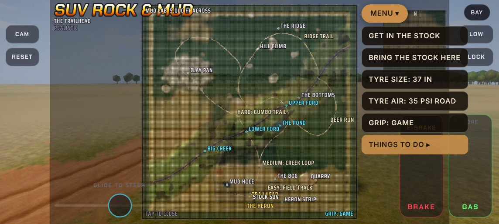 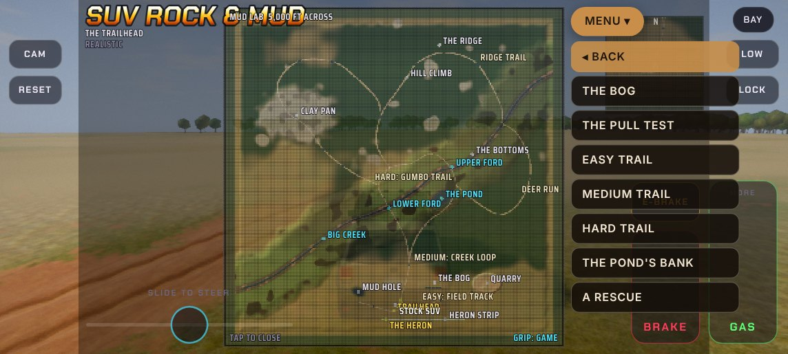
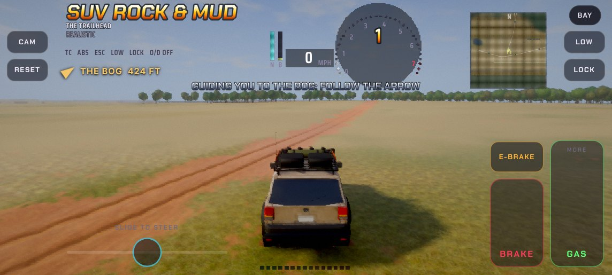 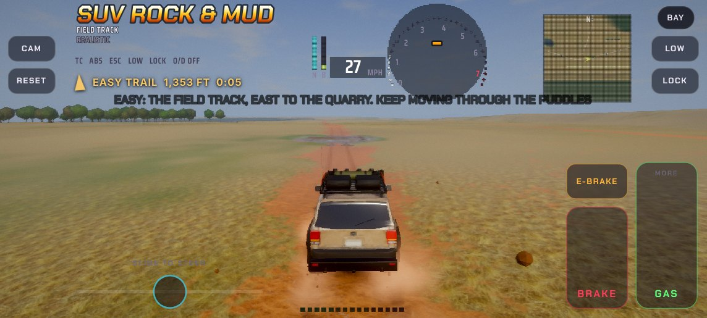
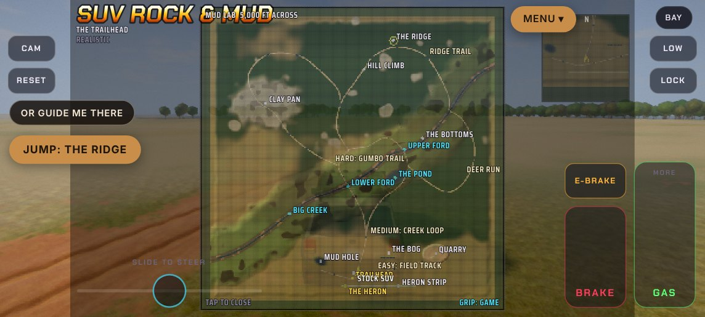 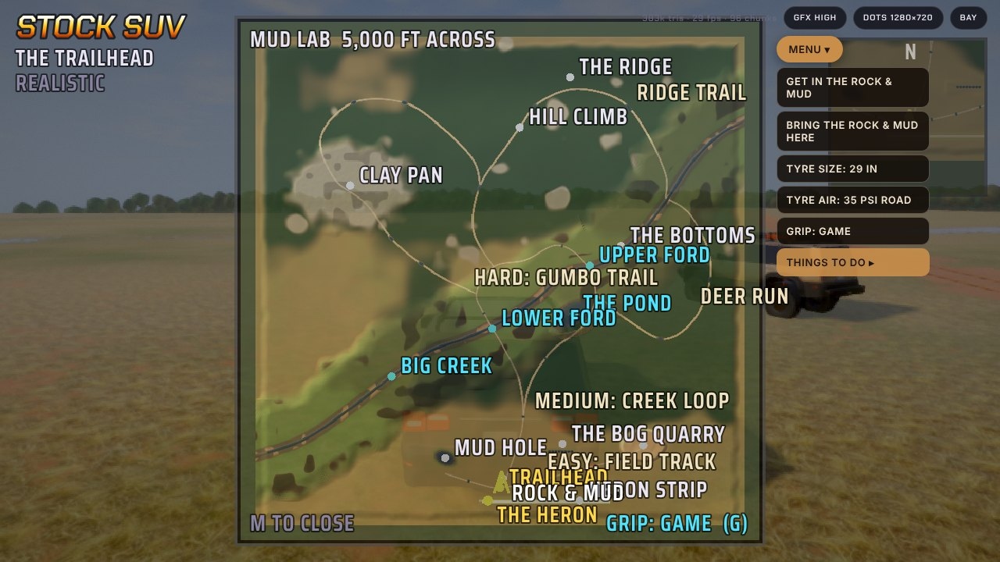

## Mud Lab 12 (Nov 10 2026): the stock SUV baked, a look back while towing, a title that fits a phone

His words after playing build 11: "extremely fun"; pulling one truck out with the other needs a rear view or a drone
view that looks back; the opening screen doesn't show all its options on his phone; and the stock SUV baked like the
Rock & Mud, with the bake tools from salt-mini-plus, where he made the Studio models.

**The stock SUV, baked.** The bake tools are in salt-mini-plus (branch `beyond-the-last-road`, `models/tools/`:
`bake.py` runs in Blender, casting a ray from every pixel of the game's own car into the detailed Studio car and
writing what it finds as pictures), and so is their result for the stock SUV, `models/suv/suv_baked_data.js` and
`suv_baked.glb`. `tools/suv_pack.py` repacks those into `base/suv-stock-baked.js`, and `src/ml-truck.js` draws it exactly as it draws the
Rock & Mud's play model (the same three picture slots, whichever SUV is being drawn: no new sampler, no shader change).
Triangles: 51,044 for the game's built model's 51,586 (the frame in the same view: 234,256 for 235,980). The page
is 19.5 MB (15.8): the three pictures, 2048 x 3072 each, halved on the phone. Two things had to be put right to draw
it: the data file's normals are in the car's own axes, and Mud Lab's baked material reads them in the surface's own
frame, so the bake's other set (in the `.glb`: `skin_tnrm`, `wheel_tnrm`) is laid into the atlas instead; and the
bake's lamps go back to the game's own lamp materials, so they light.
How it looks (side by side at the phone's size, `docs/shots/mud-lab-12-stock.jpg`, left build 11): the same shape,
the wheels and arches better drawn, the paint a flatter, darker taupe, and the chrome grille and bumper dark. The
bake carries a clear coat and chrome that Mud Lab's baked material doesn't shine (the Rock & Mud has little of
either), and that material is in the land's shader, which may not grow. So at this size it is not clearly better
than the plain model yet: his call, on his screens.
What this is and isn't: it is the bake his pipeline already made, from the first Studio SUV (484,359 triangles). It
is not a new bake of the Studio 2 SUV: that means running Blender's bake again from the Studio 2 model (about ten
minutes of baking, plus exporting the Studio 2 SUV's parts), which was not done here. On the 33s the wheel is drawn
a size up; the body is the standard one, 5 cm higher.

**REAR.** The engine's own look-back button, which Mud Lab had taken off the screen, is back only while a strap, the
pull test's line, or a winch line to a tree behind is on (tap for the view behind, tap again to return); it goes
when the line does.

**The title on a phone.** Start and Bay side by side; on a short screen the description gives way and the title
shrinks; on a narrow one the picks wrap; the page scrolls if it must. All six buttons in view at 915 x 412, 740 x 330,
640 x 300 and 412 x 780.

**Checked:** `tools/test/ml-same.py builds/mud-lab-11.html builds/mud-lab-12.html`: 7 of 7 drives the same to four
decimals, no page errors. No shader changed; no physics code changed (drawing, the title and one button).

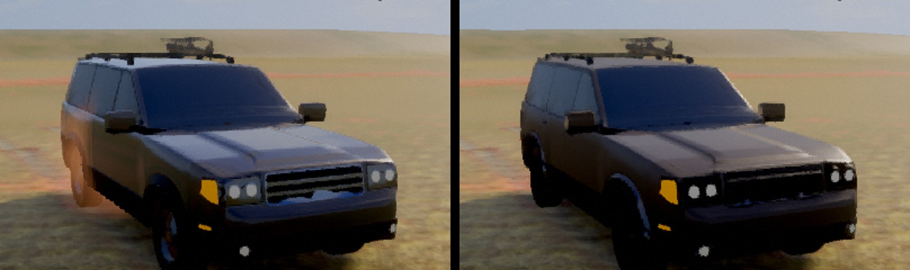

## Mud Lab 11 (Nov 10 2026): the pond's bank, a tyre size up, and the Heron from far off

His asks: the cliff at the pond made a steep slope you can drive down ("unstably of course"), splash into the pond and
winch back out of; then tyres (his idea: the stock SUV on bigger tyres, the Rock & Mud on bigger ones still) and the
vehicle models.

**The pond's bank.** Where the pond was cut into the hills its rim ended in a sheer 10.5 m (34 ft) step. It is now a
slope, 27 to 35 degrees, its foot curving up over the first 6 m, the woods on it thinned to a third (room to drive,
trees to hook). Tested from the top with the brakes dragging: both SUVs get down upright (the Rock & Mud in 32 s,
nose down 27 degrees and leaning as much, never over 7 mph; it does not stop on the brakes alone before the water).
Winched from the water's edge back up: 23 m of line, 4.5 m of height, 52 s, "AT THE TREE"; further up is the next tree.
Neither SUV drives back up it.
The winch's trough (build 10) no longer cuts where the land itself slopes more than about 11 degrees: at this bank's
foot it had dug a 1.25 m pit instead of climbing. (Letting a pulled hull pass through the soil instead was tried and
is worse: the SUV sinks a metre and the tyres cut their own tunnel.)

**A tyre size up** (the title: tap your SUV again; each SUV's own, remembered). Built by the engine's own garage, so
the radius, width, weight, tread and the taller gearing are the engine's, and the soil reads them as any tyre.

| | Stock SUV | Stock SUV, 33s | Rock & Mud | Rock & Mud, 40s |
| --- | --- | --- | --- | --- |
| Tyre | 245/65R17 all-season | 33x12.5R17 all-terrain, 2 in leveling kit | 37x12.5R17 mud-terrain | 40x13.5R17 mud-terrain (new to the garage) |
| Radius, width | 37.8 cm, 24.5 cm | 42.0 cm, 31.8 cm | 47.0 cm, 31.8 cm | 50.8 cm, 34.3 cm |
| Sills above the ground | 31.5 cm | 40.7 cm | 55.7 cm | 59.5 cm |
| Weight | 2,180 kg | 2,223 kg | 2,530 kg | 2,548 kg |
| The Bog, steady throttle | 75 ft AWD, 104 ft 4 HI | 168-170 ft | 175-205 ft | 205 ft (258 at 12 psi) |
| The Bog, floored | 76-103 ft | - | 158 ft | 137 ft |
| Stopped in an easy puddle | bogged | bogged still; cruising through, 10.5 mph at its slowest (7) | - | - |
| Stopped in a hard pit | - | - | bogged (11 of 13) | drove out (the one try) |
| Big Creek's ford | bogged | bogged still | - | - |

So the 33s more than double the stock SUV's mark on the Bog (its sills clear the fourth and fifth pits' water) without
letting it restart in a puddle or cross the creek; the 40s give the Rock & Mud 4 cm and little else. The Rock & Mud's
baked wheels are drawn 8% larger on 40s; its body is the same model, riding 4 cm higher.

**The vehicle models: what was done, and what wasn't.**
- Done, the cost: the Heron had no simpler copy, so all 60,481 of its triangles were drawn out to 450 m. It now has
  one, made as the page loads by merging its corners on a grid (10 cm; 4 cm for the pieces with thin parts, the
  struts and gear legs, which a 10 cm grid erased): 26,636 triangles, used (and for its shadow) from more than 70 m
  away on the phone, 130 m on a laptop. The Heron on its strip seen from 85 m: 217,331 triangles in the frame in
  build 10, 183,486 in build 11; side by side in `docs/shots/mud-lab-11-heron.jpg` (left the full model).
- Where the triangles are: the Rock & Mud is 24,978 for the body and 6,169 a wheel (half of it is wheels); the stock
  SUV is the game's own built model, about 51,000; the Heron 60,481.
- Not done, the finer look. The Rock & Mud looks finer than its triangle count because the 800,000-triangle Studio 2
  model was baked onto it as pictures (colour, normals, roughness). The stock SUV is still the game's plain built
  model; giving it the same treatment (and both SUVs sharper pictures) is the real step, and it needs the bake tools
  that made `base/truck-rock-mud-50k.js`, which are in his other repo, not this one.

**Checked:** `tools/test/ml-same.py builds/mud-lab-10.html builds/mud-lab-11.html`: every drive ends in the same place
at the same speed with the same ruts (7 of 7, to four decimals). In one, the pond's bottoms, the count of clods and
splashes thrown differs (3,721 / 3,740 and 4,033 / 4,092): they fly to the bank, whose shape changed. (Run on the
build before two last changes that touch no physics: the title row's spacing and the far copy's grid.) No shader
changed. The title's row of four picks is at its width on the phone.

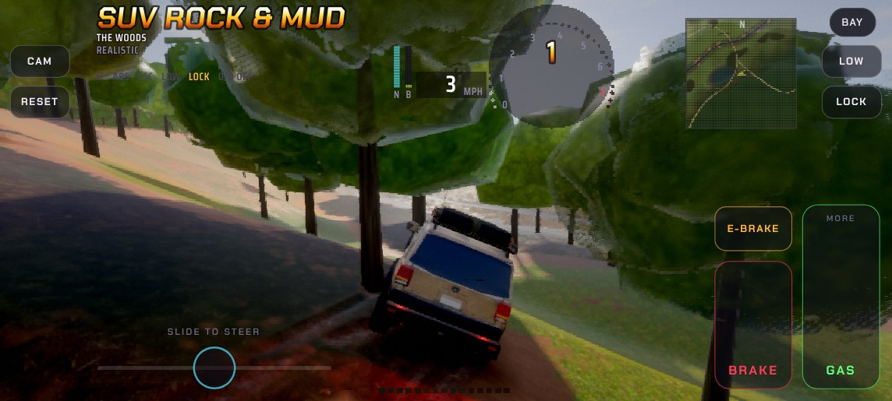 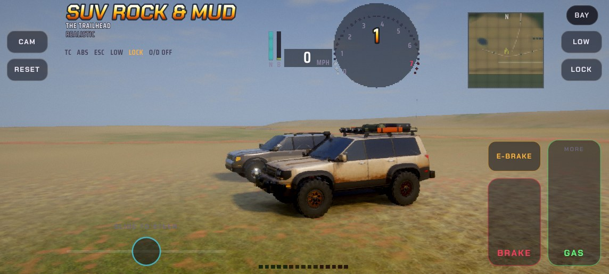

## Mud Lab 10 (Nov 10 2026): the Bog, the pull test, tyre pressure; and the winch at a bank

His asks: on to the measured bog and pull test, tyre pressure, clay in the tread, then the vehicle models; and a fault
from playing build 9: winched out near the pond, the line (on a tree above a sudden 30 ft drop) went on pulling him at
the drop, "which made the cliff erode away", and the SUV ended up stuck in a valley of its own making.

**The winch at a bank (the fault).** Build 9 let a pulled body cut the soil it was into, with no limit, so the winch
dragged the SUV straight into the bank. Now only the belly ploughs (not the bumpers), only soil standing less than 40 cm
over it (mud it has sunk into, never a bank's face), and never deeper than a metre; and a winch that has stopped
taking in line while it climbs more than about 14 degrees to its tree lets go ("TOO STEEP FOR THE WINCH"). The same
test in both builds (the Rock & Mud at the foot of the pond's steepest bank, winch on a tree above): build 9, 17 m into
the bank and a cut 12.3 m deep; build 10, 4.2 m to the foot of the bank, 40 cm of churn, line off after 17 s. Winching
out of the hard pits is as it was (23 m of line in 48 s). The drop itself is the pond's rim: the pond was cut into the
hillside and its rim ends in a 10.5 m (34 ft) step. It is as it was; it could be eased into a slope if he wants.

**The Bog** (on the map; north-east of the Trailhead): 262 ft of eight clay pits end to end, each deeper than the last
(30 cm of water in the first, 115 in the last), a post every 25 ft, a taller one every 100. Drive in from the west;
where you stand still for two seconds is your mark; a stake stays at each SUV's best (remembered).

| SUV | Road pressure (35 psi) | Aired down (12 psi) |
| --- | --- | --- |
| Stock, AWD | 75 ft | 104 ft |
| Stock, 4 HI | 103-105 ft | 104-105 ft |
| Rock & Mud, lockers, steady throttle | 175-205 ft | 233-262 ft (all of it on one run) |
| Rock & Mud, lockers, floored | 158 ft | 172 ft |
| Rock & Mud, low range | 174-223 ft | 207-248 ft |

(A first try, one long pit of water deepening to a metre, stopped nobody: kept moving, both SUVs half float across.
In this soil what stops a SUV is climbing out of a pit.)

**The pull test** (drawbar pull: what a vehicle can pull, as a share of its own weight; the number traction is
measured by). A post by the Bog's start: stopped with your tail to it, PULL TEST puts a line on; drive off, hold it,
lift off, and it reads the pull held and the peak in pounds. For the soils elsewhere `tools/test/ml-pits.py` ties the
same line anywhere (`T9.pull`). This is the card to check the soil against after it moves into another game
(0.7 throttle, 6 s, the pull held over the last 3 s; road pressure -> 12 psi):

| Soil (where) | Stock SUV | Rock & Mud |
| --- | --- | --- |
| Dry loam (the Trailhead's field) | 0.80 -> 0.83 | 1.28 -> 1.29 |
| Damp clay (the Clay Pan) | 0.69 -> 0.71 | 0.99 -> 0.99 |
| Dry sand (the Quarry) | 0.60 -> 0.66 | 0.66 -> 0.73 |
| Wet clay under water (the Mud Hole) | 0.37 -> 0.42 | 0.45 -> 0.54 |
| Wet silt (the pond's bottoms) | 0.12 -> none (it couldn't take up the line's slack) | 0.73 -> 0.86 |

**Tyre pressure** (the map: TYRES: ROAD 35 PSI -> TRAIL 20 -> SOFT 12, stopped; each SUV keeps its own, remembered).
Aired down, the footprint is longer (x1.25, x1.5) and a little wider: the same weight presses less, so the tyre sinks
less; soft or slick ground grips up to 10% / 18% better (both grip physics; in Soil science the longer footprint also
counts in its own sum); firm ground drags a little. At road pressure nothing is changed: the SUVs are exactly as they
drove. What it does: the stock SUV crosses an easy puddle no slower than 10 mph at 12 psi (7 at road), but stopped in
one it is still bogged at any pressure; the Rock & Mud, stopped in a hard pit and floored, is bogged at road pressure and
drives out in 6 s at 12 psi.

**Clay in the tread** was already the soil's (it packs in wet clay, costs up to half the grip, and spins out; a mud
tyre's lugs clear sooner): it now says so, once each time: "TREAD PACKED WITH CLAY: SPIN IT CLEAN". Nothing of it is
changed, so the two SUVs stay balanced as they are.

**Checked:** `tools/test/ml-same.py builds/mud-lab-9.html builds/mud-lab-10.html`: 7 of 7 drives the same to four
decimals (road pressure, no line on: the SUVs drive exactly as in builds 8 and 9). No shader changed; the
Bog's posts are about 370 triangles. **Not done:** bigger tyres for each SUV (his idea), the three vehicles' models.
The Bog was measured on Game grip.

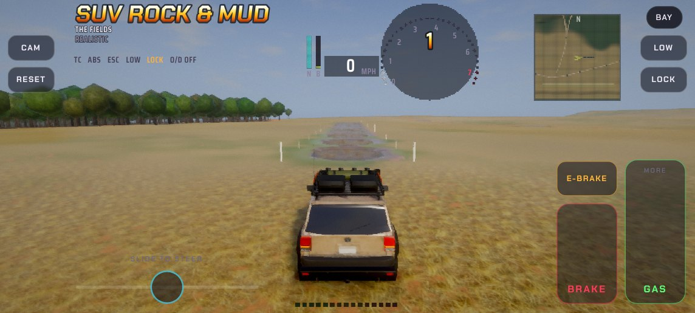 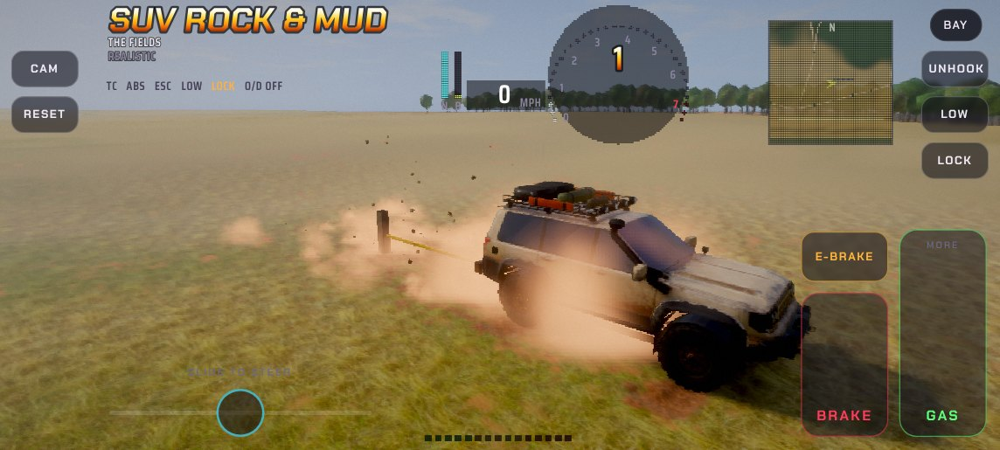

## Mud Lab 9 (Nov 10 2026): getting stuck is the game

His ask: two ways to play (free play, and a realistic one where bogged means recovered, not reset); a winch to the
trees and a tow strap from the other SUV; three trails, easy, medium and hard, tuned to the two SUVs; leaning into how
mud is really driven (keep moving, don't gun it, rock it out). Still to come, in his order: a measured mud bog and pull
test, tyre pressure, clay packing the tread as a bigger part of the driving (only if the two SUVs stay balanced as they
are), and last the three vehicles' models reworked to look finer and cost less.

**Two ways to play** (the title; remembered):
- *Free play*: as before. JUMP anywhere from the map. Bogged and upright, RESET sets you on the nearest firm ground.
- *Real*: no jumps (you drive there, or fly). RESET only rights a rolled truck. Bogged, you rock it out, winch to a
  tree, get the other SUV and strap out, or take A TOW HOME from the map (both SUVs back to the Trailhead).

**Both SUVs are in the world at once.** The one you didn't pick stands by the Trailhead. On the map GET IN: puts you in
it, where it stands (the one you leave stays where it is, engine off); in Free play BRING THE ... HERE sets it on firm
ground within the strap's reach, facing away, ready to pull; its name is on the map too.

**The winch** (both SUVs; 9,500 lb, 100 ft of line, 1 mph). Bogged with a tree within reach and within 60 degrees of
straight ahead (or, failing that, behind), WINCH appears; it takes the tree that gives the longest straight pull. The
line reels in by itself, pulls up to its rating and stalls there (a message says to help with the wheels), and lets go
3 m from the tree. UNHOOK any time.

**The strap** (46 ft, a stretchy kinetic rope). With the other SUV in reach of a bogged one, STRAP appears: hooked
between the two nearer ends. During a rescue the other SUV's name is a button too: get in it, drive off, and the strap
comes tight. The towed SUV rolls free, out of gear, engine off.

**What had to give:** the engine holds a body out of the ground as if the ground were rock, so a truck sunk to its floor
stood fast against the winch's whole 42 kN. Now, only while a line is pulling, the soil the hull is into gives way and
is left churned (a trough). Driving without a line on is untouched.

**The three trails** (each hole's recipe found on a row of trial pits in the open field, then checked where it lies):

| Trail | Holes | What the tests show |
| --- | --- | --- |
| EASY: the Field Track (Mud Hole to Trailhead to Quarry) | six puddles, 8 m long, 30 cm deep, mostly clay | Stock SUV at a steady 10-20 mph: through in 16 of 18 drives (it slows to about 7 mph in each). Stopped in one: bogged, 6 of 6, 4 LO included. The whole trail: through in AWD at 11 mph (94 s) and in 4 HI at 20 mph (58 s); bogged in the first puddle in AWD at 16 mph (it was changing gear as it went in). Rock & Mud: 49 s, never under 15 mph. |
| MEDIUM: the Creek Loop | four of the same puddles, and Big Creek's two fords (as they were) | Stock SUV: through all four puddles (12 of 12 drives), bogged in a ford every time (3 of 3). The Rock & Mud's test driver, which only holds a speed, bogged in the fords too (6 of 6); he crosses them by hand. |
| HARD: the Gumbo Trail | four pits, 20 m long, 72 cm deep, all clay, on level stretches in the woods | Rock & Mud kept moving: through in 12 of 16 drives, down to 0-5 mph in the middle. Stopped in one, then floored: bogged in 11 of 13 tries. Winched out of three of them in 37-56 s (24-28 m of line, 4-26 kN), and drove away each time. |

The Ridge Trail's and Deer Run's holes, the Mud Hole, the creek, the pond, the Clay Pan and the Quarry are as they were.
Trees for the winch: plenty at the hard pits (28-58 within 30 m); none along the Field Track or at the fords (open
ground: there it's the strap, or rocking it out).

What the trial pits showed (Game grip): the stock SUV's limit is water over its sills (32 cm): at 40 cm a cruising stock
SUV bogged in 10 of 12 trail drives, at 30 cm it gets through and still can't restart from a stop. The Rock & Mud's
limit is about 80 cm: at 72 it crawls through, at 80 it's a coin toss, at 90 it never gets through. Flooring it in a
deep pit digs it in where half throttle carries it through (his "gunning it makes you more stuck"). Near the limit the
same drive can go either way from one try to the next: judge on several.

**Numbers.** At the start the phone draws 221,738 triangles (build 8: 230,723) with the other SUV in the picture: a
parked vehicle outside the picture isn't drawn any more (the Heron on its strip behind you was 60,000 triangles a
frame), and the other SUV is its coarse copy past 30 m. With both SUVs and the Heron all in the picture near the
Trailhead it would be about 280,000. The other SUV is on the physics only when strapped, within 8 m, or moving. No
shader changed (the lines are drawn as plain bars with the trucks). Strap test: the Rock & Mud at light throttle pulled
the bogged stock SUV 26 m clear in 6 s, 4-18 kN on the strap, 71 kN at the snatch. Driving physics, soil and sound:
`tools/test/ml-same.py builds/mud-lab-8.html builds/mud-lab-9.html`: 7 of 7 drives the same to four decimals (the
dry field, the Mud Hole, the pond, the quarry, the clay pan, the Heron's take-off).

**Not done or not measurable here:** the trails were graded on Game grip; Soil science grip is harder everywhere and
wasn't re-graded. Rocking a bogged SUV out by hand couldn't be scripted (a crude forward-reverse robot didn't free the
stock SUV from an easy puddle). The phone's real frame time, as always. Ruts are still forgotten when the page closes.

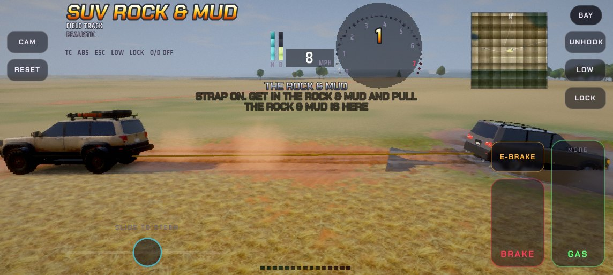 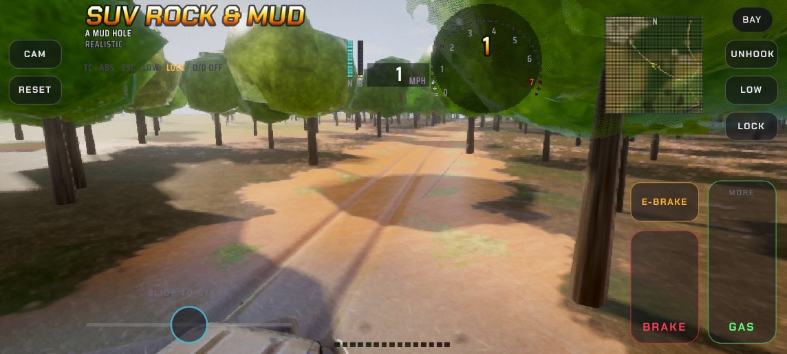

## Mud Lab 8 (Nov 9 2026): the look

His ask: make the game look better without slowing it down (the Pixel 7a first, the laptop too), inside the limits that
had already bitten: 16 texture samplers in the phone's fragment shader and no more, the laptop's slow shader compiler
(landSoil no bigger), about 175,000 triangles at the start (230-270,000 with the Heron or the stock SUV near), nothing
of the physics, the soil's behaviour or the sound touched, no new buttons.

**What was wrong with the picture** (looked at at the phone's real picture size, which the old test shots weren't):
the day was still Salt & Sand's (High noon in the desert's air: thin haze, a blank pale sky, the exposure aimed 1.8
times as bright); the fields were one orange carpet (a tint over his dry-grass picture, 40% red dirt blended evenly
through it, and the picture's tiling as a grid from 30 m out); the woods' floor was hard-edged blotches that read as
camouflage; water was a grey sheet; the trunks were his wood-planks picture wrapped round a post; the crowns glowed.

**What changed, biggest first** (`src/ml-look.js`, `src/ml-look.glsl`; shots in `docs/shots/mud-lab-8-*.jpg`):
1. *Its own daylight.* The sun lower and warmer from the west-south-west (32 degrees up, so ruts and the lie of the
   land show), a deeper blue sky with fair-weather clouds, three times the haze (distance reads as distance), all of
   the sky's light in the shade, the exposure down to 1.3 (from 1.8). Free: the same passes, other numbers. Golden hour and the
   full moon are as they were.
2. *The ground.* Sod lies in patches with bare soil between (not blended through); straw where it's dry and his green
   bog-grass picture where it's damp, in big soft patches; the woods' floor is leaf litter and moss; big light and dark
   patches so a field isn't flat from far off; his pictures fade to their own colour where a whole tile is only a few
   dots across (the grid over the fields was that tiling); dry grass, litter and dry soil no longer glint white toward
   the sun.
3. *Water.* Muddy brown, cloudy where it's deeper, the wet bed showing at its edge, the sky in it by how low you
   look. A water's far shore follows the ground's own heights, not the triangles of the land's coarse mesh.
4. *Trees.* Bark on the trunks. Crowns with clumps of leaves and gaps in their colour, deeper shade under them, and
   some sun through to the side away from it. No triangles added. Past where trees are drawn (340 m on the phone) the
   woods' floor is painted as canopy, so from the Heron the woods are woods, not brown ground.
5. *A sharper picture.* The phone draws at 75% and rebuilds; four looks round each pixel in the last pass put the edges
   back (never brighter or darker than the pixels round it). In place of the lens's colour fringe.

And one old fault found on the way: the engine's ground detail starts afresh every 4,096 m, and one of those lines
(x = 0) runs north to south through the middle of Mud Lab's world: every pattern on the ground broke along it. The
soil's detail is now laid out from the world's own corner.

**What pays for it: the land's shader cleaned out** (`src/build.py`, "MUD LAB 8").
- It was the engine's whole county. Out: the drag strip, the park's tracks, the dry lake, gravel and public roads, the
  town's walls and traffic signals, concrete, sheet metal, hay, boulders, the salt flats and their course line, rock
  in the ground: 19,065 characters that Mud Lab never reaches (`tools/test/ml-mats.py` lists every material a mesh is
  made with: 0-27, 40, 46, 48, 50, 70-108, 120).
- Inside the world the engine painted its own ground and the soil then painted over it. Now it's one or the other.
- The soil worked out all five soils, the sod and the woods' floor for every pixel. Now each only where there's some
  of it and it shows. His pictures were looked at 11 to 17 times a pixel of ground; now 2 to 5 near, none far off.
- His pictures are looked up two ways (`MLPHONE`, set on the Mobile tier): the phone's own cheapest way; everywhere
  else with gradients worked out once (textureGrad), so Windows' compiler isn't asked for gradients inside a branch
  anywhere in the ground (Mud Lab 6's "left for later").
- The rock's, salt's, gravel's and planks' pictures aren't carried: the page is 1.5 MB smaller, four fewer pictures
  to decode at the start, 5.6 MB less on the phone's graphics card.

**Numbers** (`tools/test/ml-views.py` on both builds; phone size is 858 x 386 rebuilt to 1144 x 515, the Mobile tier
at its best). The test browser has no graphics card: its times are only good for before against after, and they
drift from one sitting to the next (Mud Lab 8 was timed twice, straight after Mud Lab 7's run and an hour later), so
read them as "a third to a half less", not to the decimal. And it probably overstates what a phone will gain: the gain
is about the same in every view, mud, woods or open field, which suggests the software renderer was paying for much
of the shader on every pixel whichever branch it took (the county's roads on every pixel of mud); a phone's chip pays
only for the branch it takes. What the phone gets for certain is fewer looks at the pictures, the ground painted
once, and a smaller shader to hold.

| View (phone size) | Triangles, 7 | Triangles, 8 | Test browser, one frame, 7 | 8 (two sittings) |
| --- | --- | --- | --- | --- |
| The Trailhead at Start (the Heron parked 70 m off) | 230,723 | 230,723 | 4.5 s | 2.1 s, 2.8 s |
| Tracks across the dry field | 251,171 | 250,595 | 8.3 s | 4.0 s, 5.2 s |
| A trail through the woods | 304,757 | 304,341 | 10.9 s | 5.4 s, 6.8 s |
| The Mud Hole | 229,157 | 227,909 | 10.8 s | 5.0 s, 6.3 s |
| The Lower Ford | 197,304 | 194,064 | 7.5 s | 3.6 s, 4.5 s |
| The Pond | 252,688 | 252,688 | 12.4 s | 5.8 s, 7.5 s |
| The Clay Pan | 218,782 | 218,814 | 9.4 s | 4.6 s, 6.3 s |
| The woods by the Quarry | 217,442 | 217,442 | 10.7 s | 5.2 s, 6.8 s |
| The Bottoms | 217,566 | 229,174 | 9.1 s | 4.4 s, 5.6 s |
| Pines on the Ridge | 316,884 | 316,884 | 13.7 s | 7.6 s, 9.0 s |
| Beside the Heron | 232,933 | 232,933 | 5.3 s | 3.0 s, 3.2 s |
| The stock SUV | 223,217 | 223,217 | 6.0 s | 3.1 s, 3.7 s |
| From the Heron, 170 m up | 185,379 | 185,379 | 2.4 s | 1.5 s, 1.6 s |
| All thirteen | | | 111 s | 55 s, 69 s (50%, 62%) |

| | Mud Lab 7 | Mud Lab 8 |
| --- | --- | --- |
| landSoil, the full ground shader, as the browser hands it to the graphics driver (phone tier / laptop tier) | 683,160 / 700,653 | 500,259 / 516,565 |
| land, the plain one the title waits for | 598,866 / 616,360 | 388,104 / 395,630 |
| texture samplers in landSoil (the phone's limit is 16) | 16 | 16 |
| the page | 17.3 MB | 15.8 MB |

Triangles are the same view for view: nothing was added. (Where they differ it is clods in the air, 32 triangles
each, and in the Bottoms a stand of trees that had arrived for one picture and not the other.) At the laptop's size (1280 x 720, the High tier) the Trailhead's frame went from
19 s to 12 s in the test browser. From opening the page to the full ground being drawn took the test browser 58 s
with Mud Lab 7 and 33 to 40 s with Mud Lab 8 at the phone's tier, 146 s and 88 s at the laptop's (its own shader
compiler, not Edge's). **Checked:** `tools/test/ml-same.py builds/mud-lab-7.html builds/mud-lab-8.html`: seven drives (the Rock & Mud
over the dry field, through the Mud Hole, into the pond's bottoms and over the quarry's sand; the stock SUV into the
Mud Hole and in 4 LO on the clay pan; the Heron's take-off run), every number the same in both builds to the fourth
decimal: where it ends up, its speed, each wheel's spin, the ruts' depth, the soil dug, the clods thrown. The physics,
the soil and the sound are untouched. Both tiers' shaders build with no errors; golden hour and the full moon keep
their own light; the bay, the map and the driving screen's buttons are as they were.

**Not measured here, and how to see it:** the phone's own frame time, and how long Edge on Windows takes to build
landSoil (it should be shorter: the shader is a quarter smaller and the ground no longer needs gradients in
branches; the test machine has no Direct3D to prove it). On the phone: tap the build's name in the corner of the
title (it says "numbers on"), start, and the engine's readout shows frames a second, the frame's and the graphics
chip's time, the picture's size and the triangles; tap it again to switch it off. It's saved, so Mud Lab 7 opened
from the same place shows it too. On a keyboard it's F.

**The limits as they stand, for the next change:** the phone's fragment shader still uses all 16 samplers; landSoil is
about a quarter under Mud Lab 7's size (keep it under 683,000 on the phone tier's count: `tools/test/ml-shaders.py` prints it);
four picture slots are free in the ground's texture array (a forest floor, bark, green grass of his own would go
straight in). Not done, because they cost triangles or want his say: grass blades standing up out of the sod near
the truck (about 15,000 triangles), rounder tree crowns, his own pictures for the woods' floor and the bark.

## Mud Lab 7 (Nov 9 2026): the sound after another app

His report: the Digital Engine's sound (in all his games that use it) turns to garble after switching to another app
on the phone and back, or leaving the laptop's window and coming back; everything else in Mud Lab "amazing". The engine
had no handling for the page going out of sight: the synth ran on by itself (the phone hands the sound back on a
reopened output stream; the synth's state had run on with nothing from the engine), and nothing reset it. Now
(`src/ml-audio.js`): out of sight, the sound fades out and the browser's sound is suspended; back, it resumes, the
engine's synth is made fresh and fades in; if the phone takes the sound away while the page is in front, the next
touch or key gets it back. The test browser can't reproduce the phone's garble (no real sound device); there the sound
comes back clean after a simulated app switch (no broken samples, engine at idle 950 rpm). The same fix can go into his
other games that use the Digital Engine.

## Mud Lab 6 (Nov 8 2026): his stock SUV, and a page that opens on his laptop

**The stock SUV.** His own SUV as the engine has it (the game's Stock build, made to drive like his real one: the 4.6 V8,
six-speed automatic, 3.73 gears, 2,180 kg, 245/65R17 all-season tyres, all-wheel drive through a slipping centre
coupling with brake traction control, open diffs, no lockers, factory height, a two-speed transfer case), beside the
Rock & Mud. Pick it on the title (remembered) or swap in place on the map. Its button goes AWD -> 4 HI (centre locked) ->
4 LO (low range). Drawn with the game's own model (Studio 2's is about 800,000 triangles: never while driving now).

What makes it bog where the Rock & Mud doesn't (the soil reads each vehicle; nothing about the Rock & Mud changed):
- the tread: in soft soil an all-season's small voids bite less than mud-terrain lugs (from the engine's own grip in
  mud, .47 against .68), and pack with sticky clay sooner and throw it out later;
- its body: sills 32 cm up against the Rock & Mud's 56; water over the sills pushes on the body, and lifts it (a quarter
  of the water it pushes aside: a cab isn't sealed), so the tyres press down and grip less;
- its belly: sunk deeper than the underside sits, the axles and floor plough the mud between the ruts.

Tested (straight in from 12 m back, full and half throttle, Rock & Mud with its lockers on): a shallow trail hole, both
through (the stock 9-13 mph, the Rock & Mud 21-23); a deeper trail hole, both through (the stock crawling 3-7 mph, the
Rock & Mud 10-12); the Mud Hole, the Rock & Mud through at 3.5-4.5 mph, the stock to the far side and stuck; the pond's
soft bottoms, the Rock & Mud through at about 3 mph, the stock stopped.

**The laptop hang** (two reviews, Opus 5.5 and Fable 5.1, both found it): the page stuck on "Warming up the shaders
20 / 21" on his Windows laptop in Edge. The 21st is the land's shader; Mud Lab's ground photos and soil painting made it
the largest the engine has, and Windows' shader compiler (Direct3D's, through ANGLE) takes minutes over it. The engine
waited 60 s, then sat in a blocking wait. Mud Lab 4 had the same shader. Now:
- the land program the title waits for leaves out the photos and the soil painting (about the size of the reflections'
  program his laptop already builds); the full one, landSoil, builds in the background and takes over when it's ready
  (the plain ground until then, and a line saying so). Windows keeps a built shader, so later opens are quick;
- the soil's 19 texture reads ask for their one level outright (textureLod), and the truck's and plane's pictures use
  gradients worked out once (textureGrad): nothing in Mud Lab's code needs the compiler to work out gradients in a branch;
- the warm-up waits as long as the shaders take and the loading line names what is still building.

**And from the reviews:** nothing drawn behind the title, and no traffic cars built for a game without traffic (the
soil's preparation finishes under the title); the big map's picture made once (it was redrawn dot by dot, 25 ms a frame
on a laptop); the ground's own heights per square kept for the next time it comes into view; after a jump the ground round
the truck is ready before it's drawn; the Heron's paint is its model's picture (one 2048 picture and 0.75 MB less); the
parked Heron drawn out to 450 m and its shadow within 150 m; the town, park and Outer Loop's buildings, posts and chevrons
the engine was putting round and inside the world are gone; map names under the steering strip can be tapped; the swap
key is Enter (E is the gear-up key) and the rake Backspace (K is the lockers').

## Mud Lab 5 (Nov 8 2026): the Heron, and jumps on the map

His ask: a quick way round the map for testing, and the Heron from Ground Truth to get about and sightsee, flown for
real: take off and land yourself (or crash, reset, and switch to the truck).

- **The Heron Strip**: 400 m (1,300 ft) of mown grass in the south fields, laid level, a worn track down its middle, no
  trees near it. The Heron waits at its west end, facing east.
- **Getting in and out**: drive up to the Heron, stop, and HERON (E on a keyboard) puts you in it; the truck waits where
  you left it. Stopped on the ground anywhere, TRUCK (E) puts you in the truck beside the Heron's left wing (the nearest
  dry spot out of the trees), the Heron left standing there. Crash, RESET puts it back on its wheels where it came down,
  then TRUCK.
- **Flying**: the Heron as it is in Ground Truth (260 hp, 750 kg, the same stick, throttle lever, flaps and tilt); only the
  chase camera is Ground Truth's too. Up in it, the haze thins to half (from 20 m up to 250 m up), so the whole map shows.
- **Jumps**: on the map, tap a place's name (or THE HERON, where it waits): JUMP puts the truck at the nearest dry, open spot
  to it, facing it. From the air the Heron goes back to its strip; landed, it stays where it is.

Tested (test pilot in the headless browser): the take-off run on the strip, 10 degrees of flap, full power: tail up at
36 mph after 27 m, off the ground at 56 mph after 67 m, over 50 ft after 182 m. Level at full power: 140 mph; at about
half power, 106 mph (the map is crossed in about 30 seconds). A straight-in landing on the strip with full flap: down at
52 mph, 216 ft/min, stopped 159 m later, TRUCK put the truck 14 m off the left wing. A reset from 870 ft put the Heron on
its wheels and TRUCK worked. About 210-230K triangles on screen while flying over the woods.

## Mud Lab 4 (Nov 8 2026): five thousand feet built on moisture

His ask: a 5,000 ft map built on moisture (dry hard ground too, every spot a soil and how wet it is); a world map with
everything on it from the start, not a reveal; mud trails through the woods; and the soil science off-road engineers
use for grip as a switch beside the current grip. Getting stuck as it was (bogged to about 1 mph at full power in the
pond mud) and mud on the truck stay as they were.

**The world** (1,536 m square; u east, v south of its middle). Every spot has a soil mix (loam, clay, silt, peat, sand),
a moisture from bone dry to soaked, sod or woods' floor, and a water table. The soil's strength, grip, how it digs and
throws all slide between each soil's dry and wet numbers by the moisture.

| Place | Where (u, v) | What it is |
| --- | --- | --- |
| The Trailhead | 0, 650 | The start: dry, hard loam. |
| The Mud Hole | -172, 556 | 30 x 19 m, wet clay under up to 75 cm of water. |
| Big Creek | runs (-800, 560) to (800, -520) | Wet silt bottoms, sand bars, two fords (Upper and Lower). |
| The Pond | 232, 104 | Soft silt under deep water. |
| The Bottoms | along the creek | Wet silt and peat, moss. |
| The Clay Pan | -470, -300 | Dry, cracked clay: hard and fast when dry. |
| The Quarry | 450, 516 | A sand pit 6 m deep, dry sand. |
| The Ridge | v = -600 | High ground, pines. |
| Mud trails | Creek Loop, Ridge Trail, Gumbo Trail, Deer Run, Field Track | Two-track trails through the woods with 14 mud holes along them. |

**The map** shows the whole world from the start: soil colours, woods, water, trails, every place named, the truck's arrow,
and which grip is on.

**The grip switch** (G, or the Grip button on the phone's map; it's remembered):
- *Game* grip: the grip it always had (the engine's grip times the soil's).
- *Soil science* grip (terramechanics): grip = how sticky the soil is (cohesion) over the tyre's footprint, plus how it
  holds by friction (its friction angle); pushing through soft ground costs more the deeper the tyre sinks; sticky wet
  clay clogs the tread.

Tested (full power from a standstill, 6 s): pond mud, Game 4-5 mph, Soil science 0.4-0.7 mph (much harder: carry speed in);
the Mud Hole, Game 5.5-6 mph, Soil science 0.3-0.5 mph; dry clay pan after 3 s, Game 51 mph, Soil science 35 mph (closer to
a real SUV's pull); dry quarry sand after 6 s, Game 13 mph, Soil science 5 mph. Woods: about 253K triangles on screen
(open ground about 175K).

## Mud Lab 3 (Nov 7 2026): the whole world is soil

His ask: the modified ground the entire space, a small world (about 1,000 ft square), going hard on soil: different
muds, different depths of water on the mud.

**The world** (327.68 m square; u east, v south of its middle):

| Place | Where | What it is |
| --- | --- | --- |
| The field | the middle | red loam, gently rolling; a patch of sod to the south; you start at the south edge |
| The clay flats | north-west | flat grey clay, cracked; puddles 1-4 cm deep in its hollows |
| The peat bog | north-east | dark and mossy, the water 3 cm under the moss (ruts fill); three bog holes of open water 20-30 cm deep |
| The ditch | bog to pond | 4 m wide, about 30 cm of water over soft silt |
| The pond | east | silt bottom, water up to 65 cm deep; a ford across its west end, 15-17 cm |
| The beach | pond's south shore | sand, wet near the water |
| The sand | south-west | dry dunes 1-2 m high |
| The hills | west | a mound (1.8 m) and a steeper hill (3.6 m) |
| The bank | all round | grass rising 3 m; trees beyond |

**The soils**, each with its own behaviour (mixed where they meet; `ML_SOIL` in `src/ml-soil.js`):

| Soil | How it behaves | Test numbers (headless, phone size) |
| --- | --- | --- |
| Loam | firm: shallow ruts, berms, dust when dry | ruts stay where they are (7.2 cm, still 7.2 cm 8 s later) |
| Clay | slick (grip x 0.62); packs into the tread so grip falls further until you spin it out; sharp ruts; big clods; mud builds up on the truck | after 3.5 s at half throttle the front treads were half clogged, grip 0.47 (loam 1.0) |
| Silt | soupy: sinks deep, ruts slump back and fill in, splashes | a 19 cm rut: 15 cm after 1 s, 11 cm after 3 s, 7.6 cm after 8 s |
| Peat | spongy: 60% of what sinks springs back behind the tyre; spin it and the mat breaks through to soup | springs back 12.5 to 7.7 cm; spun through: 49 cm deep, 6.5 m2 broken |
| Sand | loose: sprays and dusts; wet sand by the pond is firm until churned, then goes soft (quicksand) | berms up to 31 cm when spinning |
| Sod | grass on loam, tears up when spun | |

**Water**: flat levels (the clay's puddles, the bog's water table and holes, the ditch, the pond, the ford), drawn as a
surface wherever the ground (ruts too) is below them, so ruts fill. Muddy, the bottom showing through where it's
shallow. The tyres throw spray, the truck pushes a bow wave, the water drags on the tyres and the body (harder the
deeper and faster: about 16 kN at 5 m/s in 60 cm), and the tyres come out wet and leave wet tracks that dry over
90 s. The ground's grip is the engine's own for the surface, times the soil's.

**How it's kept:** the soil every 8 cm (4096 x 4096 cells) in 5.12 m squares made only when touched (a test tour of
every place made 78 squares, 4.3 MB); the world's own ground every 64 cm. On the graphics card: the soil in a 122 m
window that moves with the truck, the world's ground for all of it, a fine mesh under the truck (8 cm apart under it,
out to 30 m), the water (about 9,000 triangles). Frame: about 170,000-200,000 triangles on the phone level. No stunt
scores or money in this game.

**Known:** at full throttle in sand or peat the tyres spin very fast and dig straight down (the engine's big-block
has a lot of torque); ruts are forgotten when the page closes; the land's shader now uses all 16 of a phone's
picture slots.

## How to work with Christopher

- He can't code; explain in plain words and **prove every step with screenshots and simple numbers**.
- **Uncluttered phone screens**: every button has to earn its place.
- His devices: a Pixel 7a phone and an MSI Cyborg 15 laptop (Edge). Frame rates can only be judged there.
- **Never overwrite a build**: each step gets a new file name in `builds/`.
- Change the engine with exact text swaps (`src/build.py`), so a changed engine fails loudly.
